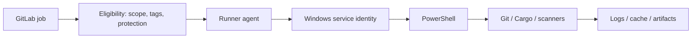

# P6 conclusions: Windows GitLab Runners

## The complete mental model

GitLab creates and schedules jobs; a registered runner requests eligible work; the executor prepares a runtime; the Windows service account executes generated PowerShell; Git, Cargo and scanners run as external tools; results return to GitLab. Every arrow represents a potential permission, configuration or network boundary.

## Key distinctions to retain

| Distinction | Correct interpretation |
|---|---|
| Runner scope vs host privilege | Scope controls assignment; Windows ACLs control access |
| Registration vs readiness | Registration proves relationship, not tool availability |
| Tag vs capability | Tag is a label, not an automatic tool installation |
| `config.toml` vs CI YAML | Worker configuration vs project job configuration |
| Cache vs artifact | Optional acceleration vs declared job output |
| Windows PowerShell vs `pwsh` | Different shell implementations and versions |
| Runner online vs job eligible | Connectivity does not guarantee scheduling |

## L1 — Understand

- [ ] Explain the GitLab/Runner/executor/host separation.
- [ ] Trace the job lifecycle from pending to artifact upload.
- [ ] Explain why a service account differs from an interactive login.
- [ ] Identify Shell executor isolation risks.
- [ ] Explain the role of `config.toml`.

## L2 — Modify

- [ ] Review a proposed `shell = "pwsh"` configuration.
- [ ] Identify required runner tags for a Windows Rust job.
- [ ] Write a PowerShell command that checks Cargo's exit code.
- [ ] Select project/group runner scope for a scenario.
- [ ] Explain how to protect runner tokens and build directories.

## L3 — Troubleshoot

- [ ] Separate job creation failures from runner assignment failures.
- [ ] Diagnose Cargo missing only in CI.
- [ ] Investigate runner-local cache misses.
- [ ] Distinguish Git TLS errors from Cargo TLS errors.
- [ ] Identify unsafe trust-level sharing on a Shell host.

## Three tabletop questions

**1. Why can `cargo` work in a console but fail in CI?** The console and service may use different accounts, PATH values, profiles or tool installations. Compare their effective environments without exposing secrets.

**2. What does `gitlab-runner verify` prove?** It checks connectivity/registration state, not end-to-end job execution, PowerShell availability, toolchain installation or scanner permissions.

**3. Why does a job remain pending when a runner is online?** Scope, tags, protection, disabled/paused status or capacity may prevent assignment.

## Relationship to the next phases

P7 maps GitHub Actions concepts onto GitLab's runner and job model. P8–P10 add scanners whose certificates, tokens, binaries and reports must be managed in the Windows service context. P11 combines these into an end-to-end pipeline. P12 formalizes incident investigation.

## Scope and limitations

This chapter set is documentation-only: no registration, service installation, GitLab access or runtime testing was performed. Examples must be adapted to the enterprise's GitLab version, runner release, approved PowerShell version and Windows security policy.

**Final principle:** A successful enterprise runner is not just an online agent. It is an eligible, appropriately isolated, correctly provisioned Windows execution environment with predictable identity, toolchain, storage and network trust.
