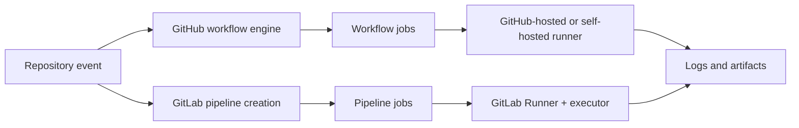

# Platform concepts and architecture

GitHub Actions and GitLab CI/CD are both event-driven automation systems, but their configuration and orchestration models differ. GitHub Actions starts a **workflow run** from a repository event; the workflow contains jobs, and jobs usually contain steps. GitLab creates a **pipeline** using pipeline-creation rules; its jobs contain script commands and are scheduled by GitLab runners. Neither platform is simply a YAML interpreter: event context, authorization, runner eligibility, secret policy and artifact transfer are part of the behavior.

A GitHub workflow commonly lives at `.github/workflows/build.yml`; a GitLab project usually uses `.gitlab-ci.yml`, possibly including other YAML files. A migration therefore changes both file location and the meaning of configuration. The GitHub `runs-on` selector does not translate directly to GitLab's `tags`, because GitLab tags match runner metadata rather than provision a managed image.

| Concern | GitHub Actions | GitLab CI/CD |
|---|---|---|
| Unit of orchestration | Workflow run | Pipeline |
| Work unit | Job with steps | Job with script/before_script/after_script |
| Event declaration | `on:` | `workflow:rules`, job `rules`, and pipeline sources |
| Job ordering | `needs` | `stages` and `needs` |
| Runner matching | `runs-on` | Runner scope, tags and protection |
| Reuse | Actions, reusable workflows, composite actions | Includes, extends, components and templates |
| Job outputs | Step/job outputs and artifacts | Artifacts, dotenv reports, variables and downstream jobs |

### Boundary of equivalence

A GitHub marketplace action is executable software with inputs, versions and permissions; it is not equivalent to a GitLab `script:` line. Replacing `actions/checkout` with GitLab's normal source checkout is usually possible because GitLab Runner performs source retrieval automatically. Replacing a third-party security action requires identifying the underlying scanner CLI, its installation, authentication, output format and exit-code policy.

### Enterprise migration inventory

Before editing YAML, list every workflow, event, branch filter, environment, secret, runner label, marketplace action, cache key, artifact, required status check and external integration. For each item, identify its owner and its security boundary. A migration that only reproduces successful build commands can silently remove branch protections or security scans.

### Java developer's mental model

Think of both systems as orchestrators around Maven or Cargo, not replacements for them. GitHub and GitLab decide *when and where* to invoke `cargo test`; Cargo decides *how* the Rust project is built. The migration should preserve build-tool semantics while deliberately changing orchestration semantics.

**Review exercise:** Given one GitHub workflow with three jobs, draw the equivalent GitLab pipeline graph and label where checkout, secrets and artifacts enter each job.
