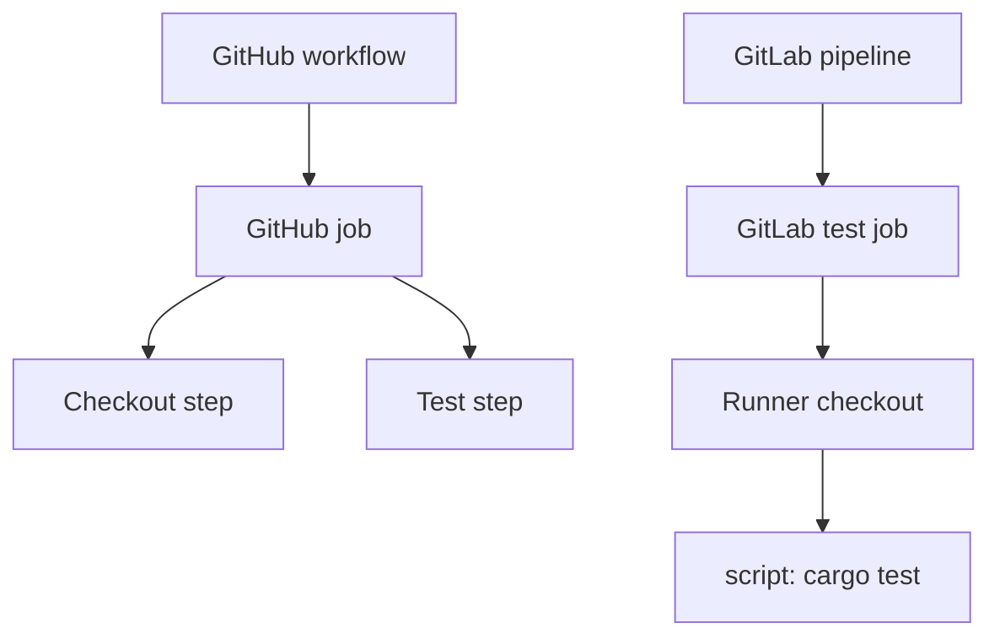

# Workflows, pipelines, jobs and steps

The largest structural difference is that GitHub Actions gives **steps** first-class identity inside a job, while GitLab generally uses a job-level `script:` sequence. GitHub steps can have `id`, `if`, `uses`, `run`, outputs and environment variables. GitLab scripts are shell commands, not independently addressable steps with native step outputs. Migration must therefore decide whether step boundaries represent mere command grouping or meaningful conditions, outputs and permissions.

### GitHub example

```yaml
name: Rust checks
on: [push, pull_request]
jobs:
  test:
    runs-on: windows-latest
    steps:
      - uses: actions/checkout@v4
      - name: Run tests
        shell: pwsh
        run: cargo test --locked
```

### GitLab analogue

```yaml
stages: [test]
rust_test:
  stage: test
  tags: [windows, rust]
  script:
    - cargo test --locked
```

The GitLab example assumes an eligible Windows runner already has Cargo installed and a PowerShell shell configured. Unlike `windows-latest`, the tags do not guarantee a fresh hosted Windows image. GitLab Runner ordinarily checks out the repository before `script`, so a checkout action is unnecessary in the common case.



### Preserve step-specific semantics

If a GitHub step is guarded by `if:`, translating it to a PowerShell `if` may be sufficient when it only affects a command. But if it changes whether artifacts, permissions or a job exist, use GitLab job-level `rules` or separate jobs. Step outputs (`GITHUB_OUTPUT`) cannot be copied directly; consider a dotenv artifact for passing a small set of values between GitLab jobs, subject to GitLab's report constraints and security rules.

### Working directory and shell

GitHub steps may specify `working-directory` and `shell`. GitLab's `script` executes in the project workspace prepared by Runner. Use `Set-Location` for intentional directory changes and `$env:CI_PROJECT_DIR` to locate the checkout. Avoid relying on a developer's interactive PowerShell profile.

### Matrix builds

GitHub's `strategy.matrix` creates job variants. GitLab supports `parallel:matrix`, but matrix variable interpolation, dependencies and naming differ. Do not mechanically copy matrix expressions. A Windows/Linux matrix must also map each variant to a compatible runner and executable environment.

| Migration item | Decision |
|---|---|
| Checkout action | Usually remove; rely on runner checkout |
| `run:` step | Convert to job script command |
| `uses:` step | Identify underlying behavior; replace or integrate |
| Step `if:` | Script conditional or separate job/rules |
| Step output | Explicit job output/report or artifact |
| Matrix | Rebuild with `parallel:matrix` where suitable |

**Key principle:** Preserve observable behavior and security controls, not the number of YAML lines.
