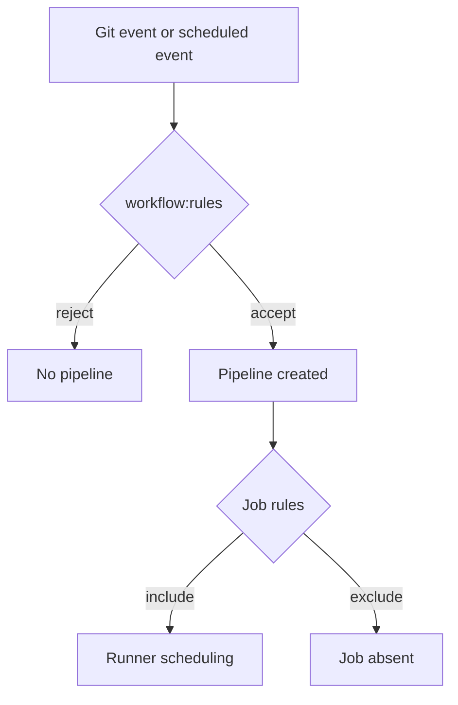

# Triggers, rules and conditional execution

GitHub Actions and GitLab differ sharply in when a workflow or pipeline is created. In GitHub, `on:` defines events such as `push`, `pull_request`, `workflow_dispatch` and schedules. In GitLab, pipeline sources include pushes, merge requests, schedules, web/API triggers and parent/child pipelines. `workflow:rules` controls whether the pipeline is created; job `rules` controls whether a particular job appears in that pipeline.

### Why a one-to-one trigger translation fails

A GitHub `pull_request` event is not simply the same object as a GitLab merge request pipeline. Branch context, fork security, token permissions and event payloads differ. GitLab can create both push and merge-request pipelines for related changes unless rules are designed to prevent unwanted duplication.



### GitHub source

```yaml
on:
  push:
    branches: [main]
  pull_request:
    branches: [main]
  workflow_dispatch:
```

### Illustrative GitLab policy

```yaml
workflow:
  rules:
    - if: '$CI_PIPELINE_SOURCE == "merge_request_event"'
    - if: '$CI_COMMIT_BRANCH == $CI_DEFAULT_BRANCH'
    - if: '$CI_PIPELINE_SOURCE == "web"'
    - when: never

rust_test:
  tags: [windows, rust]
  script: ["cargo test --locked"]
```

This creates pipelines for merge-request events, default-branch commits and web-triggered runs, subject to the exact GitLab context. It is not an exact translation of every GitHub branch filter or fork behavior. In particular, manual and scheduled pipelines may require additional explicit rules and project configuration.

### Conditions and precedence

GitHub `if:` expressions use GitHub context objects and expression syntax. GitLab `rules:if` evaluates GitLab CI variables. Expressions like `github.ref`, `github.event_name` and `github.actor` have no direct GitLab meaning. Create an explicit mapping: event source, branch, tag, merge request target and protected-ref status.

| GitHub concept | GitLab candidate | Caveat |
|---|---|---|
| `push` | Push pipeline source | Branch/tag filters must be recreated |
| `pull_request` | Merge request pipeline | Fork and secret behavior differs |
| `workflow_dispatch` | Web pipeline | Inputs and authorization differ |
| `schedule` | Pipeline schedule | Created/configured in GitLab project |
| `if:` on job | `rules` | Rule order and inclusion semantics differ |

### Security implications

Never translate a condition that protects deployment or signing as merely a script-level `if` if the job would still receive secrets or start on a privileged runner. Keep sensitive jobs absent from untrusted pipelines using creation rules and protected resources. Review behavior for merge requests from forks separately.

### Tabletop validation

Enumerate five events: feature push, merge request update, default branch push, manual launch and schedule. For each, write whether the pipeline should exist, which jobs should exist, and which protected resources are accessible. The desired truth table is more reliable than copying YAML by eye.

**Conclusion:** Trigger equivalence is a behavioral test matrix, not a text substitution.
