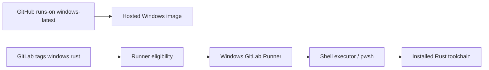

# Runners, executors and environments

The word *runner* appears in both platforms but refers to different operational systems. GitHub-hosted runners are provisioned by GitHub; GitHub self-hosted runners are registered machines that execute Actions jobs. GitLab runners are registered agents that request GitLab jobs and execute them through an executor such as Shell or Docker. A GitHub `runs-on: windows-latest` declaration therefore cannot be translated to `tags: [windows]` without first provisioning an appropriate Windows GitLab Runner.

### Runner selection versus runtime provisioning

GitHub labels may correspond to a managed image or to labels on a self-hosted machine. GitLab tags are matching criteria on runner records. They do not install Rust, Visual Studio Build Tools, Git, PowerShell or security scanners. The Windows Shell executor runs commands directly on the host under the runner service account, making its toolchain and permissions part of the migration plan.

| Question | GitHub-hosted Windows | GitLab Windows Shell |
|---|---|---|
| Fresh machine per job? | Generally ephemeral hosted environment | Typically persistent host |
| Tool versions | Image-defined and periodically updated | Enterprise-administered |
| Job identity | Hosted runner account | Windows service account |
| Isolation | Hosted VM boundary | Shared host account unless separated |
| Cache persistence | External cache action/service | Runner cache backend/configuration |
| Shell selection | Job/step shell | Runner `shell` plus script behavior |

### Environment names and deployments

GitHub `environment:` may enforce reviewers, secrets and deployment protection rules. GitLab `environment:` names a deployment environment and supports deployment tracking, with protected environments and approvals depending on edition/configuration. An environment name alone does not reproduce approval requirements. Inventory required reviewers, branch protections and who may deploy before migrating.

### Service account and PATH

If `cargo` works for an engineer but not in GitLab, inspect the service account, PATH, `CARGO_HOME`, toolchain installation and filesystem ACLs. Do not assume a successful runner registration proves build readiness. Prefer documented, pinned toolchain provisioning over user-profile-dependent installations.

### Toolchain compatibility

A Rust build targeting `x86_64-pc-windows-msvc` may require the MSVC linker and Windows SDK. Moving from a hosted image with these tools preinstalled to a bare Windows VM can expose missing native dependencies. Document the required Rust target, Cargo version, compiler/linker, scanners and proxy certificates.

### Capacity and trust

A shared Shell runner can execute jobs from multiple projects with the same Windows identity. This is materially different from ephemeral hosted isolation. Separate privileged release/signing jobs from untrusted merge-request builds; enforce runner eligibility and host permissions. Consider queue times and `concurrent`/runner `limit` when replacing hosted capacity.

**Conclusion:** Migrating runner configuration is an infrastructure and security project, not a YAML edit.
