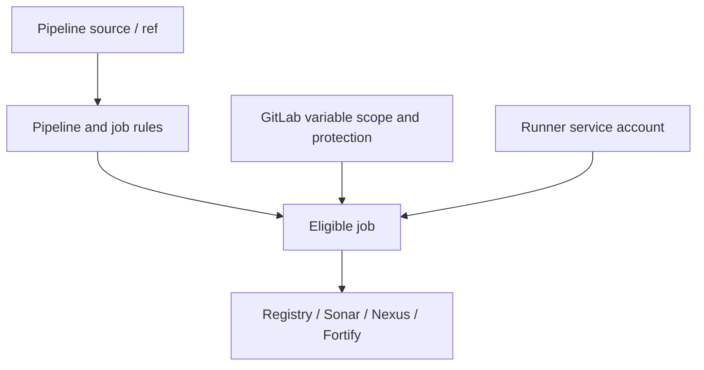

# Secrets, variables and permissions

Secrets and permission models are among the highest-risk parts of CI/CD migration. GitHub Actions uses repository, organization and environment secrets/variables and an automatically provided `GITHUB_TOKEN` with configurable permissions. GitLab uses project, group and instance CI/CD variables, protected and masked settings, job tokens, runner authentication and other credential mechanisms. The names may look similar, but their exposure rules and scopes differ.

### Inventory first

For each GitHub secret, record its owner, purpose, source, allowed events, branch/environment restrictions, rotation procedure and the external system that accepts it. Do not copy secret values into a migration spreadsheet, Markdown file, pipeline log or cache archive. Map each secret to an appropriate GitLab variable or an external secret manager with explicit access rules.



### GitHub example

```yaml
permissions:
  contents: read
jobs:
  scan:
    runs-on: windows-latest
    steps:
      - name: Upload report
        shell: pwsh
        env:
          SCAN_TOKEN: ${{ secrets.SCAN_TOKEN }}
        run: ./scanner.exe --token $env:SCAN_TOKEN
```

### GitLab analogue

```yaml
scan:
  tags: [windows, security]
  rules:
    - if: '$CI_COMMIT_REF_PROTECTED == "true"'
    - when: never
  script:
    - '& .\scanner.exe --token $env:SCAN_TOKEN'
```

In GitLab, `SCAN_TOKEN` would be configured outside the repository as an appropriately scoped protected variable. Passing tokens as command-line arguments may expose them to process listings or logs; prefer a scanner-supported secure environment variable, credential file or secret integration. The snippet illustrates variable access, not an endorsed scanner invocation.

### Built-in token differences

Do not assume `CI_JOB_TOKEN` has the same scope or API permissions as `GITHUB_TOKEN`. External registries and scanners may require dedicated tokens or OIDC-based identity federation where supported. Job-token allowlists, cross-project access and API restrictions need explicit review.

| Control | Migration question |
|---|---|
| Protected variable | Which refs may receive it? |
| Masking/hidden | Can scripts still leak it through transformations? |
| Runner account | Does the host already possess privileged credentials? |
| Environment approval | Who authorizes deployment? |
| Token scope | Which external operations are permitted? |
| Fork merge requests | Are untrusted contributors isolated? |

### Permission boundaries

GitLab roles govern who edits pipelines and variables, but host-level Windows ACLs govern what Shell jobs can access. A malicious script can read files accessible to the service account even if GitLab masks some variables. Security therefore requires runner isolation, least privilege and carefully designed rules, not only masked variables.

**Conclusion:** Preserve authorization intent, minimize credential lifetime and explicitly test untrusted pipeline contexts before release.
