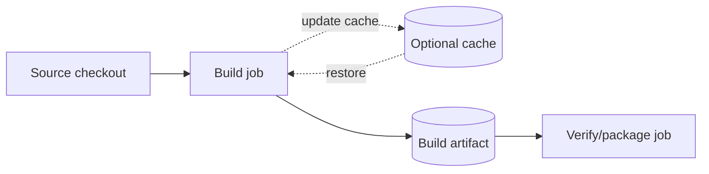

# Cache, artifacts and dependencies

A migration must separate **optimization** from **data transfer**. GitHub Actions often uses `actions/cache` to accelerate dependency downloads and `upload-artifact`/`download-artifact` to pass files. GitLab declares `cache:` and `artifacts:` directly in jobs. Both systems have storage backends and retention behavior, but keys, lookup scope, trust boundaries and transfer rules are not identical.

### Cache is optional

Cargo downloads crates to its home directory; compiled outputs go to `target/`. A GitLab cache for `.cargo/registry` and `.cargo/git` can accelerate dependency retrieval, but must not be required for correctness. On a Windows Shell runner, default Cargo home may be under the service account profile and outside GitLab's cacheable project paths.

```yaml
variables:
  CARGO_HOME: "$CI_PROJECT_DIR/.cargo"

rust_build:
  tags: [windows, rust]
  cache:
    key:
      prefix: windows-rust
      files: [Cargo.lock]
    paths:
      - .cargo/registry/
      - .cargo/git/
  script:
    - cargo build --locked --release
  artifacts:
    paths:
      - target/release/example.exe
    expire_in: 7 days
```

The binary name and Rust environment are placeholders. `Cargo.lock` must exist and the runner must resolve the configured Cargo home as intended. Toolchain version and target should also inform key design; a lockfile-derived key alone does not make compiled outputs portable.



### Job dependencies

GitHub `needs` expresses a dependency between jobs; GitLab `needs` also builds a DAG, but artifact download semantics must be reviewed explicitly. A GitLab job with `needs` should specify whether it requires artifacts from each upstream job. Stage order is not a substitute for an explicit data contract in complex DAGs.

```yaml
verify:
  tags: [windows, rust]
  needs:
    - job: rust_build
      artifacts: true
  script:
    - 'if (-not (Test-Path "target/release/example.exe")) { throw "Missing binary" }'
```

### Report formats

GitHub test/coverage annotations and GitLab `artifacts:reports` do not accept identical formats by default. Confirm which GitLab report type supports the tool output. Otherwise publish a normal artifact or report through the scanner vendor's server.

| Item | Migration decision |
|---|---|
| Cache key | Redesign for GitLab key semantics and trust |
| Cache paths | Make Cargo home project-relative |
| Artifact upload | Declare paths and retention |
| Artifact download | Map dependencies with `needs:artifacts` |
| Release package | Publish to durable registry, not expiring artifact |
| Security report | Validate supported report format |

**Conclusion:** A cache miss should slow a build, not break it; a missing required artifact should be a clear contract failure.
