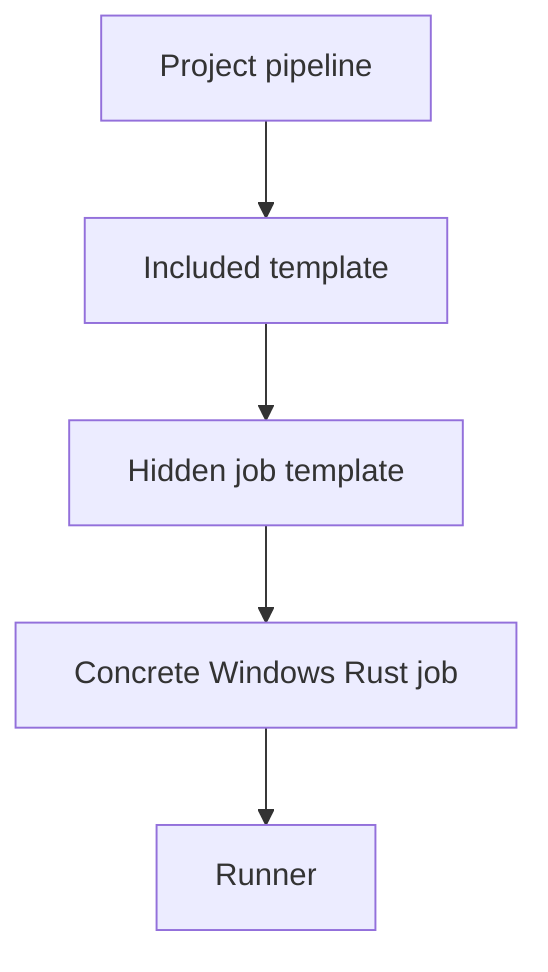

# Reusable workflows and templates

GitHub and GitLab both support configuration reuse, but the abstraction boundaries differ. GitHub reusable workflows are invoked as jobs with `workflow_call`, while composite actions bundle steps. GitLab can combine configuration through `include`, `extends`, YAML anchors and CI/CD components. A mechanical translation can unintentionally flatten reusable policies or weaken version control.

### Reuse categories

| GitHub pattern | GitLab candidate | Critical difference |
|---|---|---|
| Reusable workflow | Included pipeline template / component | Inputs, jobs and execution semantics differ |
| Composite action | Shared script or included job template | Not a native GitLab step object |
| Marketplace action | Vendor CLI/container/template | Must evaluate supply-chain trust |
| Workflow inputs | CI/CD component inputs or variables | Type/default validation differs |
| Pinned action SHA | Pinned template ref / component version | Pinning and provenance still required |

### GitHub example

```yaml
jobs:
  security:
    uses: org/platform/.github/workflows/security.yml@v2
    with:
      language: rust
    secrets: inherit
```

`secrets: inherit` deserves special attention: broad implicit secret forwarding should not be recreated without reviewing who can execute the reusable workflow and which credentials it actually needs.

### GitLab template approach

```yaml
include:
  - local: .gitlab/ci/rust-jobs.yml

rust_test:
  extends: .rust_test_template
  tags: [windows, rust]
```

In `.gitlab/ci/rust-jobs.yml`:

```yaml
.rust_test_template:
  stage: test
  script:
    - cargo test --locked
```

`extends` merges supported configuration keys according to GitLab semantics; arrays and nested mappings are not necessarily merged the way a Java developer might expect. Test the final expanded configuration using GitLab's CI lint or pipeline editor before relying on it.



### Ownership and versioning

Shared CI templates are code dependencies. A change in a central template can affect dozens of projects. Prefer versioned, reviewed references over mutable default-branch references for high-risk security or deployment workflows. Document who owns the template, compatibility expectations and the process for rolling out updates.

### Enterprise anti-patterns

Avoid copying hundreds of lines into every project; avoid a single mega-template with opaque conditional logic; avoid fetching executable scripts from unreviewed branches; and avoid inheriting privileged variables into jobs that do not need them. A template should reduce duplication while keeping the resulting pipeline understandable.

### Review checklist

Identify the original reusable workflow's inputs, outputs, permissions, environment protections, artifact contracts and version pin. Decide whether the equivalent GitLab abstraction is a reusable job, pipeline template, component or external script. Review the expanded YAML and event behavior separately.

**Conclusion:** Reuse is a governance mechanism as much as a maintainability mechanism.
