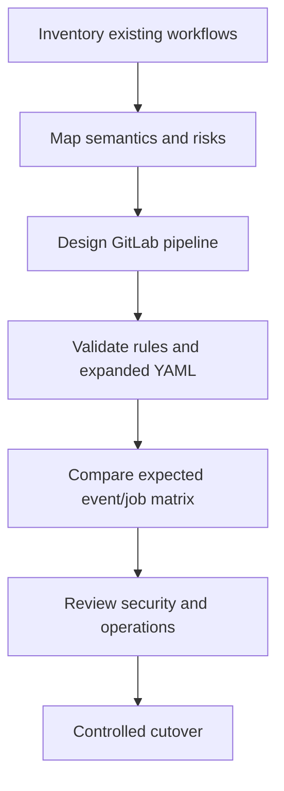

# Migration methodology and annotated Rust example

Migration should be treated as a behavior-preservation project with explicit exceptions, not a search-and-replace exercise. Start by establishing the existing GitHub Actions contract, then design the GitLab equivalent around runner topology, event policy, permissions and artifacts. The example below is documentation-only and does not assume access to GitLab infrastructure.

## 1. Inventory the current workflow

For each GitHub workflow capture: triggering events, jobs, step-level conditions, dependencies, required secrets, `GITHUB_TOKEN` permissions, environments, action versions, outputs, caches, artifacts, scanner integrations and branch protections. Mark each item **equivalent**, **redesigned** or **not yet supported** in the GitLab target.

## 2. Specify acceptance behavior

Define a matrix of expected outcomes: feature branch push, merge request, default branch push, manual run, tag release and untrusted fork. For each event, decide whether the pipeline exists, which jobs run, what credentials are accessible and what artifacts are produced. This truth table is the migration's acceptance contract.



## 3. Illustrative GitHub workflow

```yaml
name: Rust Windows
on:
  push:
    branches: [main]
  pull_request:
    branches: [main]
jobs:
  test:
    runs-on: windows-latest
    steps:
      - uses: actions/checkout@v4
      - run: cargo test --locked
        shell: pwsh
  build:
    needs: test
    runs-on: windows-latest
    steps:
      - uses: actions/checkout@v4
      - run: cargo build --locked --release
        shell: pwsh
      - uses: actions/upload-artifact@v4
        with:
          name: rust-windows
          path: target/release/example.exe
```

This intentionally omits caching and scanners to isolate orchestration semantics. In a real migration, any omitted controls must be accounted for rather than silently dropped.

## 4. Proposed GitLab design

```yaml
workflow:
  rules:
    - if: '$CI_PIPELINE_SOURCE == "merge_request_event"'
    - if: '$CI_COMMIT_BRANCH == $CI_DEFAULT_BRANCH'
    - when: never

stages: [test, build]

rust_test:
  stage: test
  tags: [windows, rust]
  script:
    - cargo test --locked

rust_build:
  stage: build
  tags: [windows, rust]
  needs:
    - job: rust_test
      artifacts: false
  script:
    - cargo build --locked --release
  artifacts:
    name: "rust-windows-$CI_COMMIT_SHORT_SHA"
    paths:
      - target/release/example.exe
    expire_in: 7 days
```

The job names and binary path are illustrative. `needs` makes the build wait for the test job, while `artifacts: false` avoids downloading unneeded files. A Windows runner with Cargo and a compatible MSVC toolchain must exist; GitLab tags alone do not provide it.

## 5. Gaps requiring decisions

| Gap | Required decision |
|---|---|
| GitHub hosted Windows image | Provision and maintain GitLab Windows runner |
| GitHub event contexts | Rewrite rules and test pipeline source behavior |
| Marketplace actions | Replace with approved toolchain/integration |
| Secrets and token permissions | Recreate least-privilege access policy |
| Required checks | Update repository merge policy in GitLab |
| Artifact retention | Set expiry and release publication policy |

## 6. Validation without execution

Review the YAML with a syntax-aware editor; reason through the event matrix; inspect runner tag eligibility; review permissions and secret exposure; and verify the artifact producer/consumer graph. Actual CI lint and runtime verification are deferred until access is available. Do not claim the migration is production-ready solely because the YAML parses.

**Outcome:** A documented migration design with traceability from every original behavior to a GitLab implementation or an explicit unresolved gap.
