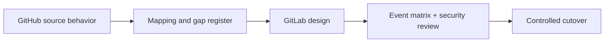

# Conclusions and migration competency validation

GitHub Actions to GitLab migration is fundamentally a change in orchestration semantics and operating model. A successful migration preserves required behavior, permissions and evidence while adapting to GitLab's pipeline creation, runner scheduling and artifact contracts. Copying commands is the easy part; reproducing conditions and trust boundaries is the hard part.

### Core distinctions

| Topic | What must be retained |
|---|---|
| Workflow vs pipeline | Intended event-to-job behavior |
| Steps vs scripts | Conditional execution and outputs |
| Hosted vs self-hosted runners | Required toolchain and isolation |
| Secrets | Least privilege and trusted-ref boundaries |
| Cache | Performance only; correctness independent |
| Artifacts | Explicit output contracts and retention |
| Reusable workflows | Versioned, reviewed shared policy |
| Security tools | Scanner execution, result handling and gates |

### L1 — Understand

- [ ] Explain why `runs-on: windows-latest` does not equal `tags: [windows]`.
- [ ] Distinguish GitHub `on:` from GitLab `workflow:rules` and job `rules`.
- [ ] Explain why `uses:` actions are not GitLab script commands.
- [ ] Describe GitHub and GitLab job output and artifact differences.
- [ ] Identify the trust risks of a persistent Windows Shell runner.

### L2 — Modify

- [ ] Translate a simple Rust Windows workflow into two GitLab jobs.
- [ ] Create a trigger matrix for push, merge request, manual and scheduled runs.
- [ ] Map a cache and a required artifact separately.
- [ ] Replace a reusable workflow with a reviewed GitLab template strategy.
- [ ] Specify where scanner credentials should be configured.

### L3 — Troubleshoot

- [ ] Explain why a pipeline exists but a Windows job remains pending.
- [ ] Diagnose a job that passes on GitHub-hosted Windows but lacks `cargo` on GitLab.
- [ ] Find a rule that accidentally excludes merge request jobs.
- [ ] Identify missing artifact transfer in a `needs` graph.
- [ ] Detect a secret-access regression in untrusted branch pipelines.

### Scenario: apparently successful but unsafe migration

A team converts GitHub YAML to GitLab and gets a green default-branch build. However, its Windows Shell runner also accepts untrusted merge-request jobs and has scanner credentials stored in the service account's profile. The migration is not complete: the green build verifies only one execution path, while the new runner topology has created a privilege exposure. Resolve runner isolation and credential boundaries before enabling broad access.

### Documentation-only acceptance gate

The chapter set does not install a runner, access GitHub/GitLab projects, execute pipelines or validate specific enterprise policies. Before operational cutover, validate configuration against the installed GitLab release, review the expanded pipeline, test event cases in a controlled project, verify scanner and registry integration, and document rollback. This is a future operational gate, not a current exercise.

### Where to continue

P8 SonarQube, P9 Nexus IQ and P10 Fortify examine the tools often wrapped by GitHub marketplace actions. P11 combines those tools into an end-to-end GitLab pipeline. P12 provides incident diagnostics when migrated jobs fail.

**Final rule:** Migrate the **contract**—events, permissions, execution, outputs and gates—not the original YAML's surface syntax.
