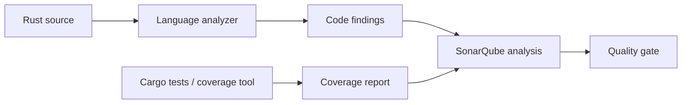

# Static analysis: what SonarQube can and cannot prove

Static analysis examines source code or derived program representations without executing the application's normal business workflow. SonarQube organizes findings around maintainability, reliability and security concerns. A finding is a reason to investigate, not proof that a production defect is exploitable. Static analysis complements tests, dependency analysis and runtime monitoring rather than replacing them.

## Three distinct evidence sources

**Static code findings** are produced by analyzers evaluating rules. **Coverage** is imported from external test tooling; SonarQube does not magically run Rust tests. **Dependency vulnerabilities** generally belong to software composition analysis tools such as Nexus IQ or cargo-audit; do not assume SonarQube code analysis substitutes for a full dependency inventory.

## Findings versus outcomes

| Term | Meaning | Caution |
|---|---|---|
| Rule | Detection criterion | Can generate false positives |
| Issue | Analyzer-reported finding | Needs contextual review |
| Hotspot | Security-sensitive code requiring review | Not automatically a vulnerability |
| Coverage | Test execution measurement | High coverage does not prove correctness |
| Quality gate | Pass/fail policy over measures | Policy result, not a security certification |

## Rust context

Rust's compiler already enforces ownership and borrowing constraints and provides extensive diagnostics. SonarQube can add maintainability and security-focused checks where supported, but it does not replace `cargo check`, Clippy or tests. Language-specific analyzer capabilities vary by SonarQube edition and version; confirm Rust support and available rules on the enterprise installation.

## Interpretation exercise

A project has 90% line coverage, no critical static issues and one unreviewed security hotspot. Can it be declared secure? No. Coverage reports executed lines, the analyzer detects only supported patterns, and the hotspot still requires review. The correct response is to identify the missing evidence and apply the organization's review policy.

**Conclusion:** Treat static analysis as one evidence stream within a wider assurance process.
