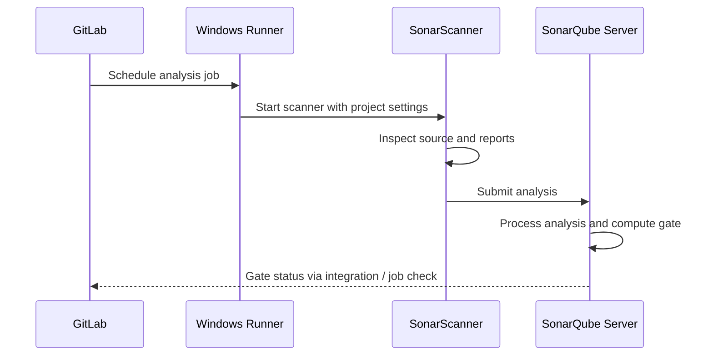

# SonarQube architecture and responsibilities

SonarQube separates the **scanner**, which runs alongside a build, from the **server**, which receives and processes analysis results. A GitLab runner executes the scanner; the SonarQube service stores and presents findings. This distinction is especially important on Windows: a scanner executable and its prerequisites must be available to the runner service account.

## Main components

| Component | Owner | Responsibility |
|---|---|---|
| GitLab project | Development team | Pipeline YAML and source |
| Windows Runner | Platform team | Service identity, tool installation, network |
| SonarScanner | CI job | Collect/analyze supported inputs and submit |
| SonarQube server | Quality platform team | Rules, project settings, history and gate |
| Quality profile | Quality administrators | Enabled analysis rules |
| Quality gate | Quality administrators | Conditions for acceptance |

SonarQube Server deployments may have separate background processing and database components. CI authors generally need the service endpoint and token, not direct database access.

## Trust boundaries

The scanner needs outbound connectivity to the SonarQube URL and a token authorized for analysis. The token must be protected in GitLab variables or an approved secret manager. The server's TLS certificate must be trusted by the scanner's runtime. A successful Git checkout does not establish that scanner TLS will work: different clients can use different trust stores.

## Java comparison

In a Java/Maven pipeline, Sonar analysis may be launched via a Maven plugin; for Rust, a generic scanner and externally generated coverage are common conceptual building blocks. Neither approach means SonarQube itself compiles the project. Separate compilation, tests, report production and analysis submission.

## Architecture review

Identify where the scanner runs, where it sends results, where quality gate policy is defined, and which component enforces pipeline failure. A gate displayed as red in SonarQube is not automatically a failed GitLab job unless the integration or job configuration makes that happen.

**Conclusion:** The runner executes the scanner; the server evaluates and retains analysis.
