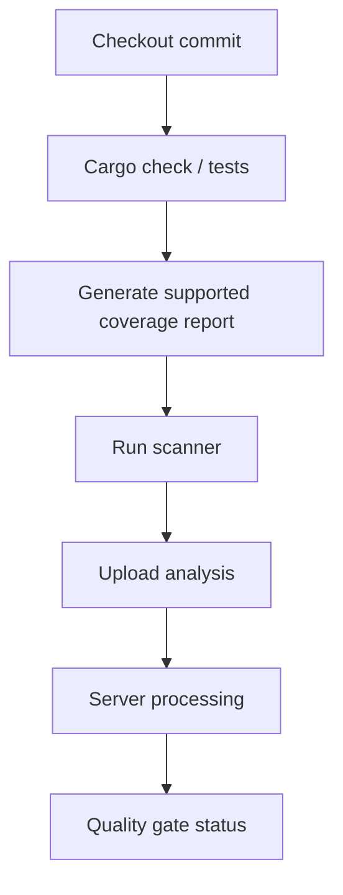

# Scanner execution and analysis data flows

A scanner job has three phases: prepare inputs, submit analysis, and optionally wait for server-side quality gate processing. This is not the same as a single synchronous compiler invocation. The server may process uploaded analysis asynchronously, which explains why a scanner can finish uploading before a gate result is available.

## Typical Windows flow



## Configuration sketch

```properties
sonar.projectKey=example-rust-service
sonar.sources=src
sonar.sourceEncoding=UTF-8
```

A `sonar-project.properties` file expresses project metadata and source scope. The exact properties needed for Rust, coverage and test reports depend on the installed analyzer and version. Do not copy Java-specific binary paths such as `sonar.java.binaries` into a Rust project.

```yaml
sonar_analysis:
  stage: analyze
  tags: [windows, powershell]
  variables:
    GIT_DEPTH: "0"
  script:
    - 'sonar-scanner -Dsonar.host.url="$env:SONAR_HOST_URL" -Dsonar.token="$env:SONAR_TOKEN"'
```

This is an **illustrative** job, assuming a scanner installed on the Windows host, a valid project configuration, and variables supplied securely. Quoting and option handling should be checked for the scanner version in use. A full Git history can be useful for new-code and blame-related analysis; shallow checkout may limit analysis metadata.

## What can fail where?

| Phase | Example failure | Evidence |
|---|---|---|
| Inputs | Missing coverage file | Local report path |
| Scanner start | Executable not found | Service PATH |
| Upload | TLS/proxy error | Scanner network logs |
| Authorization | Invalid token/project rights | HTTP response |
| Server processing | Analysis queue failure | Server task status |
| Gate | Threshold exceeded | Gate condition and measure |

## Reproducibility

A scanner should analyze the same commit and report set produced by the pipeline. Avoid fetching coverage from unrelated branches or assuming artifacts survive on a shared Windows filesystem. Use GitLab artifacts for cross-job report transfer.

**Conclusion:** Differentiate input preparation, submission, server processing and gate enforcement.
