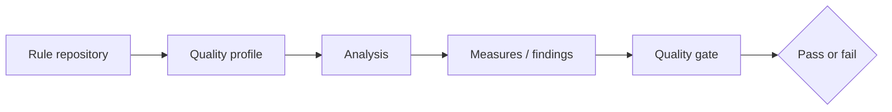

# Quality profiles, rules and gates

A **quality profile** determines which analyzer rules are active for a language. A **quality gate** evaluates metrics against conditions and yields an acceptance decision. Confusing them leads to ineffective governance: adding a rule changes detection, whereas changing a gate changes pass/fail policy.

## Example distinction

A Rust project can use a profile with several maintainability rules enabled while its gate checks only new-code conditions. Adding a rule may create new issues, but the pipeline fails only when the gate's configured conditions are violated and CI is set to enforce that result.

| Concept | Controls | Managed by |
|---|---|---|
| Rule | Individual detection logic | Analyzer vendor / administrators |
| Quality profile | Active rules and parameters | Quality administrators |
| New code definition | Which changes are evaluated as new | Project/quality policy |
| Quality gate | Thresholds on measures | Quality administrators |
| Pipeline enforcement | Whether CI blocks on gate | CI integration/configuration |

## New code versus overall code

Organizations often focus gates on *new code* to avoid blocking every change because of long-standing technical debt. This approach can support gradual improvement, but it should not hide severe legacy risks. Record the baseline and distinguish debt management from acceptance of new vulnerabilities.

## Gate enforcement timing

Some scanner modes can wait for quality gate results; other setups rely on GitLab integration or a later API check. The correct design explicitly states who waits, who interprets the status and what happens on timeout or unavailable SonarQube service. A green scanner-upload step alone does not prove a green quality gate.

## False positives and exceptions

A flagged issue can be a false positive, an accepted risk or a genuine defect. Review decisions should preserve evidence and authority. Blanket exclusions or disabling rules to make a pipeline green undermines the quality model.

## Tabletop scenario

A team reports that SonarQube shows a failing gate but GitLab pipeline succeeded. Inspect the job's scanner configuration, whether it waits for gate completion, and any integration status checks. Do not immediately modify the quality gate.

**Conclusion:** Profiles govern what is detected; gates govern acceptance; CI configuration governs enforcement.
