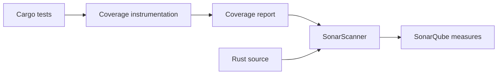

# Coverage and Rust analysis

Coverage is a property of tests and instrumentation, not a property the SonarQube scanner creates on its own. For Rust, a separate tool such as `cargo-llvm-cov` may generate coverage reports. SonarQube imports a report only if the installed edition, analyzer and configured report format support it.

## Data pipeline



## Illustrative commands

```powershell
cargo test --locked
if ($LASTEXITCODE -ne 0) { throw "Tests failed" }

# Requires cargo-llvm-cov installed and an appropriate toolchain
cargo llvm-cov --lcov --output-path coverage.lcov
if ($LASTEXITCODE -ne 0) { throw "Coverage generation failed" }
```

The output above is an **LCOV** report. Do not assume the SonarQube instance accepts LCOV for Rust; confirm the supported importer and property names. A converter or different report format may be needed. Installing `cargo-llvm-cov` and instrumenting tests is outside the current documentation-only scope.

## Coverage interpretation

| Measure | Interpretation | Limitation |
|---|---|---|
| Line coverage | Lines executed by tests | Does not measure assertions |
| Branch coverage | Branch outcomes exercised | Not always available for every tool |
| Test count | Number of tests reported | Not a measure of test quality |
| Excluded files | Files omitted from calculation | Can distort apparent quality |

## Windows-specific risks

Coverage tools may require LLVM components and particular Rust toolchains. The runner service account must find them on PATH. Paths embedded in reports must match the checked-out source tree; generated reports from another machine may contain incompatible absolute paths.

## Coverage artifact handoff

If test and scanner jobs are separate, upload the coverage report as an artifact in the test job, then download it in the scanner job through `needs:artifacts`. This is preferable to relying on a persistent Windows workspace. Preserve the report for diagnosis if the importer rejects it.

## Security and quality scope

Rust compiler checks, Clippy lints, unit tests, coverage and SonarQube findings answer different questions. Combining them creates stronger evidence, but none alone proves absence of defects or vulnerabilities.

**Conclusion:** Generate and validate coverage independently; configure SonarQube only for formats the enterprise installation supports.
