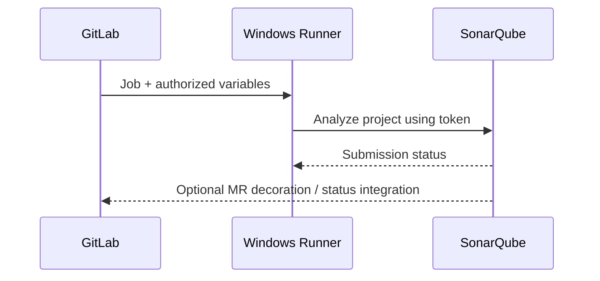

# GitLab integration and configuration

GitLab integrates SonarQube at several levels: a CI job invokes a scanner, GitLab variables provide endpoint and authentication, merge request metadata may support decoration, and quality gate results may be used to control merge readiness. Each integration is optional and must be deliberately configured.

## Reference pipeline

```yaml
stages: [test, analyze]

rust_tests:
  stage: test
  tags: [windows, rust]
  script:
    - cargo test --locked

sonarqube:
  stage: analyze
  tags: [windows, powershell]
  variables:
    GIT_DEPTH: "0"
  script:
    - 'sonar-scanner -Dsonar.host.url="$env:SONAR_HOST_URL" -Dsonar.token="$env:SONAR_TOKEN"'
```

This is not a complete enterprise pipeline. It assumes a scanner on the Windows host, a supported Rust analyzer, valid project properties, and secured variables. For quality-gate blocking, add the appropriate supported scanner wait or separate gate-check mechanism.

## Variable ownership

`SONAR_HOST_URL` is typically non-secret configuration; `SONAR_TOKEN` is a secret and should be configured in GitLab's CI/CD variable settings or an approved secrets integration, not committed to YAML. Protection and availability must match the refs on which analysis runs. Masking reduces accidental disclosure but does not protect against malicious code with access to the token.



## Merge request analysis

Branch and merge request analysis features can depend on SonarQube edition and configuration. Verify support rather than assuming all features are present. The project key, GitLab project binding, branch metadata and token permissions must align.

## Windows runtime checks

Confirm scanner executable availability for the service identity, Java runtime requirements for the chosen scanner distribution, outbound connectivity to the server and trust in corporate TLS certificates. Do not treat successful Cargo builds as evidence that SonarScanner can authenticate.

## Troubleshooting a green pipeline with red gate

Determine whether CI waited for server-side processing. Inspect the quality gate result and job configuration. If the scanner merely uploaded analysis and exited successfully, GitLab may report green without enforcing the gate. The fix belongs in enforcement configuration, not necessarily in the quality gate.

**Conclusion:** Separate scanner execution, server integration and merge policy.
