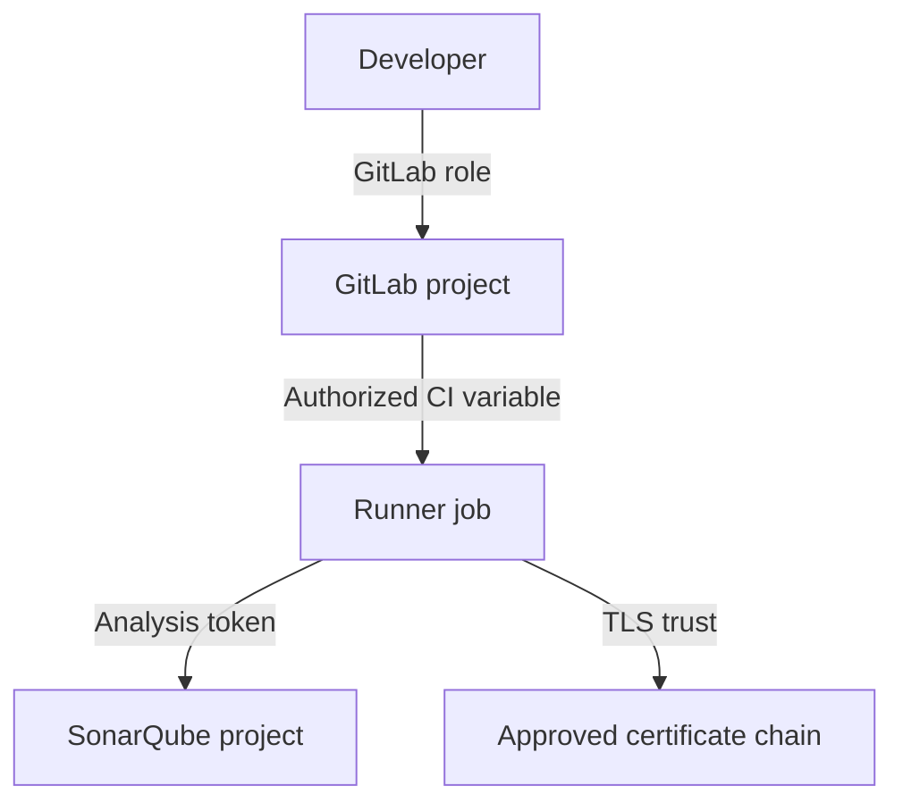

# Permissions, tokens and enterprise usage

An enterprise SonarQube integration introduces credentials, authorization, network trust and governance responsibilities. The scanner should have only the permissions required to submit analysis to the intended project. Administrative access is not needed for routine pipeline execution.

## Identity model

## Credential boundaries

| Credential or permission | Purpose | Recommended treatment |
|---|---|---|
| SonarQube analysis token | Submit analysis | Secret, scoped and rotated |
| GitLab variable edit rights | Manage CI credentials | Restrict to authorized roles |
| Runner service identity | Execute scanner | Least privilege on Windows |
| GitLab integration token | Decoration/status if needed | Separate scope and lifecycle |
| TLS trust configuration | Validate SonarQube endpoint | Approved CA, no bypass |

## Protected refs and merge requests

A protected secret may be unavailable to pipelines running on unprotected branches or certain merge request contexts. This can be a deliberate security boundary, not a misconfiguration. Plan a lower-privilege analysis strategy for untrusted contributions if analysis is required there.

## Host-level exposure

A Windows Shell runner executes code under a persistent service identity. If the host contains long-lived scanner credentials in readable files or environment settings, any project code running under that identity may be able to access them. Prefer job-scoped credentials and runner separation by trust level.

## Governance decisions

Decide who owns the quality profile, who may change the quality gate, who reviews exceptions, and who can update tokens. Record how a scanner outage affects merges: fail closed for protected releases, or permit controlled exceptions through an explicit approval process. Avoid ad hoc bypasses that cannot be audited.

## Incident example

A scanner returns HTTP 403 after a token rotation. Verify the token is present in the specific pipeline context, that it has analysis permission on the correct SonarQube project, and that the project key is accurate. Do not reveal the token in logs or temporarily grant global administrator rights.

## Risk interpretation

A passing gate means the configured conditions were satisfied on the submitted analysis. It does not mean every dependency is safe, all security issues are absent, or the release has passed Fortify and Nexus IQ checks. P9 and P10 cover those complementary tools.

**Conclusion:** Scanner access is a narrowly scoped machine-to-machine privilege; governance defines how findings affect delivery.
