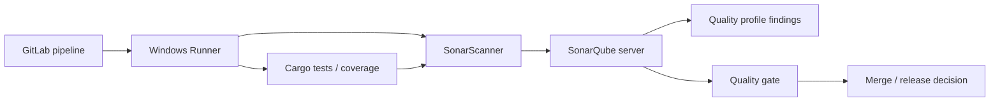

# P8 conclusions and competency validation

SonarQube belongs in the quality-evidence layer of a Rust GitLab pipeline. The Windows runner executes build and analysis tools; SonarQube receives analysis, applies profiles and calculates measures; the quality gate determines whether policy conditions are met; GitLab must explicitly enforce any blocking decision.

## Consolidated architecture

## Distinctions to remember

| Pair | Difference |
|---|---|
| Scanner / server | Job-side collection versus central processing |
| Quality profile / quality gate | Rules enabled versus acceptance thresholds |
| Code findings / dependency vulnerabilities | Static source patterns versus component risk |
| Test execution / coverage import | Tests run outside SonarQube; reports are imported |
| Upload success / gate success | Submission is not the final policy decision |
| Token masking / token security | Masking alone cannot prevent malicious use |

## L1 — Understand

- [ ] Explain where scanner and server execute.
- [ ] Define a rule, issue, quality profile and quality gate.
- [ ] Distinguish code analysis from software composition analysis.
- [ ] Explain why coverage requires external tooling.
- [ ] Identify the difference between gate computation and CI enforcement.

## L2 — Modify

- [ ] Review a GitLab job that runs SonarScanner on Windows.
- [ ] Identify which values should be GitLab variables.
- [ ] Decide how coverage artifacts reach the scanner job.
- [ ] Explain when full Git history is relevant.
- [ ] State which project and token permissions are necessary.

## L3 — Troubleshoot

- [ ] Diagnose scanner executable missing for the service account.
- [ ] Investigate token 401/403 without exposing credentials.
- [ ] Separate TLS errors from analysis-rule failures.
- [ ] Explain why a pipeline is green while a gate is red.
- [ ] Identify unsupported Rust analyzer/report features as a compatibility concern.

## Tabletop cases

**Case A:** `cargo test` passes, but SonarQube reports zero coverage. Check whether a report was generated, transferred, imported using a supported format and mapped to the source files.

**Case B:** The scanner uploads successfully, yet the GitLab job ends before gate processing. Determine the gate enforcement strategy and whether waiting or a separate check is required.

**Case C:** Analysis succeeds on the protected default branch but fails on an unprotected merge request. Check variable protection, trust model and supported merge request analysis capabilities.

## Scope

This documentation contains illustrative commands and configurations only. No SonarQube instance, GitLab project or Windows Runner was accessed or tested. Feature availability—especially Rust analysis, coverage imports and merge request decoration—must be checked against the organization's installed SonarQube edition and version.

**Next:** P9 Nexus IQ examines dependency inventories, license obligations and vulnerability policy; P10 Fortify examines another security-analysis workflow. Together they form complementary evidence, not interchangeable gates.
