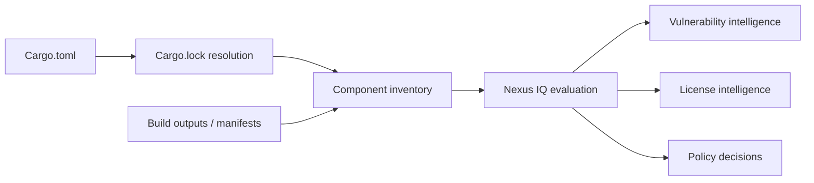

# Software Composition Analysis: why dependencies are part of the product

## The problem is bigger than application source

A Rust application contains source written by its team, dependencies selected in `Cargo.toml`, transitively resolved crates, build dependencies and sometimes externally linked native libraries. A clean `cargo test` establishes that a particular test suite passed; it does not establish that all shipped components are free from published vulnerabilities, unacceptable licenses or operational risk. **Software Composition Analysis (SCA)** examines this external component footprint.

Sonatype Nexus IQ (often called Nexus Lifecycle in product discussions) provides component intelligence and policy evaluation. Its purpose differs from SonarQube's source-oriented analysis and Fortify's security testing. SCA asks *which components are present and whether their known attributes violate policy*. It does not generally prove that a vulnerable function is reachable or that an exploit is possible.

## Core vocabulary

| Term | Meaning | Common misconception |
|---|---|---|
| Direct dependency | Explicitly declared dependency | Only direct crates matter |
| Transitive dependency | Pulled in by another dependency | Developer did not choose it, so it is exempt |
| Component coordinate | Identity and version of a package | A filename always proves identity |
| Vulnerability | Known weakness associated with a component | Presence guarantees exploitability |
| License obligation | Conditions attached to using/distributing software | Every permissive license has no obligations |
| Policy violation | Evaluation result under company rules | Every violation means the build must fail |
| Waiver | Approved exception, usually scoped and time-bound | A permanent technical fix |

## Where the data comes from

A scanner or integration must present an inventory that Nexus IQ can recognize. Inventory may come from supported manifests, lockfiles, package metadata, archives or an SBOM, depending on product version and integration. **Do not assume a generic archive scan understands Cargo.lock**. Verify the organization's supported Rust ingestion route before designing a gate.

## Enterprise example

Suppose `order-service` depends on crate A, which depends on crate B. An advisory affects B. Even if developers never import B directly, its code may enter the build. SCA makes this relationship visible. The next investigation asks whether B is included in the relevant build, whether a patched version exists, and whether the policy requires blocking a release.

## Comparison with Maven

Maven dependency graphs and Cargo dependency resolution both have direct and transitive edges. Cargo features and target-specific dependencies add important context: an inventory may include dependencies not built for the Windows target. Avoid assuming every listed crate is shipped or executed; investigate build selection separately.

**Conclusion:** SCA provides risk intelligence about components, not a universal proof of application safety.
