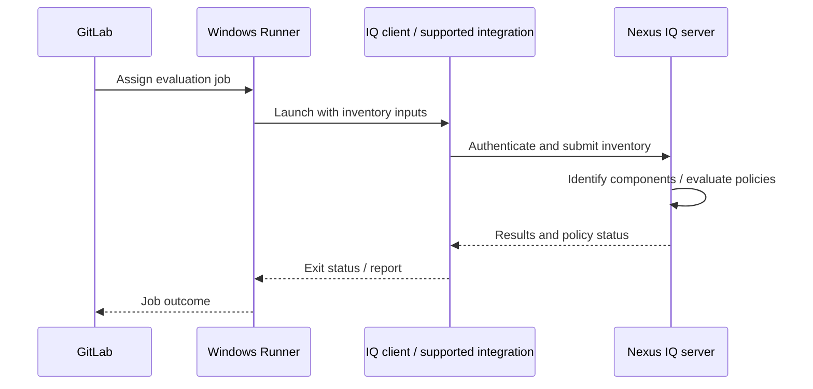

# Nexus IQ architecture: evaluation client, server and policy ownership

## Separate the pipeline from the intelligence service

A GitLab Runner executes a client or integration that gathers component information and submits it for evaluation. The Nexus IQ server maintains application identities, organizational policy, component intelligence and evaluation results. GitLab orchestrates the CI job, but it does not itself become the source of vulnerability or license intelligence.

## Logical responsibilities

| Layer | Responsibilities | Owner |
|---|---|---|
| Cargo | Resolve package graph and versions | Rust development team |
| Inventory generator | Produce supported evidence of components | CI/build engineering |
| Evaluation client | Submit evidence and obtain policy result | CI/platform team |
| IQ server | Match components, evaluate policy, store history | Application security / platform |
| Policy organization | Define risk tolerance and exceptions | Security governance |
| GitLab | Sequence jobs and enforce configured failures | Delivery platform |

The word *scan* is overloaded. A filesystem scanner, a build-tool integration, a repository analysis feature and an SBOM ingestion API may support different ecosystems and produce different inventories. Choose based on **supported input**, not the name of a scanner executable.

## Application and organization structure

IQ deployments commonly organize policies around applications and organizational hierarchies. The precise names, inheritance behavior and stage configuration depend on product version and administration. A Rust microservice should map to a stable application identity so evaluations can be compared across commits and releases. If multiple GitLab repositories are combined into one deployable product, the inventory boundary should reflect the release unit rather than merely the repository count.

## Windows host boundary

On a Windows Shell runner, the evaluation client executes under the runner service account. Its runtime, PATH, TLS trust and proxy configuration may differ from the developer's interactive environment. Successful `cargo build` or Git checkout does not imply that the IQ client can reach the server. Credentials should be supplied as protected CI secrets or via an approved enterprise secret service, not installed in readable host-wide files.

## Failure ownership

A missing Cargo inventory is a build/integration problem. An HTTP 401 is usually authentication. An HTTP 403 may indicate application permission. A server-side policy violation is an evaluated risk outcome, not a connectivity failure. Keep these cases separate in logs and incident tickets.

## Java analogy

A Maven plugin may inspect a Java project's dependencies during a build. For Rust, the integration may require a separately produced inventory. The architectural pattern remains: **build metadata → evaluation service → policy decision → CI enforcement**. The plugin's existence for Maven does not establish equivalent native Cargo support.

**Conclusion:** Explicitly identify the inventory producer, evaluator, policy owner and CI gate owner before writing YAML.
