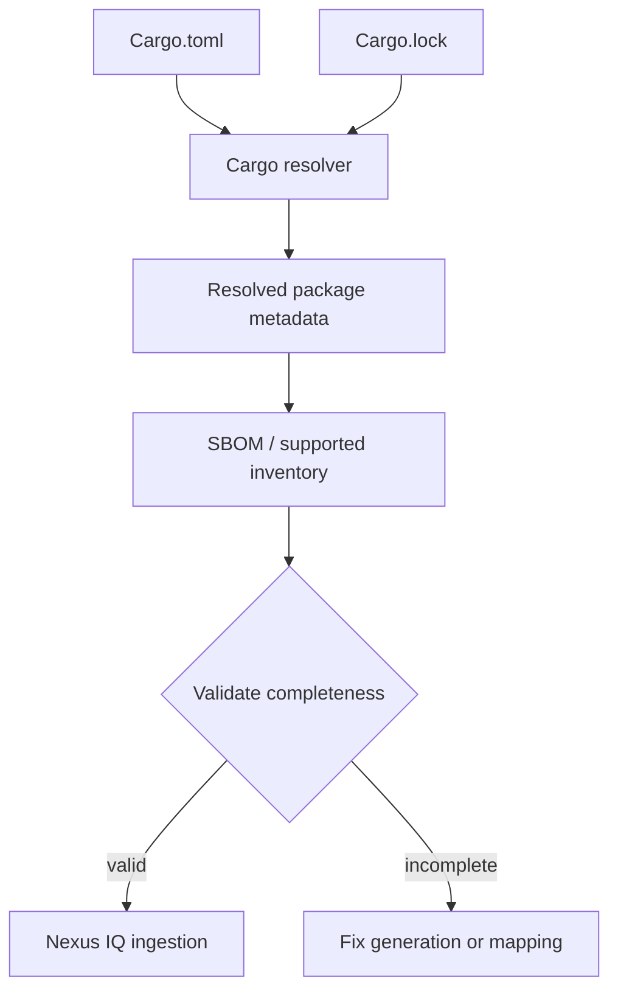

# Dependency identification and SBOM: the evidence problem

## Why identity is difficult

A vulnerability database cannot match an arbitrary folder name reliably. It needs a component identity, version and often ecosystem coordinates. Cargo's package graph provides names, versions, sources and dependency relationships. A software bill of materials (SBOM) packages such information into a transferable inventory, often in CycloneDX or SPDX format.

An SBOM is not a vulnerability report. It answers *what is present*, while an SCA evaluator asks *what risks and policies apply*. An incomplete SBOM can yield a misleadingly clean evaluation.



## Direct, transitive and target-specific components

`Cargo.lock` records a resolved dependency set for a package or workspace. It is valuable for reproducibility and inventory, but not all entries necessarily participate in a particular Windows release build. Features, optional dependencies, development dependencies and target-specific crates matter. A report should state whether it describes the whole lockfile, the selected target, or the packaged binary.

| Evidence | Strength | Limitation |
|---|---|---|
| `Cargo.toml` | Declared intent | Not full transitive graph |
| `Cargo.lock` | Resolved versions | May include unused target/feature variants |
| `cargo metadata` | Machine-readable graph | Must select and interpret relevant nodes |
| CycloneDX/SPDX SBOM | Portable inventory | Quality depends on generator and mapping |
| Built binary inspection | Release-focused evidence | May not identify every static component |

## Example: inspect the graph without running it now

```powershell
cargo metadata --locked --format-version 1 > cargo-metadata.json
cargo tree --locked --target x86_64-pc-windows-msvc
```

These are conceptual examples; the requested deliverable is documentation, not a live run. `cargo metadata` can access dependencies unless the environment is already prepared, and target selection must match the intended build. Neither command directly guarantees an IQ-compatible submission format.

## Version and source identity

Crates from the public registry, private registries and Git dependencies may need different identifiers. A Git dependency pinned to a revision is not always equivalent to a published crate version. A scanner that guesses based on a name can misidentify it. Record the source URL, revision or package URL where supported, and flag ambiguous matches for review.

## Validation before policy evaluation

Check inventory count against expected package graph, inspect missing-version warnings, confirm direct dependencies appear, and verify target/build scope. Keep the SBOM as a pipeline artifact for review when permitted by security policy. If a vendor integration does not accept the generated format, do not claim the scan covers Cargo merely because the job exited successfully.

**Conclusion:** Trustworthy SCA starts with a complete, correctly scoped inventory.
