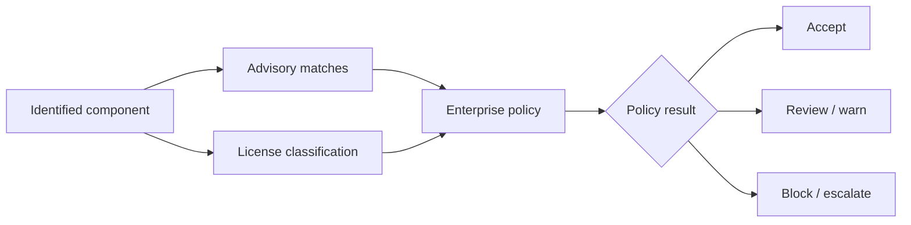

# Vulnerabilities, licenses and policy evaluation

## Risk information is not a single score

An SCA service combines component identity with security advisories, license intelligence and organization-defined policy. A vulnerability severity rating is one input; exploitability, deployment exposure, availability of a fix and business criticality may also matter. A high severity issue in an unused development-only component can demand a different response from the same issue in a network-facing release dependency.

## Three decisions, three owners

| Decision | Example | Typical owner |
|---|---|---|
| Technical applicability | Is the vulnerable code reachable? | Engineering/security |
| License obligation | Does distribution trigger obligations? | Legal/open-source compliance |
| Delivery acceptance | May this version be released? | Risk owner under policy |

An automated policy can route findings, but it does not replace legal interpretation or an engineering assessment of exploitability.

## Policy scope and stages

Organizations may apply different policies at development, build and release stages. A development evaluation might warn about new risk, while a release evaluation blocks unapproved critical issues. This should be documented explicitly: otherwise teams may treat different results for the same component as a scanner defect. The precise stage names and policy inheritance depend on the installed IQ version.

## Remediation sequence

1. Confirm component identity and exact version.
2. Check the advisory's affected and fixed version ranges.
3. Determine whether the component is direct or transitive.
4. Identify a compatible update path, including Rust feature constraints.
5. Rebuild and retest the dependency graph.
6. Re-evaluate and retain evidence of the resolved issue.

For transitive crates, a fix may require upgrading a parent dependency rather than editing `Cargo.lock` manually. Cargo's resolver constraints can prevent a patched version without a broader dependency change.

## Waivers and exceptions

An exception should have a reason, owner, expiry, scope and compensating controls. A waiver is not a patched component. Avoid blanket suppression of an entire package family to obtain a green pipeline. Reassess when an advisory changes or a fixed version becomes available.

## License examples

Permissive, copyleft and dual-license packages have different implications, but license strings alone do not settle distribution obligations. A crate with `MIT OR Apache-2.0` differs from one requiring both licenses. Treat unknown or custom license metadata as a review item rather than assuming it is harmless.

**Conclusion:** Policies convert component intelligence into organizational decisions; technical and legal review remain essential.
