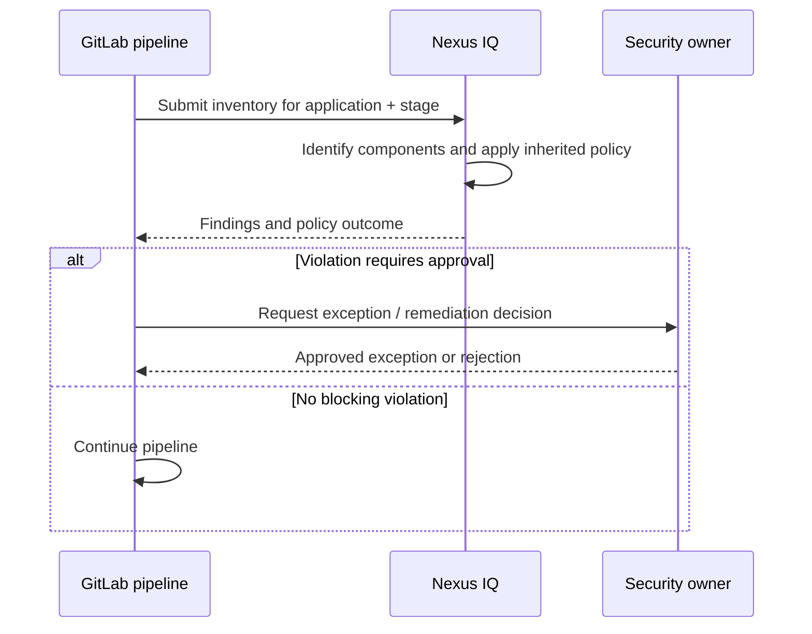

# Applications, stages and policy evaluation lifecycle

## Why application identity matters

An IQ application should represent a stable subject for risk tracking. If every CI run creates a new application identity, trends, waivers and ownership become fragmented. If several unrelated services share one identity, a finding can be assigned to the wrong team. Choose an application boundary that maps to the deployable product and its accountable owner.

## Evaluation stages are governance context

The same component inventory may be evaluated differently depending on the stage and policy. A development-stage result can inform engineers, while a release-stage result may block deployment. This does not imply the underlying component suddenly changed; the organizational decision threshold changed.

## Design the gate explicitly

A policy violation is not automatically a failed GitLab pipeline. The CI integration must interpret the evaluator's result, including warning thresholds, error codes and network failures. Do not write `allow_failure: true` merely to suppress noise without documenting which risk outcomes are allowed. Decide separately what happens if IQ is unavailable: fail closed for high-assurance releases, or use a documented approval-based contingency.

| Outcome | CI interpretation | Follow-up |
|---|---|---|
| No violations | Continue | Retain evaluation reference |
| Warning-only violation | Continue or review | Track risk according to policy |
| Blocking violation | Fail or require approval | Remediate or seek exception |
| Server unreachable | Infrastructure error | Retry, investigate, apply outage procedure |
| Inventory incomplete | Evidence-quality error | Fix scan coverage before trusting result |

## Version-to-version history

Evaluations can show whether a release adds, removes or retains risky components. Meaningful comparison requires consistent application identity, target scope and inventory generation. A change from a full lockfile scan to a binary-only scan can reduce finding count without actually reducing risk; record methodology changes.

## Review exercise

A release job reports zero policy violations, but the SBOM contains only 12 packages while the resolved Cargo graph contains 180. Is the release ready? Not on this evidence. First determine why the inventory is incomplete and whether the tool's supported ingestion method covered Rust dependencies.

**Conclusion:** Stage, application identity and inventory completeness are part of the meaning of every IQ result.
