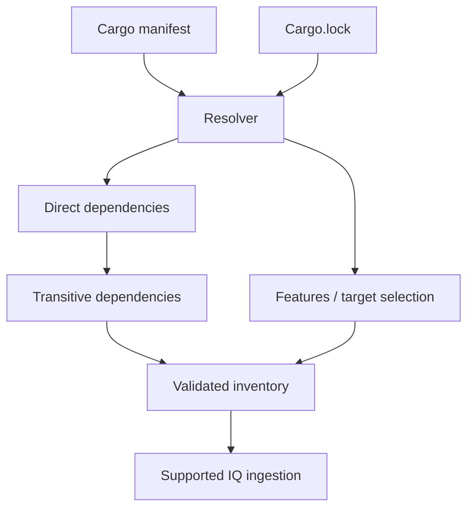

# Cargo dependency analysis: translating Rust metadata into SCA evidence

## Cargo is the source of dependency truth

`Cargo.toml` describes desired dependencies; `Cargo.lock` pins a resolution; Cargo metadata describes packages and dependency relationships. An enterprise SCA integration must interpret these artifacts correctly. Do not assume a Java-centric scanner understands Rust because it can inspect ZIP files or JARs.

## A Rust-specific dependency graph

```toml
[package]
name = "example-service"
version = "0.1.0"
edition = "2021"

[dependencies]
serde = { version = "1", features = ["derive"] }

[target.'cfg(windows)'.dependencies]
windows-sys = "0.59"
```

These version values are illustrative, not recommended current versions. A Windows release inventory should account for target-specific dependencies. A lockfile may include additional crates for other targets or dev/test use.



## Useful inspection commands

```powershell
cargo tree --locked --target x86_64-pc-windows-msvc
cargo metadata --locked --format-version 1 > cargo-metadata.json
```

These commands provide dependency evidence, **not** a complete Nexus IQ integration. An additional supported converter, SBOM generator or vendor integration may be necessary. Check that it retains component versions and relationships and is accepted by the organization's IQ server.

## Cargo-specific pitfalls

| Pitfall | Why it matters |
|---|---|
| Git dependency pinned by revision | Package identity may not match registry version |
| Private registry | Vendor intelligence may have limited metadata |
| Feature flags | Build selects different optional crates |
| Platform dependencies | Windows and Linux inventories differ |
| Workspace lockfile | Multiple packages may share resolution |
| Build dependencies | Included at build time, not necessarily in product binary |

## Maven comparison

In Maven, a scanner may obtain coordinates such as group ID, artifact ID and version from a resolved project model. Rust crates use different identity conventions. The goal is the same—accurate components and dependency relationships—but the ingestion mechanism is not interchangeable. A Maven-specific IQ CLI example is not a Rust recipe.

## Policy implications

If a vulnerable transitive crate is detected, `cargo tree -i crate_name` can help identify reverse dependencies; choose an exact package identifier when versions are ambiguous. A remediation may require updating the direct parent or changing features. Avoid editing the lockfile by hand to disguise an issue.

**Conclusion:** Inventory quality and ecosystem support are the main technical risks in Rust-to-IQ integration.
