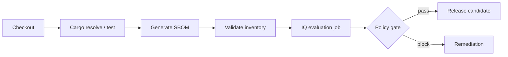

# GitLab integration: making an IQ result meaningful in CI

## The pipeline contract

A sensible pipeline builds or resolves Rust dependencies, creates an inventory in a supported format, evaluates it against Nexus IQ, and makes the policy result visible to GitLab. The evaluation job should not be a decorative step that always returns success regardless of the policy outcome.



## Illustrative YAML skeleton

```yaml
stages: [test, inventory, policy]

rust_test:
  stage: test
  tags: [windows, rust]
  script:
    - cargo test --locked

inventory:
  stage: inventory
  tags: [windows, rust]
  script:
    - 'Write-Host "Generate a validated SBOM with the approved Rust tool"'
    - 'throw "Replace placeholder with approved SBOM generator"'
  artifacts:
    paths: [reports/rust-sbom.json]

nexus_iq_policy:
  stage: policy
  tags: [windows, security]
  needs:
    - job: inventory
      artifacts: true
  script:
    - 'throw "Configure supported Nexus IQ ingestion and policy enforcement"'
```

The intentional `throw` statements prevent this skeleton from pretending to be executable. A real integration requires the approved generator, compatible IQ client or API, validated application/stage identifiers and explicit exit-code mapping. Vendor command names and flags should be taken from the installed version's documentation, not invented.

## Credential handling

An IQ endpoint URL may be stored as ordinary configuration; an API token or machine credential is secret. Supply it through GitLab protected/masked variables or an approved secret provider, respecting branch and merge-request trust boundaries. Do not place it in `.gitlab-ci.yml`, generated SBOMs or caches. Masking is not protection against malicious scripts on a privileged Shell runner.

## Windows execution constraints

The service account needs the generator and evaluation client on PATH, appropriate filesystem ACLs and TLS/proxy connectivity. A Java-based client may require a compatible JVM even though the application being scanned is Rust. Verify tool-specific certificate stores; a working Git clone does not establish IQ connectivity.

## Enforcement and reports

Retain the SBOM and sanitized evaluation summary as CI artifacts when permitted. Define whether warnings, blocking policy results, HTTP errors and incomplete inventory each fail the job. If the enterprise supports GitLab status integration, verify that it reports the same policy stage and application identity as the CI job.

**Conclusion:** An accurate, enforceable integration is better than a nominal scanner stage with uncertain coverage.
