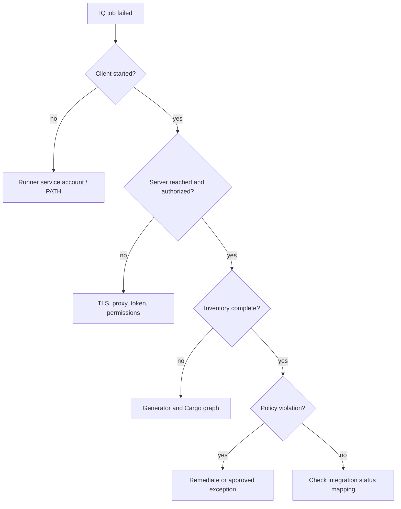

# Enterprise governance and troubleshooting

## Operational failures and policy failures are different incidents

A pipeline can fail because Nexus IQ found a blocking component, because the scanner could not identify the components, or because the runner could not connect to IQ. These require different owners and corrective actions. A blanket retry or `allow_failure` masks the distinction.

| Symptom | Likely layer | First evidence |
|---|---|---|
| 401 unauthorized | Authentication | Token presence, expiry and scope |
| 403 forbidden | Authorization | Application permission and stage access |
| TLS handshake error | Network trust | Client trust store, proxy, endpoint |
| Unknown components | Identification | SBOM coordinates, supported ecosystem |
| Unexpectedly few packages | Inventory generation | Cargo graph vs SBOM count |
| Policy violation | Risk policy | Rule, component, version, stage |
| Runner cannot start client | Windows environment | Service identity, PATH, runtime |
| Different results across branches | Scope/configuration | Features, lockfile, target, stage |

## Triage flow

## Governance model

Security defines policy and exception criteria; engineering owns dependency updates; legal/compliance interprets license obligations; platform engineering maintains the integration; product owners accept residual risk under delegated authority. Make these responsibilities explicit rather than assigning every finding to the CI administrator.

## Risk exception lifecycle

A good exception records affected component/version, application, policy, business justification, approver, compensating controls and expiry. Review it when dependency versions change or a patch becomes available. A waiver must not silently follow unrelated applications or future releases unless policy explicitly allows it.

## Evidence handling

Store enough data to reconstruct a decision: commit, Cargo.lock checksum, SBOM generator/version, target triple, IQ application/stage, evaluation identifier, policy result and approval reference. Avoid publishing credentials or confidential vulnerability reports to public artifacts. A scanner log with “evaluation complete” is insufficient without knowing what was evaluated.

## Three scenarios

**False clean result:** 0 vulnerabilities reported, but many crates absent from SBOM. Fix inventory before trusting the result.

**New critical advisory:** no code change, but a previously accepted crate becomes flagged. Intelligence changes over time; reevaluate and follow policy.

**Release blocked only on Windows:** inspect target-specific dependencies, runner environment and stage configuration before declaring the tool inconsistent.

**Conclusion:** Reliable governance depends on evidence completeness, explicit ownership and a clear separation of technical failures from policy decisions.
