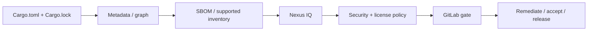

# P9 conclusions: Nexus IQ and dependency-risk competency

## Synthesis

The SCA workflow starts with **component identification**, not with a policy gate. Cargo supplies dependency information; a supported generator or integration converts it into a recognizable inventory; Nexus IQ enriches the inventory with intelligence and evaluates policy; GitLab enforces the result according to enterprise rules. A green status is meaningful only if the inventory is sufficiently complete and the right policy stage was evaluated.

## Concepts that must not be conflated

| Concept A | Concept B | Difference |
|---|---|---|
| SBOM | SCA evaluation | Inventory versus risk interpretation |
| Direct crate | Transitive crate | Declared versus inherited dependency |
| Vulnerability match | Exploitability | Known affected version versus actual reachable risk |
| Policy warning | Blocking violation | Advisory versus delivery enforcement |
| Waiver | Remediation | Accepted exception versus risk removal |
| SonarQube | Nexus IQ | Source analysis versus component intelligence |
| Cargo.lock | Released binary | Resolved package set versus shipped output |

## L1 — Understand

- [ ] Define SCA, component identity, transitive dependency and SBOM.
- [ ] Explain why a successful Rust build does not prove dependency safety.
- [ ] Distinguish policy stages from vulnerability severity.
- [ ] Explain why a clean report can still be incomplete.
- [ ] Describe where IQ runs and where its evaluation client runs.

## L2 — Modify

- [ ] Review a Cargo dependency graph for target-specific packages.
- [ ] Choose a supported inventory format for the installed IQ version.
- [ ] Design an artifact handoff from SBOM generation to evaluation.
- [ ] Identify the GitLab variables needed for endpoint and credentials.
- [ ] Define how warnings, blocks and outages affect the pipeline.

## L3 — Troubleshoot

- [ ] Separate authentication errors from policy violations.
- [ ] Investigate a low component count in the generated SBOM.
- [ ] Explain a new advisory without a source-code change.
- [ ] Identify a Windows service account PATH or TLS issue.
- [ ] Determine whether a waiver has appropriate scope and expiry.

## Tabletop case: 180 resolved crates, 12 evaluated components

A CI job reports a green IQ result for a Rust service. The Cargo metadata graph contains 180 packages, but the evaluation lists 12 components. This is not enough evidence to approve release. Investigate whether the inventory generator omitted transitive dependencies, selected the wrong workspace package or target, or produced unsupported coordinates. Compare the generated SBOM to the graph, confirm ingestion support and rerun evaluation before relying on the gate.

## Enterprise decision record

For each production integration, document: application identity; repository and release boundary; Cargo target and feature selection; SBOM generation tool and version; IQ product version and supported ingestion method; policy stage; token owner; Windows runner identity; CI exit-code behavior; report retention; and exception workflow.

## What follows

P10 Fortify addresses a different security-analysis family. P11 combines Cargo, Windows runners, SonarQube, Nexus IQ and Fortify into a single enterprise pipeline. P12 uses these boundaries to diagnose failures without confusing a policy rejection with a network outage.

**Final principle:** Inventory completeness and enforcement semantics are prerequisites for a trustworthy SCA gate.
