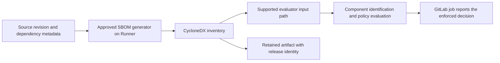

# CycloneDX and software bills of materials

## What an SBOM describes

A **software bill of materials**, or **SBOM**, is a structured inventory of software components and their relationships for a defined software product. It helps answer which dependencies a release contains, where they came from, and which other components depend on them. A security team can use that inventory when a new advisory appears. A compliance team can review declared licenses, and a release team can retain dependency evidence alongside the delivered artifact.

The inventory needs a clear boundary. An SBOM generated from source dependency metadata describes what that generator could identify in that project. A build-specific or binary-derived inventory may describe a different set of components. Record how the document was produced and which release, commit, platform and build configuration it represents. Native libraries, build tools, downloaded assets and runtime services can require additional discovery beyond the package manager's dependency graph.

| Term | Meaning and responsibility |
|---|---|
| Component | A software item, such as a Rust crate, with identifying metadata. |
| Direct dependency | A component requested by the application or package itself. |
| Transitive dependency | A component reached through another dependency. |
| Dependency relationship | An edge describing how one component depends on another. |
| Generator | A tool that inspects available evidence and produces the inventory. |
| SCA evaluator | A software composition analysis tool that identifies components and applies vulnerability or license intelligence and policy. |
| Policy gate | The enterprise decision about whether the evaluated result may proceed. |

An SBOM provides inventory evidence. Its usefulness depends on scope, accurate identities and relationships, and association with a specific artifact. Vulnerability intelligence and policy can change after the document was generated. Preserve the original inventory so later evaluations can be associated with the same release. [CycloneDX specification overview](https://cyclonedx.org/specification/overview/)

## What CycloneDX adds

**CycloneDX** is an OWASP standard for representing and exchanging bills of materials and related supply-chain information. An SBOM is a document with a particular purpose, while CycloneDX supplies an interoperable model and serialization for that document. Other standards, including SPDX, also represent software inventory. A pipeline must choose a format and specification version supported by its producer and consumers.

CycloneDX can describe components, services, dependency relationships, document metadata and other information. This guide focuses on its software inventory use. A filename such as `bom.json` does not establish its format. Inspect `bomFormat` and `specVersion`, then validate the document against the corresponding schema. Acceptance by a schema establishes document structure, while a separate coverage review establishes whether the inventory describes the intended product. [CycloneDX specification and object model](https://cyclonedx.org/specification/overview/)

## Read a small CycloneDX document

The following JSON is illustrative and unexecuted. It uses CycloneDX 1.5 to demonstrate a deliberately selected version. In an enterprise integration, confirm the versions supported by the chosen generator and evaluator. The package names are synthetic.

```json
{
  "bomFormat": "CycloneDX",
  "specVersion": "1.5",
  "version": 1,
  "metadata": {
    "component": {
      "type": "application",
      "bom-ref": "ledger-gateway",
      "name": "ledger-gateway",
      "version": "0.1.0"
    }
  },
  "components": [
    {
      "type": "library",
      "bom-ref": "routing-lib-1.2.3",
      "name": "routing-lib",
      "version": "1.2.3",
      "purl": "pkg:cargo/routing-lib@1.2.3"
    }
  ],
  "dependencies": [
    {
      "ref": "ledger-gateway",
      "dependsOn": ["routing-lib-1.2.3"]
    },
    {
      "ref": "routing-lib-1.2.3",
      "dependsOn": []
    }
  ]
}
```

`version` is the revision of this BOM document. It is separate from both the CycloneDX specification version and the application's version. `metadata.component` identifies the subject of the inventory. `components` describes the library, while `dependencies` links it to the application. Each `bom-ref` is a document-local identifier that other entries can reference. The **package URL**, or **purl**, expresses an ecosystem-qualified package identity useful for component matching. Real documents can add suppliers, hashes, licenses and generator metadata when supported by their evidence and schema. [CycloneDX 1.5 JSON reference](https://cyclonedx.org/docs/1.5/json/)

## Rust and Cargo inputs

`Cargo.toml` describes dependency requirements and features. `Cargo.lock` records a resolved graph of package versions and sources. An SBOM generator translates available package evidence into an exchange format and can add relationships and metadata. The resulting inventory depends on the generator's package selection, feature and target behavior. A lockfile can include packages that a particular build does not compile, so document whether the inventory covers the workspace, a selected package or a particular build configuration.

The CycloneDX Rust project provides `cargo-cyclonedx`, a Cargo subcommand for generating CycloneDX BOMs. Its official repository documents installation, output and selection options. For a future pipeline, pin the approved generator version and review its supported flags and schema versions. Capture the invocation and the configuration it represents with the artifact. This guide does not assume a particular installed CLI version. [CycloneDX Rust generator](https://github.com/CycloneDX/cyclonedx-rust-cargo), [Cargo dependency resolution](https://doc.rust-lang.org/cargo/reference/resolver.html)

For a Maven developer, compare this process with generating inventory from a resolved Maven dependency graph. A POM or Cargo manifest expresses intent. The resolved graph and generator behavior determine the inventory available to the evaluator. Build-only and platform-specific dependencies need explicit treatment in either ecosystem.

## Where the SBOM fits in GitLab and Nexus IQ



Generation, evaluation and enforcement are separate operations. The generator writes the inventory. An evaluator accepts a supported input, identifies components and evaluates policy. The CI integration interprets completion and policy outcomes according to the release contract. A successful generation step proves only that a file was produced. A successful upload requires separate evidence of processing and the policy decision.

Sonatype documents Rust application analysis through coordinate-based matching of dependencies in `Cargo.lock`. Before substituting a CycloneDX SBOM for that input, verify that the deployed Lifecycle/IQ version and integration support the document version, ecosystem and required policy behavior. The screenshot's label “SBOM scan” should therefore be read as an architectural intent whose exact input contract must be established. [Sonatype Rust application analysis](https://help.sonatype.com/en/rust-application-analysis.html)

An SBOM also serves a different purpose from Fortify source analysis and SonarQube quality analysis. Component identity can support dependency policy, while source and quality tools inspect different evidence. Preserve the relevant report identities and link each result to the same release revision. See the [enterprise tool comparison](README.md).

## Diagnose common failures

| Observation | Investigation |
|---|---|
| The evaluator rejects the JSON | Check format, specification version and supported ingestion path. A JSON syntax check alone cannot establish compatibility. |
| The evaluation finds few components | Compare the document's package identities and coverage with the expected resolved graph. Review unsupported ecosystems or incomplete evidence. |
| A dependency seems missing | Check selected workspace package, feature, target and dependency scope, then inspect the generator's documented behavior. |
| The document belongs to another commit | Trace the producer job and artifact transfer. Regenerate inventory for the intended revision and retain the producer identity. |
| A clean inventory job is followed by a blocked release | Inspect evaluation completion and the actual policy verdict. Generation success does not establish approval. |

## Synthesis and knowledge checks

The useful chain is **defined scope → identified components → explicit relationships → supported evaluation → traceable decision**. Associate the SBOM with the release artifact, retain the generation context and use an evaluator whose input contract is known. Inventory completeness and policy results require different evidence.

1. Why can two SBOMs from the same repository differ? Compare package selection, features, targets, discovery method and generator version.
2. What does `bom-ref` identify? It identifies an object within the document so dependency relationships can refer to it.
3. Does `bom.json` establish compatibility with Nexus IQ? Inspect its actual format and version and confirm the deployed integration's supported ingestion path.
4. What should accompany an archived SBOM? The producing commit and job identity, generator version and invocation, intended scope and association with the release artifact.

Continue with [Cargo resolution](../../labs/p2-1-read-cargo-manifests-and-lockfile.md) and [artifact provenance](../../labs/p5-2-trace-artifacts-and-dependency-edges.md) to review the inputs and handoff.
