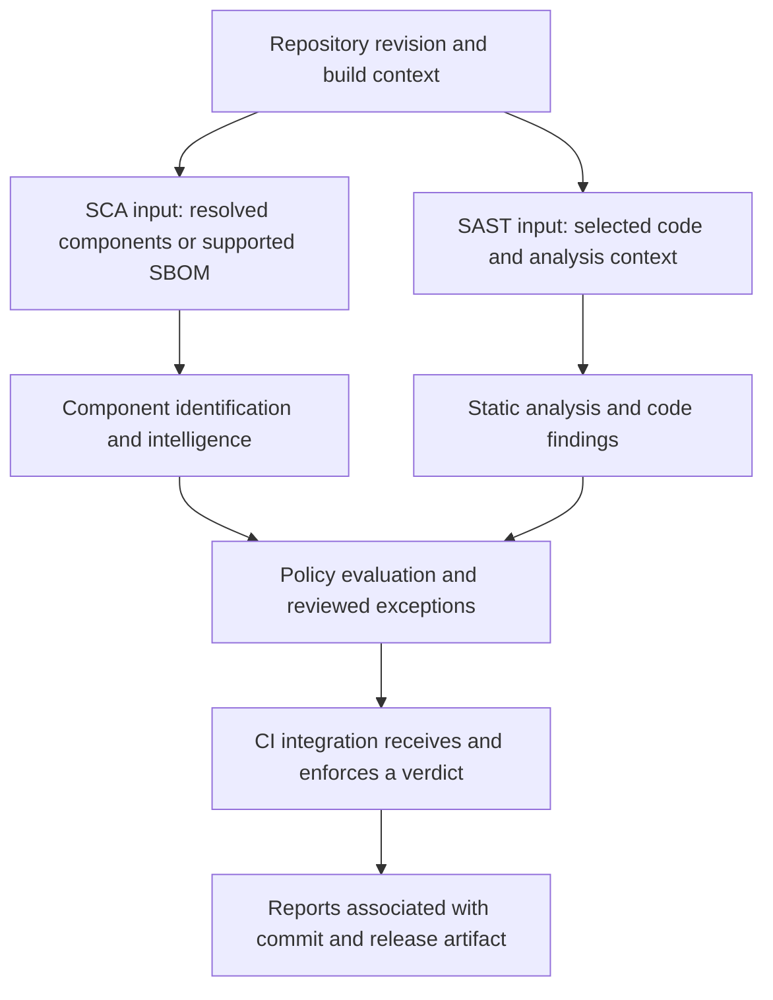

# SCA and SAST

## Definitions and purpose

**Software Composition Analysis (SCA)** identifies software components and evaluates risks associated with those components. A typical application depends on libraries maintained by other teams or external projects. SCA helps establish which versions are present and associates those identities with vulnerability intelligence, licensing information and enterprise policy. Its scope depends on the product, ecosystem and input method. A dependency inventory, including an SBOM, is an important input to this process. [OWASP component analysis](https://owasp.org/www-community/Component_Analysis)

**Static Application Security Testing (SAST)** analyzes source code or supported intermediate or compiled representations to identify potential security weaknesses. It reasons about code without exercising the application through requests in a running deployment. Depending on the engine and language, analysis can use syntax, control flow, data flow and models of security-sensitive APIs. Findings typically identify code locations and sometimes a path connecting an input to a dangerous operation. [OWASP source code analysis](https://owasp.org/www-community/Source_Code_Analysis_Tools)

Both contribute evidence to a security decision. They examine different aspects of an application, so their results can differ for legitimate reasons. An application can use approved dependency versions while still constructing an unsafe query. It can also use carefully written application code while depending on a library version with a published advisory.

| Aspect | SCA | SAST |
|---|---|---|
| Main subject | Components and their identities or relationships | Code and its modeled behavior |
| Typical inputs | Lockfiles, manifests, supported binaries or SBOMs | Source files, build information or supported compiled representations |
| Example finding | A resolved component version matches a known advisory | Untrusted input may reach a filesystem or database operation unsafely |
| Typical response | Upgrade, replace or remove the component, or justify an exception | Change the implementation or prove that the reported path is infeasible |
| Important limitation | Incomplete inventory or matching limits conclusions | Unsupported language features or incomplete code models limit conclusions |

## How SCA works internally

The first stage discovers components from the selected input. A lockfile can provide exact package names and versions, while binary inspection or an SBOM can provide other evidence. The evaluator maps those observations to component identities. That matching step matters because a report containing very few identified components may reflect incomplete coverage.

Next, the evaluator associates identified components with available intelligence and applies policy. A vulnerability severity is one input to a risk decision. An enterprise may also consider exploitability, deployment exposure, dependency usage, license obligations and approved exceptions. Reachability analysis, where supported, can provide additional evidence about whether affected functionality is used. Check the actual product and ecosystem capability before relying on it.

For Rust, distinguish the dependency requirement in `Cargo.toml` from the resolved package identity in `Cargo.lock`. In Java, the comparable review begins with the resolved Maven graph, including transitive dependencies. A declaration alone may leave the final selected version unclear. Sonatype documents Cargo coordinate matching from package names and versions in `Cargo.lock`. Confirm the deployed integration's accepted inputs and coverage before substituting an SBOM or another report. [Sonatype Rust application analysis](https://help.sonatype.com/en/rust-application-analysis.html)

## How SAST works internally

An analyzer first identifies the source and configuration within its scan scope. Some engines require build capture or a translation phase to understand language constructs, imports and dependencies. Others consume source directly. The required workflow is specific to the scanner and language.

A data-flow analysis can model a **source** of untrusted data, a **sink** such as a sensitive API, and the transformations between them. A sanitizer or validation step can change whether a path is considered dangerous. Control-flow analysis examines possible execution paths. Other rules may identify an insecure API call or configuration pattern without constructing a full data-flow path.

A reported path still requires review against the actual code and runtime contract. A false positive reports a problem that the evidence does not establish in the application's context. A false negative is a real weakness the analysis misses. Coverage, supported frameworks, build settings and rule configuration affect both. Record why a finding is confirmed, dismissed or accepted, and keep that decision with the relevant code revision. [OWASP SAST capabilities and limitations](https://owasp.org/www-community/Source_Code_Analysis_Tools)

Rust's ownership and borrowing checks address important memory-safety properties, while application security also depends on authorization, input handling, cryptographic choices and unsafe or foreign code boundaries. A successful Rust compilation therefore supplies only part of the assurance needed for an enterprise release.

## Architecture and responsibility boundaries

The runner launches the approved client. Analysis may occur locally or in a remote service, depending on the product and deployment. A reporting platform can store findings and review decisions separately from the execution engine. The policy owner defines thresholds and exceptions, and the pipeline configuration determines how completion and failure affect release eligibility.

In this project, Nexus IQ or Sonatype Lifecycle supplies dependency-policy evaluation, while Fortify supplies source-security analysis through an approved scan mode. OpenText SAST 26.1 specifically documents Rust through AI-powered SAST and describes regular-expression analysis when that mode is unavailable. Verify the installed mode, entitlement and approved source-processing boundary before interpreting a Rust report. [OpenText SAST 26.1 guide, section 1.18](https://cabs.microfocus.com/documentation/fortify-static-code-analyzer-and-tools/2610/sast-ugd-26.1.0.pdf)

SonarQube can supply quality and security-related findings within its supported analyzers and editions. Compare the actual Rust capabilities, analysis scope and gate contract for the installed version. Product names alone do not establish equivalent coverage. See the [tool support references](README.md).

## Apply the model in an enterprise pipeline

All records in this section are illustrative and unexecuted. They describe outcomes without assuming a vendor-specific command or report schema.

| Event | Evidence | Interpretation |
|---|---|---|
| Dependency evaluation completes and blocks | Application, commit, component identity and violated policy are recorded | Review the dependency and policy decision. Repeating the same evaluation may return the same block. |
| Source upload completes but scan processing fails | Submission ID exists, but no completed analysis is available | The source reached the service. Investigate processing before treating the scan as complete. |
| Analyzer finishes with zero findings | Scan scope and analyzed files are recorded | Review whether the intended code was analyzed and whether the engine supports it. |
| A client cannot validate the service certificate | TLS error occurs before a submission or evaluation ID exists | Investigate client trust, proxy and endpoint configuration. There is no policy verdict to interpret yet. |

A GitLab job should distinguish an operational error, a completed evaluation that passes, and a completed evaluation that blocks. Use the approved tool's documented exit codes and result API. Define what happens when evidence is missing or the service times out. Keep job credentials scoped to the application and operation, and avoid exposing sensitive reports, source or tokens in unrestricted artifacts.

For every result, retain the source commit, producer job, scan scope, scanner version and report or task identity. For SCA, preserve the resolved inventory and matching evidence. For SAST, preserve the source-selection and analysis-mode evidence. Link the security verdict to the artifact the pipeline intends to release. [GitLab artifact provenance exercise](../../labs/p5-2-trace-artifacts-and-dependency-edges.md)

## SBOMs, findings and exceptions

A CycloneDX SBOM can communicate an inventory to a compatible evaluator. The generator, ingestion path and component matching must all support the intended ecosystem and document version. A generated inventory alone establishes neither a completed evaluation nor policy approval. See [CycloneDX and SBOM](cyclonedx-and-sbom.md).

An exception records a deliberate decision about a particular finding or policy violation. It needs an owner, scope, rationale and review or expiry conditions under enterprise policy. Broadly suppressing a rule or disabling an entire scan changes coverage. Compare that impact before approving such a change.

## Synthesis and knowledge checks

Component identity drives SCA conclusions, while code scope and analysis models drive SAST conclusions. Both need a separate record of processing completion, policy interpretation and release enforcement. Diagnosing the correct stage avoids confusing missing evidence with an approved result.

1. A new advisory appears for a transitive dependency after release. Which evidence helps locate affected artifacts? The retained resolved inventory, component version and association between SBOM, commit and release.
2. A source scanner reports a potentially unsafe path. What should the reviewer inspect? The reported input, transformations, sink, scan context and actual application constraints.
3. A pipeline uploads a report successfully. What remains to be established? Processing completion, expected scope and the applicable policy decision.
4. Both scans show no blocking findings. What additional assurance is still relevant? Coverage review, testing, architecture and access-control review, deployment configuration and the enterprise's other release requirements.
