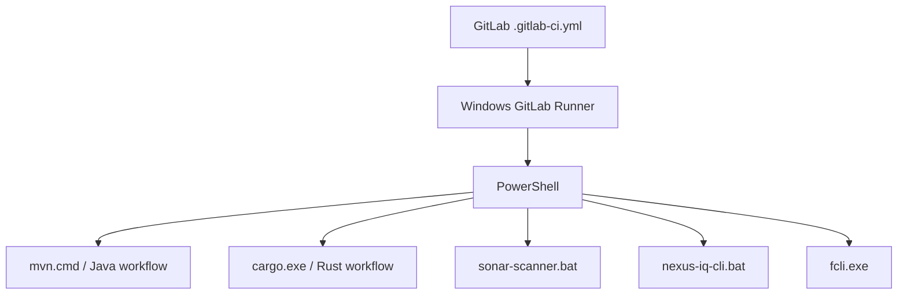

# Common Maven vs Rust Baseline & Reusable Repository Organization

> Shared reference for the SonarQube, Nexus IQ, and Fortify integration studies. Covers Windows GitLab Runner execution, Java/Maven vs Rust/Cargo, repository layout, and PowerShell fundamentals.

## Common Maven vs Rust baseline

| Concept | Java / Maven | Rust / Cargo |
|---|---|---|
| Main executable on Windows | `mvn.cmd` | `cargo.exe` |
| Compiler | `javac` | `rustc` |
| Descriptor | `pom.xml` | `Cargo.toml` |
| Dependency locking | No standard `Cargo.lock` equivalent; version management is usually in POMs/BOMs | `Cargo.lock` |
| Dependency sources | Maven Central / enterprise Nexus | crates.io / enterprise registry mirror |
| Build | `mvn package` | `cargo build --locked` |
| Test | `mvn test` | `cargo test --locked` |
| Extension model | Maven plugins and lifecycle goals | Cargo subcommands as separate executables |
| Typical build output | `target/` | `target/` |

Maven defines a configurable lifecycle (`validate → compile → test → package → verify → install → deploy`). Cargo has commands such as `build`, `test` and external subcommands rather than a directly equivalent Maven lifecycle. GitLab itself does not run either language: the Windows Shell runner starts **PowerShell**, which starts `mvn.cmd`, `cargo.exe`, scanner `.bat` launchers or `fcli.exe`.



## Reusable repository organization

```text
rust-project/
├── .gitlab-ci.yml
├── Cargo.toml
├── Cargo.lock
├── src/
├── ci/
│   ├── scripts/
│   │   ├── common.ps1
│   │   ├── build.ps1
│   │   ├── test.ps1
│   │   ├── sonar.ps1
│   │   ├── nexus-iq.ps1
│   │   └── fortify.ps1
│   └── README.md
└── docs/
```

The YAML declares **when and where** a job runs; the version-controlled `.ps1` file declares **how**. The `sonar.ps1`, `nexus-iq.ps1`, and `fortify.ps1` examples below are intentionally independent, so you can add jobs one at a time.

### PowerShell for CI/CD

For the unchanged PowerShell syntax reference table and practical, step-by-step examples, see [PowerShell CI/CD learning guide](00-powershell-ci-cd-learning-guide.md).

A CI runner must have access to the tool executable and relevant service endpoints; a `.ps1` in the repository does **not** install an executable on the Windows host. Prefer exact tool paths or controlled PATH configuration, avoid putting credentials directly into source files, and test CI jobs with the runner's actual account.
