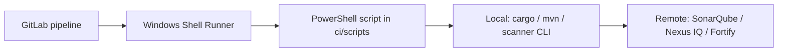

# PowerShell CI/CD Learning Guide — Windows GitLab Runner

> Companion to [Common Maven vs Rust baseline and repository organization](00-common-maven-vs-rust-and-repository-organization.md). Learn the PowerShell syntax needed to orchestrate Rust/Cargo and Java/Maven builds, then integrate SonarQube, Nexus IQ and Fortify. The reference table below is **copied unchanged** from the common guide.

## 1. Execution model: GitLab → PowerShell → tool → service



The Windows GitLab Runner's **Shell executor** executes job script commands under the runner's Windows account. PowerShell is the orchestration language; it launches locally installed tools. A scanner executable is usually **local**, while its central policy, analysis or reporting server is **remote**. A repository `.ps1` file does not install those executables.

## 2. PowerShell syntax to know (unchanged reference table)

| Syntax | Meaning in CI |
|---|---|
| `& "C:\Tools\...\tool.bat"` | Call executable/launcher at a path containing spaces or special characters |
| `$env:NAME` | Read an environment variable, including GitLab CI variables |
| `` ` `` at end of line | PowerShell command continuation; no trailing spaces allowed |
| `$LASTEXITCODE` | Exit code from the most recent native executable (e.g. Cargo, `.bat`, `fcli`) |
| `if ($LASTEXITCODE -ne 0) { throw ... }` | Convert native tool failures into a failed CI job |
| `$ErrorActionPreference = "Stop"` | Promote many PowerShell cmdlet errors to terminating errors; does **not** replace native exit-code checks |
| `Join-Path`, `Test-Path` | Construct and check paths safely |
| `try { ... } finally { ... }` | Perform cleanup even when a scan or command fails |


## 3. Learn each syntax item

### 3.1 `& "C:\Tools\...\tool.bat"` — call an executable

`&` is PowerShell's **call operator**. Use it when the executable path is stored in a variable or quoted (especially when paths contain spaces). Quoting a path alone produces a string rather than running it.

```powershell
$scanner = 'C:\Program Files\SonarScanner\bin\sonar-scanner.bat'
& $scanner '-Dsonar.projectKey=rust-demo'
if ($LASTEXITCODE -ne 0) { throw 'SonarScanner failed' }
```

You can also call `cargo.exe`, `mvn.cmd`, `nexus-iq-cli.bat` or `fcli.exe` the same way. Pass arguments as separate quoted values when needed. A `.bat`/`.cmd` is a Windows command launcher, not a PowerShell script; PowerShell can still invoke it with `&`.

### 3.2 `$env:NAME` — read GitLab CI variables

GitLab project/group CI/CD variables arrive as **environment variables** in the job's process. `$env:NAME` reads them; do not hardcode tokens or passwords in `.ps1` files.

```powershell
$server = $env:SONAR_HOST_URL
$token  = $env:SONAR_TOKEN
if ([string]::IsNullOrWhiteSpace($server) -or
    [string]::IsNullOrWhiteSpace($token)) {
    throw 'Required SonarQube environment variables are missing'
}
```

For Nexus IQ and Fortify, use their respective variables, for example `$env:NEXUS_IQ_URL` and `$env:FORTIFY_SSC_URL`. Mark secret variables **masked** and scope/protect them appropriately in GitLab. Masking is not a substitute for controlling what commands log.

### 3.3 Backtick at end of line — continue a command

A trailing backtick tells PowerShell the command continues on the next line. **It must be the last character**: spaces after it can break continuation. For complex CI scripts, argument arrays are often safer.

```powershell
& 'C:\Tools\sonar-scanner\bin\sonar-scanner.bat' `
  '-Dsonar.projectKey=rust-demo' `
  '-Dsonar.sources=src'
```

A more maintainable alternative when arguments are assembled conditionally:

```powershell
$args = @('-Dsonar.projectKey=rust-demo', '-Dsonar.sources=src')
& 'C:\Tools\sonar-scanner\bin\sonar-scanner.bat' @args
```

### 3.4 `$LASTEXITCODE` — read native process status

Native executables typically report status using an **integer process exit code**: `0` means success by convention, nonzero usually means failure. Check it **immediately after each native command**, before another native process overwrites it.

```powershell
cargo build --locked
$buildExitCode = $LASTEXITCODE
if ($buildExitCode -ne 0) { throw "Cargo build failed: $buildExitCode" }

cargo test --locked
if ($LASTEXITCODE -ne 0) { throw 'Cargo tests failed' }
```

`$LASTEXITCODE` is not a general error-state variable for PowerShell cmdlets such as `Test-Path` or `Copy-Item`.

### 3.5 `if ($LASTEXITCODE -ne 0) { throw ... }` — fail the CI job

GitLab must receive a failure when a required scan or build fails. A PowerShell `throw` terminates the script and signals job failure. Otherwise, an unsuccessful tool might be followed by successful commands and the job could appear green.

```powershell
& 'C:\Tools\nexus-iq\bin\nexus-iq-cli.bat' --help
if ($LASTEXITCODE -ne 0) {
    throw "Nexus IQ CLI failed with exit code $LASTEXITCODE"
}
```

The `--help` call only tests invocation; actual Nexus IQ policy evaluation requires a configured application, credentials and an SBOM or other supported input. A successful scan submission is **not** the same as a completed, passing policy gate.

### 3.6 `$ErrorActionPreference = "Stop"` — PowerShell cmdlet failures

This setting promotes many **non-terminating PowerShell errors** into terminating errors. It is particularly useful for filesystem and configuration operations. It does not uniformly enforce native `.exe`/`.bat` return codes, especially across PowerShell versions: keep explicit `$LASTEXITCODE` checks.

```powershell
$ErrorActionPreference = 'Stop'
New-Item -ItemType Directory -Path '.\out' -Force | Out-Null
Copy-Item '.\Cargo.lock' '.\out\Cargo.lock'

cargo test --locked
if ($LASTEXITCODE -ne 0) { throw 'cargo test failed' }
```

In PowerShell 7, native error-handling behavior can also depend on `$PSNativeCommandUseErrorActionPreference`; explicit checks make examples portable across Windows PowerShell 5.1 and PowerShell 7.

### 3.7 `Join-Path`, `Test-Path` — reliable paths

CI jobs execute within a checkout directory, exposed by GitLab as `$env:CI_PROJECT_DIR`. Use `Join-Path` to assemble paths and `Test-Path` to validate prerequisites instead of assuming the shell's current directory.

```powershell
$project = $env:CI_PROJECT_DIR
$scriptPath = Join-Path $project 'ci\scripts\nexus-iq.ps1'
$manifest = Join-Path $project 'Cargo.toml'
if (-not (Test-Path $manifest)) { throw "Missing manifest: $manifest" }
if (-not (Test-Path $scriptPath)) { throw "Missing script: $scriptPath" }
```

For a CycloneDX output, test the **actual generated path**: workspace layouts and tool options can affect the SBOM filename and location.

### 3.8 `try { ... } finally { ... }` — cleanup, including failures

Use `finally` for session logout and removal of temporary scan files. It runs after the `try` block whether the operations succeed or throw. Avoid allowing a cleanup error to hide the original scan failure.

```powershell
$ErrorActionPreference = 'Stop'
$fcli = 'C:\Tools\fortify\fcli\fcli.exe'
try {
    & $fcli ssc session login --url=$env:FORTIFY_SSC_URL --token=$env:FORTIFY_SSC_TOKEN
    if ($LASTEXITCODE -ne 0) { throw 'Fortify login failed' }

    # Invoke the approved, version-compatible Fortify scanning workflow here.
}
finally {
    & $fcli ssc session logout
    if ($LASTEXITCODE -ne 0) { Write-Warning 'Fortify logout reported an error' }
}
```

Fortify Rust analysis depends on **your platform version and licensed scanning mode**. This example illustrates PowerShell cleanup, not a complete scan or quality gate.

## 4. Put scripts into the repository

```text
rust-project/
├── .gitlab-ci.yml
├── Cargo.toml
├── Cargo.lock
└── ci/
    ├── README.md
    └── scripts/
        ├── common.ps1
        ├── build.ps1
        ├── test.ps1
        ├── sonar.ps1
        ├── nexus-iq.ps1
        └── fortify.ps1
```

Use `common.ps1` for reusable helpers. One pattern is **dot-sourcing**: `. "$PSScriptRoot\common.ps1"`, which loads helper functions into the current scope. `$PSScriptRoot` resolves the current script's folder.

```powershell
# ci/scripts/common.ps1
function Assert-NativeSuccess {
    param([string]$Step, [int]$ExitCode)
    if ($ExitCode -ne 0) { throw "$Step failed (exit $ExitCode)" }
}
```

```powershell
# ci/scripts/build.ps1
$ErrorActionPreference = 'Stop'
. "$PSScriptRoot\common.ps1"
cargo build --locked
Assert-NativeSuccess -Step 'Cargo build' -ExitCode $LASTEXITCODE
```

```yaml
# .gitlab-ci.yml (fragment; requires existing stages and Windows runner tag)
cargo_build:
  stage: build
  tags: [windows, rust]
  script:
    - '& .\ci\scripts\build.ps1'

sonar_scan:
  stage: security
  tags: [windows, rust]
  script:
    - '& .\ci\scripts\sonar.ps1'

nexus_iq_scan:
  stage: security
  tags: [windows, rust]
  script:
    - '& .\ci\scripts\nexus-iq.ps1'

fortify_scan:
  stage: security
  tags: [windows, rust]
  script:
    - '& .\ci\scripts\fortify.ps1'
```

Make sure the `.gitlab-ci.yml` stage list contains `build` and `security`. The jobs above are orchestration examples; their scanner scripts need the real installation paths, permissions, authentication and failure-policy logic described in each integration study.

## 5. Practical exercise: from local PowerShell to GitLab job

1. Run `& .\ci\scripts\build.ps1` in a **PowerShell session** locally; correct path or tool-installation errors.
2. Add a deliberate invalid Cargo option and verify the script **fails nonzero**, rather than continuing silently.
3. Define a non-secret test variable and inspect it with `$env:NAME`; configure real scanner credentials in GitLab CI/CD variables.
4. Execute through the GitLab **Windows Shell runner** and confirm the runner account can access `cargo.exe` and the repository files.
5. Repeat for SonarQube, Nexus IQ, then Fortify; verify the **remote report** and finally a deliberate policy-gate failure.

**Exit criterion:** You can explain the difference between a PowerShell script, a local CLI/launcher (`cargo.exe`, `mvn.cmd`, `sonar-scanner.bat`, `fcli.exe`), and a remote scanner service—and you can trace a failed native tool's exit code all the way to a failed GitLab job.
