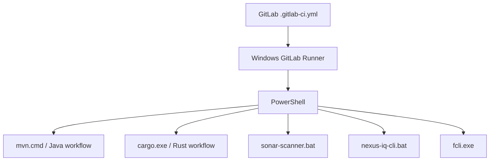
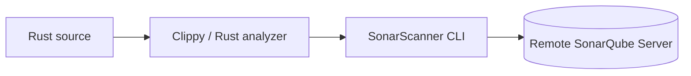

# SonarQube in a Windows Rust GitLab Pipeline — Maven vs Cargo

> Scope: Windows GitLab Runner with PowerShell shell executor. This study consolidates only the concepts, diagrams, comparison tables, and command examples discussed on 22 November 2026; it is not copied from earlier generated files.

## Common Maven vs Rust baseline

| Concept | Java / Maven | Rust / Cargo |
|---|---|---|
| Main executable on Windows | `mvn.cmd` | `cargo.exe` |
| Compiler | `javac` | `rustc` |
| Descriptor | `pom.xml` | `Cargo.toml` |
| Dependency locking | No standard `Cargo.lock` equivalent; version management is usually in POMs/BOMs | `Cargo.lock` |
| Dependency sources | Maven Central / enterprise Nexus | crates.io / enterprise registry mirror |
| Build | `mvn package` | `cargo build --locked` |
| Test | `mvn test` | `cargo test --locked` |
| Extension model | Maven plugins and lifecycle goals | Cargo subcommands as separate executables |
| Typical build output | `target/` | `target/` |

Maven defines a configurable lifecycle (`validate → compile → test → package → verify → install → deploy`). Cargo has commands such as `build`, `test` and external subcommands rather than a directly equivalent Maven lifecycle. GitLab itself does not run either language: the Windows Shell runner starts **PowerShell**, which starts `mvn.cmd`, `cargo.exe`, scanner `.bat` launchers or `fcli.exe`.



## Reusable repository organization

```text
rust-project/
├── .gitlab-ci.yml
├── Cargo.toml
├── Cargo.lock
├── src/
├── ci/
│   ├── scripts/
│   │   ├── common.ps1
│   │   ├── build.ps1
│   │   ├── test.ps1
│   │   ├── sonar.ps1
│   │   ├── nexus-iq.ps1
│   │   └── fortify.ps1
│   └── README.md
└── docs/
```

The YAML declares **when and where** a job runs; the version-controlled `.ps1` file declares **how**. The `sonar.ps1`, `nexus-iq.ps1`, and `fortify.ps1` examples below are intentionally independent, so you can add jobs one at a time.

### PowerShell syntax to know

| Syntax | Meaning in CI |
|---|---|
| `& "C:\Tools\...\tool.bat"` | Call executable/launcher at a path containing spaces or special characters |
| `$env:NAME` | Read an environment variable, including GitLab CI variables |
| `` ` `` at end of line | PowerShell command continuation; no trailing spaces allowed |
| `$LASTEXITCODE` | Exit code from the most recent native executable (e.g. Cargo, `.bat`, `fcli`) |
| `if ($LASTEXITCODE -ne 0) { throw ... }` | Convert native tool failures into a failed CI job |
| `$ErrorActionPreference = "Stop"` | Promote many PowerShell cmdlet errors to terminating errors; does **not** replace native exit-code checks |
| `Join-Path`, `Test-Path` | Construct and check paths safely |
| `try { ... } finally { ... }` | Perform cleanup even when a scan or command fails |

A CI runner must have access to the tool executable and relevant service endpoints; a `.ps1` in the repository does **not** install an executable on the Windows host. Prefer exact tool paths or controlled PATH configuration, avoid putting credentials directly into source files, and test CI jobs with the runner's actual account.


## 1. Purpose and the CycloneDX analogy

SonarQube focuses on code quality and static analysis. In the previous discussion, **Clippy** was the closest *Rust-specific conceptual analogue* to `cargo-cyclonedx`, but these tools do **not** do the same work: `cargo-cyclonedx` generates a dependency inventory (SBOM); Clippy performs Rust lint/static checks. For supported SonarQube editions/versions, its Rust analyzer can use Clippy automatically, so a separate report-generation step may be unnecessary.

| Question | Maven / Java | Rust / Cargo |
|---|---|---|
| What triggers SonarQube? | Maven scanner plugin such as `mvn sonar:sonar` | Standalone SonarScanner CLI, often `sonar-scanner.bat` on Windows |
| What prepares code findings? | Java compiler/project context plus Sonar analyzers | Rust analyzer; optionally Clippy findings |
| Is Clippy the same as CycloneDX? | N/A | No—Clippy analyzes code; CycloneDX describes dependencies |
| Where is the analysis/reporting service? | Remote SonarQube Server | Remote SonarQube Server |
| What runs on Windows? | `mvn.cmd` and Maven plugin | `cargo.exe`, potentially Clippy, and SonarScanner CLI |



This is a **conceptual** flow: depending on server/scanner version, SonarScanner can invoke Clippy rather than reading a separately generated Clippy report. Unlike Nexus IQ's SBOM flow, a universal intermediary file is not required.

## 2. Local vs remote boundaries

| Location | Component | Function |
|---|---|---|
| Git repository | `.gitlab-ci.yml`, `ci/scripts/sonar.ps1`, optional `sonar-project.properties` | Job orchestration and project configuration |
| Windows runner | PowerShell, Rust toolchain, SonarScanner CLI (`sonar-scanner.bat`) | Launch local scanner, read source and contact server |
| Windows runner (possible) | Clippy / `cargo clippy` | Rust lint analysis; automatic or separately invoked depending on setup |
| Remote | SonarQube Server | Analysis results, issues and quality gates |

## 3. Maven commands versus Rust commands

**Java / Maven scanner plugin:**

```powershell
mvn clean verify
mvn sonar:sonar
```

**Rust scanner launcher on Windows:**

```powershell
& "C:\Tools\sonar-scanner\bin\sonar-scanner.bat" `
  "-Dsonar.projectKey=rust-demo" `
  "-Dsonar.sources=src" `
  "-Dsonar.host.url=$env:SONAR_HOST_URL" `
  "-Dsonar.token=$env:SONAR_TOKEN"
```

Here, `sonar-scanner.bat` is a Windows **launcher**, not a Maven goal or Cargo extension. The `&` operator is necessary to invoke an executable whose path is stored in a string. `mvn sonar:sonar` executes the SonarScanner for Maven plugin, whereas Rust commonly uses a standalone CLI.

## 4. Separate `ci/scripts/sonar.ps1`

```powershell
$ErrorActionPreference = "Stop"

$scanner = "C:\Tools\sonar-scanner\bin\sonar-scanner.bat"
if (-not (Test-Path $scanner)) { throw "SonarScanner missing: $scanner" }
if (-not $env:SONAR_HOST_URL -or -not $env:SONAR_TOKEN) {
  throw "Missing SONAR_HOST_URL or SONAR_TOKEN GitLab variable"
}

& $scanner `
  "-Dsonar.projectKey=rust-demo" `
  "-Dsonar.sources=src" `
  "-Dsonar.host.url=$env:SONAR_HOST_URL" `
  "-Dsonar.token=$env:SONAR_TOKEN"
if ($LASTEXITCODE -ne 0) { throw "SonarScanner failed: $LASTEXITCODE" }
```

If your SonarQube instance supports Rust/Clippy integration, avoid adding an extra Clippy import mechanism until its behavior is confirmed. Where strict gating is wanted, configure the scanner/CI integration to wait for and enforce the **quality gate**, not merely to submit an analysis. The example above is a baseline submission job.

## 5. Minimal `.gitlab-ci.yml` snippet

```yaml
stages:
  - build
  - test
  - security

sonar_scan:
  stage: security
  tags:
    - windows
    - rust
  script:
    - '& .\ci\scripts\sonar.ps1'
```

For the same pipeline, a Rust build and test script would use `cargo build --locked` and `cargo test --locked`, checking `$LASTEXITCODE`. In Java, `mvn package` and `mvn test` occupy comparable jobs. Keep the tool-specific command in `.ps1` and the stage/tag configuration in YAML.

## 6. Three integration layers in context

| Layer | SonarQube | Nexus IQ | Fortify |
|---|---|---|---|
| 1. Language-aware preparation | Rust analyzer / Clippy | `cargo-cyclonedx` SBOM | Source packaging, Rust analysis mode must be supported |
| 2. CI integration | SonarScanner CLI | Nexus IQ CLI | `fcli` / ScanCentral Client |
| 3. Remote platform | SonarQube Server | Nexus IQ Server | Fortify SSC / ScanCentral |

**Takeaway:** Clippy is an analyzer, not a standardized SBOM format. SonarScanner is a vendor scanner, and `sonar-scanner.bat` is simply its Windows entry point. The Maven equivalent often appears as a Maven plugin goal; Rust usually makes the scanner boundary explicit.
