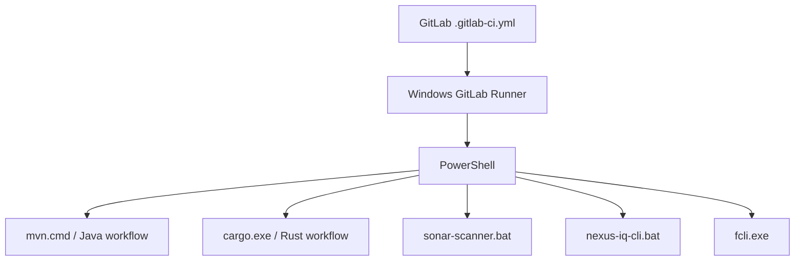
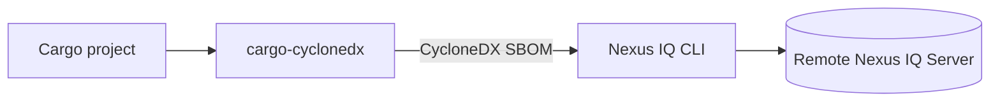

# Nexus IQ in a Windows Rust GitLab Pipeline — Maven vs Cargo

> Scope: Windows GitLab Runner with PowerShell shell executor. This study consolidates only the concepts, diagrams, comparison tables, and command examples discussed on 22 November 2026; it is not copied from earlier generated files.

## Common Maven vs Rust baseline

| Concept | Java / Maven | Rust / Cargo |
|---|---|---|
| Main executable on Windows | `mvn.cmd` | `cargo.exe` |
| Compiler | `javac` | `rustc` |
| Descriptor | `pom.xml` | `Cargo.toml` |
| Dependency locking | No standard `Cargo.lock` equivalent; version management is usually in POMs/BOMs | `Cargo.lock` |
| Dependency sources | Maven Central / enterprise Nexus | crates.io / enterprise registry mirror |
| Build | `mvn package` | `cargo build --locked` |
| Test | `mvn test` | `cargo test --locked` |
| Extension model | Maven plugins and lifecycle goals | Cargo subcommands as separate executables |
| Typical build output | `target/` | `target/` |

Maven defines a configurable lifecycle (`validate → compile → test → package → verify → install → deploy`). Cargo has commands such as `build`, `test` and external subcommands rather than a directly equivalent Maven lifecycle. GitLab itself does not run either language: the Windows Shell runner starts **PowerShell**, which starts `mvn.cmd`, `cargo.exe`, scanner `.bat` launchers or `fcli.exe`.



## Reusable repository organization

```text
rust-project/
├── .gitlab-ci.yml
├── Cargo.toml
├── Cargo.lock
├── src/
├── ci/
│   ├── scripts/
│   │   ├── common.ps1
│   │   ├── build.ps1
│   │   ├── test.ps1
│   │   ├── sonar.ps1
│   │   ├── nexus-iq.ps1
│   │   └── fortify.ps1
│   └── README.md
└── docs/
```

The YAML declares **when and where** a job runs; the version-controlled `.ps1` file declares **how**. The `sonar.ps1`, `nexus-iq.ps1`, and `fortify.ps1` examples below are intentionally independent, so you can add jobs one at a time.

### PowerShell syntax to know

| Syntax | Meaning in CI |
|---|---|
| `& "C:\Tools\...\tool.bat"` | Call executable/launcher at a path containing spaces or special characters |
| `$env:NAME` | Read an environment variable, including GitLab CI variables |
| `` ` `` at end of line | PowerShell command continuation; no trailing spaces allowed |
| `$LASTEXITCODE` | Exit code from the most recent native executable (e.g. Cargo, `.bat`, `fcli`) |
| `if ($LASTEXITCODE -ne 0) { throw ... }` | Convert native tool failures into a failed CI job |
| `$ErrorActionPreference = "Stop"` | Promote many PowerShell cmdlet errors to terminating errors; does **not** replace native exit-code checks |
| `Join-Path`, `Test-Path` | Construct and check paths safely |
| `try { ... } finally { ... }` | Perform cleanup even when a scan or command fails |

A CI runner must have access to the tool executable and relevant service endpoints; a `.ps1` in the repository does **not** install an executable on the Windows host. Prefer exact tool paths or controlled PATH configuration, avoid putting credentials directly into source files, and test CI jobs with the runner's actual account.


## 1. Purpose: CycloneDX is not a Nexus IQ or Rust product

**CycloneDX** is an open, language-independent SBOM standard. **`cargo-cyclonedx`** is a Rust-specific Cargo subcommand that emits CycloneDX metadata. **Nexus IQ** receives/evaluates dependency information and applies vulnerability and license policies. These three components solve different problems.

| Component | Role | Rust-specific? | Nexus IQ-specific? |
|---|---|---|---|
| CycloneDX | Standard SBOM format | No | No |
| `cargo-cyclonedx` | Generate an SBOM from a Cargo project | Yes | No |
| Nexus IQ CLI | Send project/SBOM for policy evaluation | No | Yes |
| Nexus IQ Server | Central policy and vulnerability/license assessment | No | Yes |



Maven's analogue for producing the same format is the **CycloneDX Maven plugin**, while Rust uses a separate executable `cargo-cyclonedx` exposed as `cargo cyclonedx`.

## 2. Maven plugin vs Cargo extension

| Concern | Maven / Java | Cargo / Rust |
|---|---|---|
| Extensibility | Plugin goals invoked within Maven's framework | Standalone `cargo-*` executables found by Cargo |
| SBOM command | `mvn org.cyclonedx:cyclonedx-maven-plugin:makeBom` | `cargo cyclonedx --format json` |
| How extension is installed | Maven resolves plugin dependencies | `cargo install cargo-cyclonedx --locked` installs executable |
| Result | CycloneDX JSON/XML | CycloneDX JSON/XML |
| Security policy platform | Nexus IQ Server | Nexus IQ Server |

```powershell
# Rust extension installation and validation
cargo install cargo-cyclonedx --locked
cargo cyclonedx --help
cargo cyclonedx --format json
```

Cargo dispatches `cargo cyclonedx` to the independently installed `cargo-cyclonedx.exe`. It is accurate to call this a **Cargo subcommand extension**, not a built-in Cargo feature or a Maven-style plugin. Verify actual SBOM file names, especially in a Cargo workspace.

## 3. Local vs remote boundaries

| Location | Component | Function |
|---|---|---|
| Git repository | Cargo manifests, `.gitlab-ci.yml`, `ci/scripts/nexus-iq.ps1` | Source, dependency metadata and CI wiring |
| Windows runner | `cargo.exe`, `cargo-cyclonedx.exe` | Generate SBOM locally |
| Windows runner | Nexus IQ CLI (`nexus-iq-cli.bat`) | Upload/evaluate SBOM |
| Remote | Nexus IQ Server | Dependency vulnerability/license policy evaluation and report |

The earlier model distinguished **preparation → CI integration CLI → server**. Nexus IQ clearly illustrates this separation because an SBOM file is transferred between local stages.

## 4. PowerShell script `ci/scripts/nexus-iq.ps1`

```powershell
$ErrorActionPreference = "Stop"

$cli = "C:\Tools\nexus-iq\bin\nexus-iq-cli.bat"
if (-not (Test-Path $cli)) { throw "Nexus IQ CLI missing: $cli" }
if (-not $env:NEXUS_IQ_URL -or -not $env:NEXUS_IQ_APP_ID) {
  throw "Missing Nexus IQ URL or application ID"
}

# Local preparation: Cargo subcommand generates a CycloneDX SBOM
cargo cyclonedx --format json
if ($LASTEXITCODE -ne 0) { throw "CycloneDX generation failed" }

# Single-crate illustration; workspaces can generate additional files.
if (-not (Test-Path "bom.json")) { throw "bom.json not found" }

# Demonstration only: a production setup should use a CLI-supported secure
# credential mechanism instead of exposing a user:password process argument.
$auth = "${env:NEXUS_IQ_USER}:${env:NEXUS_IQ_PASSWORD}"
& $cli `
  -s $env:NEXUS_IQ_URL `
  -i $env:NEXUS_IQ_APP_ID `
  -a $auth `
  "bom.json"
if ($LASTEXITCODE -ne 0) { throw "Nexus IQ evaluation failed" }
```

Notice PowerShell's `$env:` for GitLab variables, backticks for continuation, and `$LASTEXITCODE` checks after **both** external tools. The call operator `&` runs the `.bat` launcher. The application ID, URL and credentials are CI variables; do not hard-code secrets in tracked scripts.

## 5. `.gitlab-ci.yml` snippet

```yaml
nexus_iq_scan:
  stage: security
  tags:
    - windows
    - rust
  script:
    - '& .\ci\scripts\nexus-iq.ps1'
  artifacts:
    when: always
    paths:
      - bom.json
    expire_in: 7 days
```

This assumes `security` is declared in the parent pipeline `stages:` and that one `bom.json` is produced at the project root. For real projects, verify the generated file path before configuring artifacts; ensure your SBOM disclosure is permitted.

## 6. Comparison with the other integrations

| Layer | Nexus IQ | SonarQube | Fortify |
|---|---|---|---|
| Rust-aware preparation | `cargo-cyclonedx` | Rust analyzer / optional Clippy findings | Source packaging, subject to Rust support |
| Data passed on | CycloneDX SBOM | Source / scanner analysis | Fortify-specific source package |
| Local CLI | Nexus IQ CLI | SonarScanner CLI | `fcli` / ScanCentral Client |
| Remote service | Nexus IQ Server | SonarQube Server | Fortify platform |

**Takeaway:** The reason `cargo-cyclonedx` appears before Nexus IQ is that dependency discovery and security policy evaluation are decoupled. The intermediate SBOM is a portable standard—not a vulnerability scan by itself.
