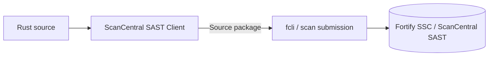

# Fortify in a Windows Rust GitLab Pipeline — Maven vs Cargo

> Scope: Windows GitLab Runner with PowerShell shell executor. This study consolidates only the concepts, diagrams, comparison tables, and command examples discussed on 22 November 2026; it is not copied from earlier generated files.

**Shared foundations:** See [Common Maven vs Rust baseline & reusable repository organization](00-common-maven-vs-rust-and-repository-organization.md) for the build-tool comparison, Windows runner process diagram, shared `ci/scripts/` directory structure, and PowerShell syntax.

## 1. Fortify differs from both SonarQube and Nexus IQ

Fortify SAST primarily analyzes application source code. In today's comparison, **ScanCentral SAST Client** was the nearest *pipeline preparation* counterpart to `cargo-cyclonedx`, but not a true semantic equivalent. `cargo-cyclonedx` generates a standardized dependency SBOM; ScanCentral packages source code for submission to a Fortify scanning infrastructure. There is no universal Rust-specific "CycloneDX for Fortify" tool.

| Question | Maven / Java | Cargo / Rust |
|---|---|---|
| Typical preparation | Java source/build context for Fortify SAST tools | Rust source package, if supported by the deployed Fortify analysis mode |
| Integration interface | Fortify tooling; may be combined with Maven workflows | `fcli` plus ScanCentral SAST Client |
| Local Windows entry point | Fortify executables | `fcli.exe` and ScanCentral client |
| Intermediate result | Fortify-specific scan inputs | Fortify-specific source package |
| Remote service | Fortify SSC / ScanCentral SAST | Fortify SSC / ScanCentral SAST |

**Critical prerequisite:** Verify the exact licensed Fortify version, sensor and **Rust language-support mode** with your administrators. A package upload or successful submission does **not** prove Rust was analyzed. The examples below are illustrative and require compatibility validation against your deployment.



## 2. Local vs remote boundaries

| Location | Component | Function |
|---|---|---|
| Git repository | `.gitlab-ci.yml`, `ci/scripts/fortify.ps1`, Rust source | Pipeline wiring and scan input |
| Windows runner | PowerShell, `fcli.exe` | Authentication, automation, submission |
| Windows runner | ScanCentral SAST Client | Produce package for remote scanning |
| Remote | SSC, ScanCentral controller/sensors | Scan execution, findings and central reporting |

Unlike `mvn sonar:sonar`, `fcli` is a separate security automation CLI, **not** a Maven plugin nor a Cargo subcommand. Unlike `sonar-scanner.bat`, `fcli.exe` is an executable rather than a `.bat` launcher; PowerShell can invoke both using `&`.

## 3. Local install/verification commands discussed today

```powershell
$fcli = "C:\Tools\fortify\fcli\fcli.exe"

& $fcli --version
& $fcli --help

# Version and permissions depend on your deployment.
& $fcli ssc session login `
  --url=$env:FORTIFY_SSC_URL `
  --token=$env:FORTIFY_SSC_TOKEN
if ($LASTEXITCODE -ne 0) { throw "Fortify login failed" }

& $fcli sc-sast sensor list --latest-only
& $fcli ssc session logout
```

When compatible and approved, the client can be installed/validated using the Fortify CLI's tool commands:

```powershell
& $fcli tool sc-client install -v "<compatible-version>" -y
& $fcli tool sc-client list
& $fcli tool sc-client run -- package -h
```

The placeholder `<compatible-version>` must be replaced with a version validated against the organization's ScanCentral sensors.

## 4. `ci/scripts/fortify.ps1`: package and submit

```powershell
$ErrorActionPreference = "Stop"

$fcli = "C:\Tools\fortify\fcli\fcli.exe"
if (-not (Test-Path $fcli)) { throw "Fortify fcli missing: $fcli" }
if (-not $env:FORTIFY_SSC_URL -or -not $env:FORTIFY_SSC_TOKEN -or
    -not $env:FORTIFY_APP_VERSION) {
  throw "Missing required Fortify CI variables"
}

# Keep state isolated to the current job.
$env:FCLI_STATE_DIR = Join-Path $env:CI_PROJECT_DIR ".fcli-state"
try {
  & $fcli ssc session login `
    --url=$env:FORTIFY_SSC_URL `
    --token=$env:FORTIFY_SSC_TOKEN
  if ($LASTEXITCODE -ne 0) { throw "Fortify login failed" }

  & $fcli tool sc-client run -- package -o fortify-package.zip
  if ($LASTEXITCODE -ne 0) { throw "Fortify source packaging failed" }

  & $fcli sc-sast scan start `
    --file="fortify-package.zip" `
    --publish-to=$env:FORTIFY_APP_VERSION
  if ($LASTEXITCODE -ne 0) { throw "Fortify submission failed" }
}
finally {
  & $fcli ssc session logout
  Remove-Item $env:FCLI_STATE_DIR -Recurse -Force -ErrorAction SilentlyContinue
}
```

This reproduces the **package → submit** idea from today's discussion. Exact `fcli`/ScanCentral command syntax and source-package compatibility must be validated with installed versions. Login tokens are GitLab variables. Avoid publishing proprietary source package ZIPs as general-purpose GitLab artifacts.

## 5. Minimal `.gitlab-ci.yml` snippet

```yaml
fortify_sast_scan:
  stage: security
  tags:
    - windows
    - rust
  script:
    - '& .\ci\scripts\fortify.ps1'
```

This is a submission job, **not yet a security gate**. A production pipeline must explicitly wait for completion, inspect the findings/policy outcome, and fail when the agreed rule is violated. Also confirm whether this Rust project needs a different Fortify AI-powered scanning route.

## 6. End-to-end comparison across integrations

| Integration | Rust-specific preparation | Local integration layer | Remote platform | What success must mean |
|---|---|---|---|---|
| SonarQube | Rust analyzer / Clippy when supported | SonarScanner CLI | SonarQube Server | Quality gate evaluated, not just scanner launched |
| Nexus IQ | `cargo-cyclonedx` SBOM | Nexus IQ CLI | IQ Server | Dependency policy evaluated |
| Fortify | Compatible source packaging | `fcli` + ScanCentral Client | SSC / ScanCentral | Rust analysis complete and security gate evaluated |

**Takeaway:** Maven can hide some integrations in plugin goals; Cargo typically exposes separate preparation tools. For Fortify, this is especially visible: the local Windows runner packages/submits source, while scanning and reporting usually take place remotely. Do not treat scan submission as a completed SAST assessment.
