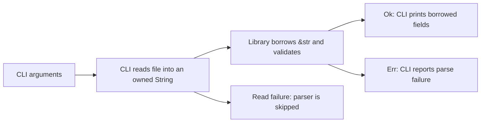

# P1.1 · Read a Rust library and CLI

**Access** — Offline. Allow 45–60 minutes. Read the examples and predict the outcomes before consulting the worked answers.

Ledger Gateway's deployment tooling receives a small routing file. A CLI reads it, validates a single `tenant=destination` record and prints a summary. The library owns the parsing rules. The CLI owns file access, presentation and exit status. This separation lets a reviewer reason about parsing without assuming anything about Windows, a pipeline or a filesystem.

The two excerpts represent `src/lib.rs` and `src/main.rs` in a hypothetical package whose library is named `ledger_route`. They are illustrative and unexecuted. The parser accepts one record with exactly one equals sign and nonempty fields after trimming. It does not validate destination names against a registry. Assume Rust 1.65 or newer for the syntax and APIs shown.

## Library · Follow the borrowed data

```rust
// src/lib.rs
#[derive(Debug, PartialEq, Eq)]
pub enum ParseError {
    MissingSeparator,
    ExtraSeparator,
    EmptyTenant,
    EmptyDestination,
    MultipleLines,
}

#[derive(Debug, PartialEq, Eq)]
pub struct Route<'a> {
    pub tenant: &'a str,
    pub destination: &'a str,
}

pub fn parse_route<'a>(input: &'a str) -> Result<Route<'a>, ParseError> {
    let record = input.trim();
    if record.contains('\n') || record.contains('\r') {
        return Err(ParseError::MultipleLines);
    }

    let (tenant, destination) = record
        .split_once('=')
        .ok_or(ParseError::MissingSeparator)?;
    if destination.contains('=') {
        return Err(ParseError::ExtraSeparator);
    }

    let tenant = tenant.trim();
    let destination = destination.trim();
    if tenant.is_empty() {
        return Err(ParseError::EmptyTenant);
    }
    if destination.is_empty() {
        return Err(ParseError::EmptyDestination);
    }

    Ok(Route { tenant, destination })
}
```

- `&str` is a borrowed UTF-8 string slice. Trimming and splitting produce slices into the input. The parser can read the caller's text without taking its `String` or copying its bytes.
- `Route<'a>` contains two references. The explicit lifetime connects those references to the input borrow. A caller can use the route while the backing text is valid. The annotation does not extend that validity.
- `split_once` returns `Option<(&str, &str)>`. `ok_or` supplies the error if there is no separator, turning `None` into `Err(MissingSeparator)`. The first `?` extracts the pair on success or returns the error from `parse_route` immediately.
- `ParseError` enumerates failures callers can distinguish. The order of the checks determines which error wins if more than one condition holds. The derived equality traits let a test compare the returned value with an expected value. `Debug` provides a developer-facing representation.

A Java method can return a record of strings or throw a checked exception. Here the failure is a value in the return type, and the borrowed fields depend on the caller's input remaining valid. The API exposes that dependency in its signature. [Rust ownership and borrowing](https://doc.rust-lang.org/book/ch04-02-references-and-borrowing.html), [lifetime syntax](https://doc.rust-lang.org/book/ch10-03-lifetime-syntax.html), [recoverable errors](https://doc.rust-lang.org/book/ch09-02-recoverable-errors-with-result.html)

## CLI · Follow the owners and error paths

```rust
// src/main.rs
use ledger_route::{parse_route, ParseError};
use std::{env, fs, io, process::ExitCode};

#[derive(Debug)]
enum CliError {
    Usage,
    Read(io::Error),
    InvalidRoute(ParseError),
}

fn run() -> Result<(), CliError> {
    let mut paths = env::args_os().skip(1);
    let path = paths.next().ok_or(CliError::Usage)?;
    if paths.next().is_some() {
        return Err(CliError::Usage);
    }

    let text = fs::read_to_string(path).map_err(CliError::Read)?;
    let route = parse_route(&text).map_err(CliError::InvalidRoute)?;
    println!("{} -> {}", route.tenant, route.destination);
    Ok(())
}

fn main() -> ExitCode {
    match run() {
        Ok(()) => ExitCode::SUCCESS,
        Err(CliError::Usage) => {
            eprintln!("usage: ledger-route <path>");
            ExitCode::FAILURE
        }
        Err(CliError::Read(error)) => {
            eprintln!("cannot read routing file: {error}");
            ExitCode::FAILURE
        }
        Err(CliError::InvalidRoute(error)) => {
            eprintln!("invalid routing file: {error:?}");
            ExitCode::FAILURE
        }
    }
}
```

| Value | Owner and lifetime | Why it matters |
|---|---|---|
| `path` | The argument iterator yields an owned `OsString`, and the call to `read_to_string(path)` moves it into the function. | The path uses an OS string representation. A path argument need not be valid UTF-8. |
| `text` | `run` owns the `String` returned by the file read. | The file contents must be UTF-8 for the read to succeed. |
| `route` | `run` owns the small struct. Its fields borrow slices of `text`. | Printing the fields while `text` is valid requires no clone. |
| Errors | `map_err` wraps an owned error before `?` returns it. | The CLI distinguishes usage, read and parse failures. `main` reports the category and sets a failure status. |



The Rust compiler checks the borrowing relationship during compilation. At runtime, `?` follows a `Result` branch and can return from the current function. Unlike Java exception propagation, this error path is visible in the function signature and passes through explicit error values. The outer `match` is where the CLI maps those values to process status. [Rust error propagation](https://doc.rust-lang.org/book/ch09-02-recoverable-errors-with-result.html), [read_to_string](https://doc.rust-lang.org/std/fs/fn.read_to_string.html), [ExitCode](https://doc.rust-lang.org/std/process/struct.ExitCode.html)

## Offline exercise

1. For a file containing ` north = settlement ` followed by Windows CRLF, predict the parser result, stdout and exit outcome. Explain whether either field is copied.
2. Predict the error variants for `north settlement`, `north=`, `=settlement` and `north=settlement=backup`. What happens if the file contains two records?
3. Compare a nonexistent file with a readable file containing invalid UTF-8. Which layer reports the failure? Can either reach the parser?
4. A reviewer suggests a helper that reads its own local `String` and returns a `Route` that borrows from it. Explain why the proposed API cannot keep those references valid. Describe one design that keeps borrowing and one that transfers ownership.
5. Propose a minimal unit test for the parser's success path and one for an invalid record. Which additional test belongs at the CLI boundary?

## Worked answers

1. The library returns a route with `tenant == "north"` and `destination == "settlement"`. Trimming removes the surrounding whitespace and line ending. The CLI prints `north -> settlement` and returns success. Both fields still refer to the input buffer.
2. The variants in order are `MissingSeparator`, `EmptyDestination`, `EmptyTenant` and `ExtraSeparator`. An internal CR or LF produces `MultipleLines` before separator checks. Both LF and CRLF after a single record are accepted.
3. Both fail in `read_to_string` and surface as `CliError::Read`. One fails to open the file and the other fails to decode its contents as UTF-8. The parser is skipped in both cases. A readable UTF-8 file containing `north=` instead reaches the parser and produces `CliError::InvalidRoute`.
4. Dropping the local `String` at the helper's exit invalidates any slices into it. Keep the buffer in the caller and pass `&str` to the helper, or return a different route type that owns its field data when the result must outlive the input.
5. Check that `parse_route(" north = settlement ")` yields a route with both expected slices, and that `parse_route("north=")` yields `Err(ParseError::EmptyDestination)`. Test a missing path argument at the CLI boundary, where usage is reported and the process returns failure.

## Acceptance

Trace who owns the path and text, identify where a borrow begins and ends, and predict the CLI outcome for both a read error and a parse error. Use the worked answers to explain the difference between compiler-enforced reference validity and runtime error propagation. The next [P1 step](../roadmap/P1.md) applies this reasoning to a proposed change.
