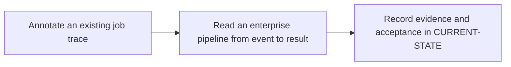

# P0 · GitLab execution lifecycle

**Prerequisites** — —. **Effort** — 2–3 hours. **Access** — Offline documentation and configuration reading.

Map the boundary between the server, runner, executor and shell. Compare GitLab orchestration with Maven's in-process lifecycle.

## Flow to trace

## Bounded documentation steps

### P0.1 · Annotate an existing job trace

**Prerequisites** — Read the execution diagrams.

**Scope and deliverable** — Use the [job trace lab](../labs/p0-1-job-trace.md) to annotate the simulated Windows job and classify the three failure variants.

**Verification and expected result** — Match checkout, cache, artifacts, script and cleanup to the architecture diagram; validate against a supplied sanitized trace or the official job execution sequence.

### P0.2 · Read an enterprise pipeline from event to result

**Prerequisites** — Complete P0.1.

**Scope and deliverable** — Use the [pipeline walkthrough](../labs/p0-2-pipeline-walkthrough.md) to predict a job graph from YAML and classify scheduling and transfer incidents.

**Verification and expected result** — Compare the simulated record and worked answers with the YAML and official pipeline, job log and runner references.

## Acceptance and operational review

**Status** — DOCUMENTATION COMPLETE. The trace and configuration walkthroughs supply the examples, troubleshooting and worked assessments. Implementation and runtime verification are DEFERRED. See [Future labs](../../FUTURE-LABS.md).

Explain where a pending job stops and where a failed checkout stops.

Use the phase's official references from [concepts](../concepts/README.md) and record each step separately in [CURRENT-STATE.md](../../CURRENT-STATE.md).

## Knowledge check

Who requests work? Which steps run before the main script?
