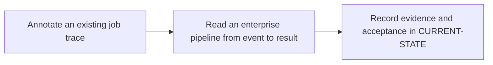

# P0 · GitLab execution lifecycle

**Study effort** — 2–3 hours. **Access** — Offline documentation and configuration reading.

## Purpose and enterprise relevance

Map the boundary between the server, runner, executor and shell. Compare GitLab orchestration with Maven's in-process lifecycle.

Read the [job lifecycle chapter](../concepts/job-lifecycle.md) before the exercises. Use the [foundations summary](../concepts/foundations.md#p0--from-git-event-to-job-result) for a quick review.

**Operational target** — L3. Modify an event or runner tag and predict the affected graph or eligibility. Locate the stopping boundary in pending, checkout and transfer incidents using trace evidence.

## Prerequisites

- **Mandatory** — No prior phase. Read a commit/ref and understand basic Git events.
- **Optional** — None. Familiarity with Git branches and commits is helpful.
- Use the [concept index](../concepts/README.md) for source and version notes. Dependency checks concern the prerequisite knowledge listed here. A learner can use the existing material while earlier expansion work is pending.

## Layer A · Knowledge Base deliverables

**KNOWLEDGE COMPLETE** — [GitLab job lifecycle](../concepts/job-lifecycle.md).

**Subject and learning objective** — GitLab control plane and runner execution model. Build a mental model that transfers across enterprise configurations and failure paths.

### Planned chapter hierarchy

1. **Concepts and definitions.** Start with repository, ref, commit and event identity. Then define pipeline, stage, job and dependency graph as scheduling abstractions. Finally separate runner record, runner manager, executor, generated script, shell and storage by ownership and lifetime. For each major concept, state why it exists, what problem it solves, what it owns and what it is commonly confused with.
2. **Responsibilities, relationships and usage.** Explain event admission, graph creation, job eligibility, runner polling and assignment as distinct decisions. Compare stage barriers with explicit dependency edges and runner scope with executor choice.
3. **Architecture and internal execution.** Plan normal, rejected, queued, canceled and failed paths. Include source acquisition, cache and artifact ordering, main and cleanup shell contexts, result reporting and credentials without treating optional steps as unconditional. Distinguish observable contracts from deployment-specific polling and queue details.
4. **Configuration and enterprise application.** Locate policy and scope in GitLab settings, graph and commands in YAML, and executor or shell in runner configuration. Introduce this split before any walkthrough. Explain long polling, runner eligibility, job credentials, trace ownership, and pending vs failed checkout. Compare GitLab orchestration with Maven lifecycle.
5. **Selected illustrations.** Select a successful trace and one nonexecution or partial-execution path. Use them to illustrate boundary identification. Present these after the relevant explanation and use Layer B for the full reference.
6. **Conclusions and knowledge checks.** Synthesize event admission versus scheduling versus runtime. Ask what evidence separates a missing pipeline, a pending job and a source failure. Direct readers to P3, P5 and P6.

**Dependencies and reuse** — Use the mandatory prerequisite knowledge above. Consult [lifecycle architecture](../architecture/README.md) and [P0 foundations](../concepts/foundations.md#p0--from-git-event-to-job-result) for existing explanations, diagrams or later assessment alignment. Set chapter coverage from the hierarchy above and verify technical claims against authoritative references.

**Knowledge acceptance** — Explain the purpose, boundaries, interactions and material alternatives across the hierarchy. Diagrams and prose must agree for normal and significant alternate or failure paths. End with a synthesis that resolves the named distinctions and a knowledge check that can be answered from the chapter. Review completeness independently of any existing example or L1–L3 target. Plan roughly 1,000–2,000 words for substantial coverage, with room for diagrams and tables.

## Layer B · Practical Reference deliverables

**REFERENCE COMPLETE** — [GitLab job trace reference](../references/job-trace-reference.md).

- **Technologies and selected illustrations** — Annotated push and MR YAML plus a stage-by-stage trace keyed by pipeline, job and commit.
- **Syntax, alternatives and depth** — Explain default stage barriers, optional execution steps and status evidence. Contrast server-side admission, pending assignment and runner-side failure. Annotate material lines and explain defaults, tradeoffs, version assumptions and change consequences.
- **Dependencies and reuse** — Complete P0.A before choosing examples. Use existing material where it illustrates the established concepts: [1 · job trace](../labs/p0-1-job-trace.md), [2 · pipeline walkthrough](../labs/p0-2-pipeline-walkthrough.md).
- **Acceptance** — Supply the configuration or evidence needed to predict the stated outcomes, identify owners and justify a safe alternative. Use complete illustrative files where appropriate, mark them unexecuted and check their structure offline.

## Layer C · Competency Validation deliverables

Apply the [L1–L3 model](../competency-levels/00-COMPETENCY-MODEL.md) and [validation rubric](../competency-levels/04-SUMMARY-VALIDATION.md). Each required level assumes Layers A and B and the knowledge and evidence listed below. Learners work through the required levels in order. The mapping below identifies evidence for selected capabilities already taught. Conceptual coverage may extend beyond the exercises and the initial competency target.

| Level | Expected capability and required knowledge | Exercise | Assessment evidence |
|---|---|---|---|
| L1 · Understand | Identify the owner and evidence for every lifecycle boundary. Requires the Layer A definitions and flow. | P0.1 trace annotation and P0.2 event walkthrough. | Annotated explanation citing the relevant configuration or trace and identifying the responsible component. |
| L2 · Modify | Modify an event or runner tag and predict the affected graph or eligibility. Requires L1 and the Layer B syntax and ownership rules. | P0.2 event/tag review. | A bounded change or review decision with predicted outcomes, regression risk and applicable rollback. |
| L3 · Troubleshoot | Locate the stopping boundary in pending, checkout and transfer incidents using trace evidence. Requires L2 and the Layer B failure evidence. | P0.1 failure variants and P0.2 scheduling and transfer cases. | A ranked hypothesis, decisive evidence, scoped correction and recovery check. |

**Exercise source** — Retain [1 · job trace](../labs/p0-1-job-trace.md), [2 · pipeline walkthrough](../labs/p0-2-pipeline-walkthrough.md). Use the existing prompts and worked answers before adding any narrowly scoped extension.

### P0 scoring crosswalk

Use the [lifecycle chapter](../concepts/job-lifecycle.md) for component ownership and execution order, and the [trace reference](../references/job-trace-reference.md) for event admission, dependency and recovery evidence. Score the retained exercises and extensions with the shared rubric. For each level, award **0** for missing or incorrect, **1** for correct but incomplete, or **2** for correct and grounded in the supplied evidence. Pass each level at **8/10**, with **2** on its required item. Record scores separately and revisit the linked teaching material for missed criteria.

| Level | Evidence to score | Five criteria |
|---|---|---|
| L1 | [P0.1 annotation](../labs/p0-1-job-trace.md#exercise) and [P0.2 event and graph questions](../labs/p0-2-pipeline-walkthrough.md#exercises-and-worked-answers) | (1) Name event, ref and configuration revision. (2) Predict selected jobs and the dependency. (3) **Required** — Attribute graph decisions to GitLab and execution to Runner, executor and shell. (4) Identify the checkout commit variable, cache key and artifact producer. (5) Separate trace evidence from runner and toolchain assumptions. |
| L2 | [P0.2 scheduled-run extension](../labs/p0-2-pipeline-walkthrough.md#p0c--scored-review-extensions) | (1) State the requirement and show a minimal rule diff. (2) Predict the schedule and unchanged feature-push outcomes. (3) **Required** — Preserve the intended ref, runner and access boundaries and name the relevant owners. (4) Account for shell, data path and dependency effects and regression risk. (5) Give an offline graph check and a rollback for affected settings. |
| L3 | [P0.1 pending and checkout variants](../labs/p0-1-job-trace.md#exercise) and [P0.2 failed-transfer extension](../labs/p0-2-pipeline-walkthrough.md#p0c--scored-review-extensions) | (1) Name the last successful boundary in the incidents. (2) Rank two plausible transfer causes and cite discriminating evidence. (3) **Required** — Justify the cause and scoped correction without weakening access or provenance. (4) Specify recovery evidence tied to the intended revision. (5) Name a preventive action and its owner. |

## Educational gaps

- **EXISTING / ADEQUATE** for the stated baseline — Component and sequence diagrams cover the introductory job lifecycle. The two labs supply a simulated trace and a worked pipeline graph. Evidence: [1 · job trace](../labs/p0-1-job-trace.md), [2 · pipeline walkthrough](../labs/p0-2-pipeline-walkthrough.md).
- **EXISTING / NEEDS EXPANSION** for full phase coverage — The [lifecycle architecture](../architecture/README.md) and [P0 foundations](../concepts/foundations.md#p0--from-git-event-to-job-result) remain useful summaries. The dedicated chapter now covers assignment and conditional execution. P0.B now maps representative traces to the responsible components.
- **VALIDATION READY** — The scoring crosswalk maps the retained exercises and two targeted extensions to the P0 lifecycle chapter and trace reference. Runtime verification remains deferred.

## Implementation steps

### P0.A · Develop the Knowledge Base chapter

**Status** — COMPLETED.

**Scope and inputs** — Develop the subject in the order specified by the Layer A hierarchy. Use prerequisite knowledge and technical references to establish scope, then consult existing material for reuse.

**Delivered Markdown chapters** — [01 Concepts](../knowledge/P0-architecture/01-concepts.md), [02 Components and flows](../knowledge/P0-architecture/02-components-and-flows.md) and [03 Enterprise architecture](../knowledge/P0-architecture/03-enterprise-architecture.md).

**Dependencies** — Mandatory prerequisite knowledge above.

**Acceptance and documentation validation** — Meet Layer A acceptance. Trace each diagram through the prose, check normal and alternate paths against official references, and review the synthesis and knowledge checks independently of the labs.

### P0.B · Develop the Practical Reference

**Status** — COMPLETED.

**Scope and inputs** — Select and annotate Layer B examples that clarify the completed subject model. Explain why each example is useful and what assumptions it makes.

**Expected Markdown deliverable** — `docs/references/job-trace-reference.md`.

**Dependencies** — P0.A.

**Acceptance and documentation validation** — Meet Layer B acceptance. Review annotated examples for syntax, compatible assumptions and deterministic expected outcomes; check Markdown links and file relationships.

### P0.1 · Annotate an existing job trace

**Status** — COMPLETED in the prior roadmap.

**Prerequisites** — Read the execution diagrams.

**Scope and deliverable** — Use the [job trace lab](../labs/p0-1-job-trace.md) to annotate the simulated Windows job and classify the three failure variants.

**Verification and expected result** — Match checkout, cache, artifacts, script and cleanup to the architecture diagram; validate against a supplied sanitized trace or the official job execution sequence.

**Educational dependencies** — For learners, read Layers A and B first. For historical inputs and deliverables, reuse the linked lab. P0.C checks its alignment.

**Existing Markdown input and deliverable** — [p0-1-job-trace.md](../labs/p0-1-job-trace.md).

**Acceptance and documentation validation** — Check the prompt against the stated evidence and expected answer in the corresponding Layer C capability. Verify references and version assumptions offline.

### P0.2 · Read an enterprise pipeline from event to result

**Status** — COMPLETED in the prior roadmap.

**Prerequisites** — Complete P0.1.

**Scope and deliverable** — Use the [pipeline walkthrough](../labs/p0-2-pipeline-walkthrough.md) to predict a job graph from YAML and classify scheduling and transfer incidents.

**Verification and expected result** — Compare the simulated record and worked answers with the YAML and official pipeline, job log and runner references.

**Educational dependencies** — For learners, read Layers A and B first. For historical inputs and deliverables, reuse the linked lab. P0.C checks its alignment.

**Existing Markdown input and deliverable** — [p0-2-pipeline-walkthrough.md](../labs/p0-2-pipeline-walkthrough.md).

**Acceptance and documentation validation** — Check the prompt against the stated evidence and expected answer in the corresponding Layer C capability. Verify references and version assumptions offline.

### P0.C · Verify education coverage

**Status** — COMPLETED.

**Scope and inputs** — Compare both layers and the retained P0.1/P0.2 deliverables with the Layer C table.

**Expected Markdown deliverable** — a coverage and scoring crosswalk in this phase specification, with any needed prompts or answer-key updates applied to the existing labs.

**Dependencies** — P0.A, P0.B, P0.1 and P0.2.

**Acceptance and documentation validation** — Walk through required assessments offline, verify each answer uses documented concepts and references, and close or explicitly classify gaps. Check links, fixture consistency and the phase status.

## Phase completion criteria

**Status** — EDUCATION COMPLETE. P0.A, P0.B and P0.C meet the offline criteria below.

- **Knowledge complete** — P0.A meets its acceptance criteria, with definitions, component relationships and internal flows supported by diagrams.
- **Reference complete** — P0.B provides the stated enterprise scenario with annotated examples and tradeoffs.
- **Validation ready** — P0.C confirms that all required levels through L3 are assessable, including the existing or planned work in P0.1 and P0.2.
- **Education complete** — All three layers meet their criteria. Verify internal consistency from diagrams to settings, traces and answer keys. Judge conceptual breadth against the subject hierarchy and assess competency alignment separately. Phase-specific exit evidence: Explain where a pending job stops and where a failed checkout stops.
- **Live validation deferred** — Runtime evidence is tracked separately in [Future labs](../../FUTURE-LABS.md). Historical step progress is in [CURRENT-STATE.md](../../CURRENT-STATE.md).

## Flow to trace

## Knowledge check

Who requests work? Which steps run before the main script?
