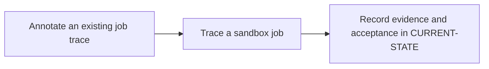

# P0 · GitLab execution lifecycle

**Prerequisites** — —. **Effort** — 2–3 hours. **Access** — Local + GitLab.

Map the boundary between the server, runner, executor and shell. Compare GitLab orchestration with Maven's in-process lifecycle.

## Flow to trace

## Bounded implementation steps

### P0.1 · Annotate an existing job trace

**Prerequisites** — Roadmap reviewed and phase dependencies met. Confirm access for the specific lab before starting.

**Scope and deliverable** — Perform the first exercise in the phase and save a reproducible lab note under [labs](../labs/README.md), including sanitized inputs and observed output.

**Verification and expected result** — Match checkout, cache, artifacts, script and cleanup to the architecture diagram; validate against a supplied sanitized trace or the official job execution sequence.

### P0.2 · Trace a sandbox job

**Prerequisites** — Complete P0.1 and confirm access for the second exercise.

**Scope and deliverable** — Perform the second exercise in isolation, then save the lab instructions, expected results, and a troubleshooting note for the demonstrated failure.

**Verification and expected result** — Open a supplied pipeline and inspect its ref, source, graph, runner and trace; identify which component owns each transition.

## Acceptance and operational review

Accept P0.1 when its verification is reproducible from the recorded inputs. Accept P0.2 when its verification is repeatable and the learner can meet this phase outcome.

Explain where a pending job stops and where a failed checkout stops.

Use the phase's official references from [concepts](../concepts/README.md) and log each step separately in [CURRENT-STATE.md](../../CURRENT-STATE.md).

## Knowledge check

Who requests work? Which steps run before the main script?
