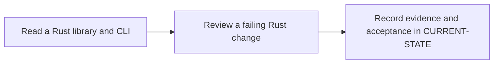

# P1 · Rust for Java developers

**Study effort** — 5–7 hours. **Access** — Offline documentation and configuration reading.

## Purpose and enterprise relevance

Work through moves, borrowing, lifetimes, enums, matching, traits, modules, error propagation and tests. Compare Result with checked exceptions and traits with Java interfaces.

Read the [concepts and definitions](../concepts/foundations.md#p1--rust-ownership-and-errors) before the exercises.

**Operational target** — L2. Review a minimal API change and predict test and diagnostic effects. Optional extension using the existing move-error review. Full operational Rust debugging is a later target.

## Prerequisites

- **Mandatory** — P0. Use P0 to locate compiler output in a job trace.
- **Optional** — Java interfaces and exception handling as comparison points.
- Use the [concept index](../concepts/README.md) for source and version notes. Dependency checks concern the prerequisite knowledge listed here. A learner can use the existing material while earlier expansion work is pending.

## Layer A · Knowledge Base deliverables

**PLANNED chapter** — `docs/concepts/rust-language.md`

**Subject and learning objective** — Rust values, APIs and compilation boundaries. Build a mental model that transfers across enterprise configurations and failure paths.

### Planned chapter hierarchy

1. **Concepts and definitions.** Start with value semantics, mutability and scope. Teach ownership and destruction before moves, Copy, Clone, references and lifetimes. Then cover structs, enums, match, Option and Result, followed by traits, generics, modules, visibility and crate boundaries. For each major concept, state why it exists, what problem it solves, what it owns and what it is commonly confused with.
2. **Responsibilities, relationships and usage.** Connect ownership to API design, resource cleanup and sharing. Compare borrowed versus owned return values, enum errors versus dynamic error reporting, and traits versus Java interfaces. Introduce Send and Sync at the shared-state boundary where relevant.
3. **Architecture and internal execution.** Plan diagrams for move/drop, overlapping or ending borrows, and typed error propagation. Distinguish compile-time lifetime checking and trait resolution from runtime control flow. Include library, binary, unit and integration test boundaries.
4. **Configuration and enterprise application.** Explain signatures, imports, public interfaces and the library-to-CLI boundary. Defer Cargo dependency resolution and build orchestration to P2. Explain API ownership choices, tests at library vs CLI boundaries, and Rust moves and typed errors versus Java references and exceptions.
5. **Selected illustrations.** Use parser/CLI excerpts to illustrate borrowing and typed errors. Use independent micro-examples only where the parser cannot illustrate a distinction clearly. Present these after the relevant explanation and use Layer B for the full reference.
6. **Conclusions and knowledge checks.** Synthesize when to borrow, move, clone or share ownership. Ask what data owns a returned reference and which failures are compiler-enforced versus runtime values. Direct readers to P2.

**Dependencies and reuse** — Use the mandatory prerequisite knowledge above. Consult [P1 foundations](../concepts/foundations.md#p1--rust-ownership-and-errors) for existing explanations, diagrams or later assessment alignment. Set chapter coverage from the hierarchy above and verify technical claims against authoritative references.

**Knowledge acceptance** — Explain the purpose, boundaries, interactions and material alternatives across the hierarchy. Diagrams and prose must agree for normal and significant alternate or failure paths. End with a synthesis that resolves the named distinctions and a knowledge check that can be answered from the chapter. Review completeness independently of any existing example or L1–L3 target. Plan roughly 1,000–2,000 words for substantial coverage, with room for diagrams and tables.

## Layer B · Practical Reference deliverables

**PLANNED reference** — `docs/references/rust-review-reference.md`.

- **Technologies and selected illustrations** — Annotated library and CLI excerpts, module layout, minimal borrowing diff and expected unit/CLI outcomes.
- **Syntax, alternatives and depth** — Cover public vs private boundaries, shared vs mutable references, the cost of cloning, and where compile failures prevent tests. Annotate material lines and explain defaults, tradeoffs, version assumptions and change consequences.
- **Dependencies and reuse** — Complete P1.A before choosing examples. Use existing material where it illustrates the established concepts: [1 · read a rust library and cli](../labs/p1-1-read-a-rust-library-and-cli.md), [2 · review a failing rust change](../labs/p1-2-review-a-failing-rust-change.md).
- **Acceptance** — Supply the configuration or evidence needed to predict the stated outcomes, identify owners and justify a safe alternative. Use complete illustrative files where appropriate, mark them unexecuted and check their structure offline.

## Layer C · Competency Validation deliverables

Apply the [L1–L3 model](../competency-levels/00-COMPETENCY-MODEL.md) and [validation rubric](../competency-levels/04-SUMMARY-VALIDATION.md). Each required level assumes Layers A and B and the knowledge and evidence listed below. Learners work through the required levels in order. The mapping below identifies evidence for selected capabilities already taught. Conceptual coverage may extend beyond the exercises and the initial competency target.

| Level | Expected capability and required knowledge | Exercise | Assessment evidence |
|---|---|---|---|
| L1 · Understand | Trace the owner, borrows and typed error paths. Requires the Layer A definitions and flow. | P1.1 parser and CLI reading. | Annotated explanation citing the relevant configuration or trace and identifying the responsible component. |
| L2 · Modify | Review a minimal API change and predict test and diagnostic effects. Requires L1 and the Layer B syntax and ownership rules. | P1.2 borrowing repair. | A bounded change or review decision with predicted outcomes, regression risk and applicable rollback. |
| L3 · Troubleshoot (optional initially) | Optional extension using the existing move-error review. Full operational Rust debugging is a later target. Requires L2 and the Layer B failure evidence. | P1.2 move-error cases. | A ranked hypothesis, decisive evidence, scoped correction and recovery check. |

**Exercise source** — Retain [1 · read a rust library and cli](../labs/p1-1-read-a-rust-library-and-cli.md), [2 · review a failing rust change](../labs/p1-2-review-a-failing-rust-change.md). Use the existing prompts and worked answers before adding any narrowly scoped extension.

## Educational gaps

- **EXISTING / ADEQUATE** for the stated baseline — The parser/CLI fixture and move-error review establish basic ownership and error reasoning. Evidence: [1 · read a rust library and cli](../labs/p1-1-read-a-rust-library-and-cli.md), [2 · review a failing rust change](../labs/p1-2-review-a-failing-rust-change.md).
- **EXISTING / NEEDS EXPANSION** for full phase coverage — Review [P1 foundations](../concepts/foundations.md#p1--rust-ownership-and-errors) against Layer A. Expand modules, visibility, traits and testing, and provide an API and diagnostic review reference.
- **MISSING / PLANNED** — The dedicated Layer A chapter and Layer B reference above. The existing lab pair needs a scored, explicit alignment review under P1.C.

## Implementation steps

### P1.A · Develop the Knowledge Base chapter

**Status** — PLANNED.

**Scope and inputs** — Develop the subject in the order specified by the Layer A hierarchy. Use prerequisite knowledge and technical references to establish scope, then consult existing material for reuse.

**Expected Markdown deliverable** — `docs/concepts/rust-language.md`.

**Dependencies** — Mandatory prerequisite knowledge above.

**Acceptance and documentation validation** — Meet Layer A acceptance. Trace each diagram through the prose, check normal and alternate paths against official references, and review the synthesis and knowledge checks independently of the labs.

### P1.B · Develop the Practical Reference

**Status** — PLANNED.

**Scope and inputs** — Select and annotate Layer B examples that clarify the completed subject model. Explain why each example is useful and what assumptions it makes.

**Expected Markdown deliverable** — `docs/references/rust-review-reference.md`.

**Dependencies** — P1.A.

**Acceptance and documentation validation** — Meet Layer B acceptance. Review annotated examples for syntax, compatible assumptions and deterministic expected outcomes; check Markdown links and file relationships.

### P1.1 · Read a Rust library and CLI

**Status** — COMPLETED in the prior roadmap.

**Prerequisites** — Read the relevant prerequisite phase notes.

**Scope and deliverable** — Use the [library and CLI reading exercise](../labs/p1-1-read-a-rust-library-and-cli.md) to trace ownership, borrowing and typed errors, then compare predictions with the worked answers.

**Verification** — Compare predictions with the official reference and verify that the worked answer follows from the supplied inputs.

**Educational dependencies** — For learners, read Layers A and B first. For historical inputs and deliverables, reuse the linked lab. P1.C checks its alignment.

**Existing Markdown input and deliverable** — [p1-1-read-a-rust-library-and-cli.md](../labs/p1-1-read-a-rust-library-and-cli.md).

**Acceptance and documentation validation** — Check the prompt against the stated evidence and expected answer in the corresponding Layer C capability. Verify references and version assumptions offline.

### P1.2 · Review a failing Rust change

**Status** — COMPLETED in the prior roadmap.

**Prerequisites** — Complete P1.1.

**Scope and deliverable** — Use the [failing change review](../labs/p1-2-review-a-failing-rust-change.md) to predict compiler errors and test outcomes, propose a minimal repair, and explain when independent ownership is appropriate.

**Verification** — Walk through the exercise offline and check the predicted outcome and diagnostic path against the example.

**Educational dependencies** — For learners, read Layers A and B first. For historical inputs and deliverables, reuse the linked lab. P1.C checks its alignment.

**Existing Markdown input and deliverable** — [p1-2-review-a-failing-rust-change.md](../labs/p1-2-review-a-failing-rust-change.md).

**Acceptance and documentation validation** — Check the prompt against the stated evidence and expected answer in the corresponding Layer C capability. Verify references and version assumptions offline.

### P1.C · Verify education coverage

**Status** — PLANNED.

**Scope and inputs** — Compare both layers and the retained P1.1/P1.2 deliverables with the Layer C table.

**Expected Markdown deliverable** — a coverage and scoring crosswalk in this phase specification, with any needed prompts or answer-key updates applied to the existing labs.

**Dependencies** — P1.A, P1.B, P1.1 and P1.2.

**Acceptance and documentation validation** — Walk through required assessments offline, verify each answer uses documented concepts and references, and close or explicitly classify gaps. Check links, fixture consistency and the phase status.

## Phase completion criteria

- **Knowledge complete** — P1.A meets its acceptance criteria, with definitions, component relationships and internal flows supported by diagrams.
- **Reference complete** — P1.B provides the stated enterprise scenario with annotated examples and tradeoffs.
- **Validation ready** — P1.C confirms that all required levels through L2 are assessable, including the existing or planned work in P1.1 and P1.2.
- **Education complete** — All three layers meet their criteria. Verify internal consistency from diagrams to settings, traces and answer keys. Judge conceptual breadth against the subject hierarchy and assess competency alignment separately. Phase-specific exit evidence: Explain which component owns each input and why the repair does not require cloning.
- **Live validation deferred** — Runtime evidence is tracked separately in [Future labs](../../FUTURE-LABS.md). Historical step progress is in [CURRENT-STATE.md](../../CURRENT-STATE.md).

## Flow to trace

## Knowledge check

When does a String move? How does ? differ from throwing an exception?
