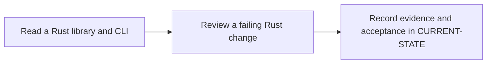

# P1 · Rust for Java developers

**Prerequisites** — P0. **Effort** — 5–7 hours. **Access** — Offline documentation and configuration reading.

Work through moves, borrowing, lifetimes, enums, matching, traits, modules, error propagation and tests. Compare Result with checked exceptions and traits with Java interfaces.

Read the [concepts and definitions](../concepts/foundations.md#p1--rust-ownership-and-errors) before the exercises.

## Flow to trace

## Bounded documentation steps

### P1.1 · Read a Rust library and CLI

**Prerequisites** — Read the relevant prerequisite phase notes.

**Scope and deliverable** — Use the [library and CLI reading exercise](../labs/p1-1-read-a-rust-library-and-cli.md) to trace ownership, borrowing and typed errors, then compare predictions with the worked answers.

**Verification** — Compare predictions with the official reference and verify that the worked answer follows from the supplied inputs.

### P1.2 · Review a failing Rust change

**Prerequisites** — Complete P1.1.

**Scope and deliverable** — Use the [failing change review](../labs/p1-2-review-a-failing-rust-change.md) to predict compiler errors and test outcomes, propose a minimal repair, and explain when independent ownership is appropriate.

**Verification** — Walk through the exercise offline and check the predicted outcome and diagnostic path against the example.

## Acceptance and operational review

**Status** — DOCUMENTATION COMPLETE. The reading exercise and change review include annotated examples, troubleshooting and worked assessments. Implementation and runtime verification are DEFERRED. [Future runtime lab](../../FUTURE-LABS.md).

Explain which component owns each input and why the repair does not require cloning.

Use the phase's official references from [concepts](../concepts/README.md) and log each step separately in [CURRENT-STATE.md](../../CURRENT-STATE.md).

## Knowledge check

When does a String move? How does ? differ from throwing an exception?
