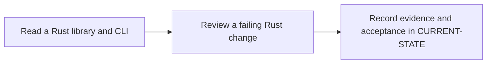

# P1 · Rust for Java developers

**Prerequisites** — P0. **Effort** — 5–7 hours. **Access** — Offline documentation and configuration reading.

Work through moves, borrowing, lifetimes, enums, matching, traits, modules, error propagation and tests. Compare Result with checked exceptions and traits with Java interfaces.

## Flow to trace

## Bounded documentation steps

### P1.1 · Read a Rust library and CLI

**Prerequisites** — Read the relevant prerequisite phase notes.

**Scope and deliverable** — Trace ownership, borrowing and typed errors from annotated Rust snippets. Save annotated examples and a worked answer.

**Verification** — Compare predictions with the official reference and verify that the worked answer follows from the supplied inputs.

### P1.2 · Review a failing Rust change

**Prerequisites** — Complete P1.1.

**Scope and deliverable** — Predict compiler errors and test outcomes, then explain the smallest repair and when cloning would be appropriate. Save a reading exercise, answer key and troubleshooting notes.

**Verification** — Walk through the exercise offline and check the predicted outcome and diagnostic path against the example.

## Acceptance and operational review

Mark this phase DOCUMENTATION COMPLETE when the explanations, annotated examples, troubleshooting guide and knowledge assessment are ready. Evaluate the following outcome by reading the supplied examples. [Future runtime lab](../../FUTURE-LABS.md).

Explain which component owns each input and why the repair does not require cloning.

Use the phase's official references from [concepts](../concepts/README.md) and log each step separately in [CURRENT-STATE.md](../../CURRENT-STATE.md).

## Knowledge check

When does a String move? How does ? differ from throwing an exception?
