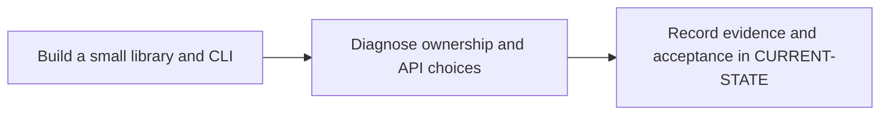

# P1 · Rust for Java developers

**Prerequisites** — P0. **Effort** — 5–7 hours. **Access** — Local.

Work through moves, borrowing, lifetimes, enums, matching, traits, modules, error propagation and tests. Compare Result with checked exceptions and traits with Java interfaces.

## Flow to trace

## Bounded implementation steps

### P1.1 · Build a small library and CLI

**Prerequisites** — Roadmap reviewed and phase dependencies met. Confirm access for the specific lab before starting.

**Scope and deliverable** — Perform the first exercise in the phase and save a reproducible lab note under [labs](../labs/README.md), including sanitized inputs and observed output.

**Verification and expected result** — Use cargo new after review; run cargo check and cargo test. Tests cover successful parsing and a typed error.

### P1.2 · Diagnose ownership and API choices

**Prerequisites** — Complete P1.1 and confirm access for the second exercise.

**Scope and deliverable** — Perform the second exercise in isolation, then save the lab instructions, expected results, and a troubleshooting note for the demonstrated failure.

**Verification and expected result** — Introduce a move-after-use error, read the compiler diagnostic, then repair it using a borrow. Run cargo fmt --check and cargo clippy --all-targets -- -D warnings.

## Acceptance and operational review

Accept P1.1 when its verification is reproducible from the recorded inputs. Accept P1.2 when its verification is repeatable and the learner can meet this phase outcome.

Explain which component owns each input and why the repair does not require cloning.

Use the phase's official references from [concepts](../concepts/README.md) and log each step separately in [CURRENT-STATE.md](../../CURRENT-STATE.md).

## Knowledge check

When does a String move? How does ? differ from throwing an exception?
