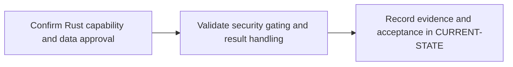

# P10 · Fortify static security analysis

**Prerequisites** — P2, P5, P6. **Effort** — 4–7 hours. **Access** — Local simulation + GitLab + licensed Vendor.

Distinguish source analysis, findings, triage, upload and gate evaluation. Establish the approved Rust-capable OpenText SAST mode before configuring a scan.

## Flow to trace

## Bounded implementation steps

### P10.1 · Confirm Rust capability and data approval

**Prerequisites** — Roadmap reviewed and phase dependencies met. Confirm access for the specific lab before starting.

**Scope and deliverable** — Perform the first exercise in the phase and save a reproducible lab note under [labs](../labs/README.md), including sanitized inputs and observed output.

**Verification and expected result** — Record product/version, AI-powered SAST entitlement, execution path and source data boundary. In an approved lab, confirm source enumeration and scan mode in vendor logs.

### P10.2 · Validate security gating and result handling

**Prerequisites** — Complete P10.1 and confirm access for the second exercise.

**Scope and deliverable** — Perform the second exercise in isolation, then save the lab instructions, expected results, and a troubleshooting note for the demonstrated failure.

**Verification and expected result** — Use a controlled finding and approved integration to check report ingestion, severity and gate result. With no licensed environment, use labeled pass/block/error fixtures and capture the gate evidence.

## Acceptance and operational review

Accept P10.1 when its verification is reproducible from the recorded inputs. Accept P10.2 when its verification is repeatable and the learner can meet this phase outcome.

Explain whether each result proves Rust coverage, report upload or policy evaluation.

Use the phase's official references from [concepts](../concepts/README.md) and log each step separately in [CURRENT-STATE.md](../../CURRENT-STATE.md).

## Knowledge check

Why can report upload succeed while policy evaluation fails? What mode did the engine use?
