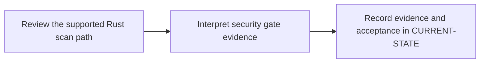

# P10 · Fortify static security analysis

**Prerequisites** — P2, P5, P6. **Effort** — 4–7 hours. **Access** — Offline documentation and configuration reading.

Distinguish source analysis, findings, triage, upload and gate evaluation. Establish the approved Rust-capable OpenText SAST mode before configuring a scan.

## Flow to trace

## Bounded documentation steps

### P10.1 · Review the supported Rust scan path

**Prerequisites** — Read the relevant prerequisite phase notes.

**Scope and deliverable** — Explain source enumeration, approved mode and the data boundary from the versioned vendor documentation. Save annotated examples and a worked answer.

**Verification** — Compare predictions with the official reference and verify that the worked answer follows from the supplied inputs.

### P10.2 · Interpret security gate evidence

**Prerequisites** — Complete P10.1.

**Scope and deliverable** — Classify synthetic findings, upload and gate outcomes and trace the decisions back to the commit. Save a reading exercise, answer key and troubleshooting notes.

**Verification** — Walk through the exercise offline and check the predicted outcome and diagnostic path against the example.

## Acceptance and operational review

Mark this phase DOCUMENTATION COMPLETE when the explanations, annotated examples, troubleshooting guide and knowledge assessment are ready. Evaluate the following outcome by reading the supplied examples. [Future runtime lab](../../FUTURE-LABS.md).

Explain whether each result proves Rust coverage, report upload or policy evaluation.

Use the phase's official references from [concepts](../concepts/README.md) and log each step separately in [CURRENT-STATE.md](../../CURRENT-STATE.md).

## Knowledge check

Why can report upload succeed while policy evaluation fails? What mode did the engine use?
