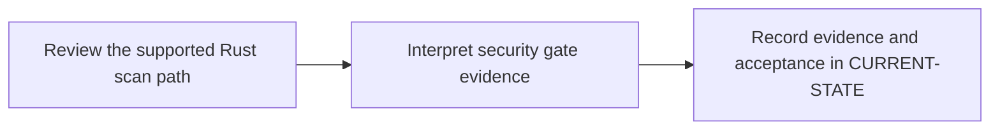

# P10 · Fortify static security analysis

**Study effort** — 4–7 hours. **Access** — Offline documentation and configuration reading.

## Purpose and enterprise relevance

Distinguish source analysis, findings, triage, upload and gate evaluation. Establish the approved Rust-capable OpenText SAST mode before configuring a scan.

**Operational target** — L2. Revise inputs or gate behavior while preserving the approved data and access boundaries. Classify scan, upload and gate failures. P12 covers integrated incidents.

## Prerequisites

- **Mandatory** — P2, P5, P6. Use P2 for the source/build context, P5 for reports and P6 for runner context.
- **Optional** — P4 for deeper protected credential review.
- Use the [concept index](../concepts/README.md) for source and version notes. Dependency checks concern the prerequisite knowledge listed here. A learner can use the existing material while earlier expansion work is pending.

## Layer A · Knowledge Base deliverables

**PLANNED chapter** — `docs/concepts/fortify-sast-model.md`

**Subject and learning objective** — Fortify source analysis and security gate model. Build a mental model that transfers across enterprise configurations and failure paths.

### Planned chapter hierarchy

1. **Concepts and definitions.** Define SAST, source scope, analysis mode, rule or finding, report, triage and policy verdict. Separate source analysis from component evaluation and quality coverage before teaching CI integration. For each major concept, state why it exists, what problem it solves, what it owns and what it is commonly confused with.
2. **Responsibilities, relationships and usage.** Explain relationships among repository, scanner runtime, optional reporting platform and policy owner. Compare approved local versus remote processing where supported, source exposure, scan coverage and exception ownership.
3. **Architecture and internal execution.** Plan source-selection, scan, reporting and enforcement sequences. Cover unsupported modes, incomplete source inventory, scan failure, upload failure, false-positive review and policy block. Qualify implementation by product and version.
4. **Configuration and enterprise application.** Locate source selection and versioned scanner mode in job configuration, authorization and policy on the appropriate service, and tool prerequisites on the runner. Explain supported Rust scope and version limits, source data boundaries, permission roles, and why report generation differs from policy evaluation.
5. **Selected illustrations.** Select a supported Rust scan-path illustration and synthetic report/gate records. Mark simulated and unsupported paths explicitly. Present these after the relevant explanation and use Layer B for the full reference.
6. **Conclusions and knowledge checks.** Synthesize scan coverage, finding severity, triage and release policy. Ask why a successful upload cannot establish either coverage or a pass. Direct readers to P9, P11 and P12.

**Dependencies and reuse** — Use the mandatory prerequisite knowledge above. Consult [vendor support notes](../concepts/README.md) and [gate triage](../competency-levels/03-L3-TROUBLESHOOT.md) for existing explanations, diagrams or later assessment alignment. Set chapter coverage from the hierarchy above and verify technical claims against authoritative references.

**Knowledge acceptance** — Explain the purpose, boundaries, interactions and material alternatives across the hierarchy. Diagrams and prose must agree for normal and significant alternate or failure paths. End with a synthesis that resolves the named distinctions and a knowledge check that can be answered from the chapter. Review completeness independently of any existing example or L1–L3 target. Plan roughly 1,000–2,000 words for substantial coverage, with room for diagrams and tables.

## Layer B · Practical Reference deliverables

**PLANNED reference** — `docs/references/fortify-rust-reference.md`.

- **Technologies and selected illustrations** — Version-qualified SAST integration pattern, source selection and synthetic findings, upload and verdict records.
- **Syntax, alternatives and depth** — Annotate mode, credential reference, report handling, timeout and safe failure behavior. Label unsupported or simulated paths explicitly. Annotate material lines and explain defaults, tradeoffs, version assumptions and change consequences.
- **Dependencies and reuse** — Complete P10.A before choosing examples. Use existing material where it illustrates the established concepts: [vendor support notes](../concepts/README.md) and [gate triage](../competency-levels/03-L3-TROUBLESHOOT.md).
- **Acceptance** — Supply the configuration or evidence needed to predict the stated outcomes, identify owners and justify a safe alternative. Use complete illustrative files where appropriate, mark them unexecuted and check their structure offline.

## Layer C · Competency Validation deliverables

Apply the [L1–L3 model](../competency-levels/00-COMPETENCY-MODEL.md) and [validation rubric](../competency-levels/04-SUMMARY-VALIDATION.md). Each required level assumes Layers A and B and the knowledge and evidence listed below. Learners work through the required levels in order. The mapping below identifies evidence for selected capabilities already taught. Conceptual coverage may extend beyond the exercises and the initial competency target.

| Level | Expected capability and required knowledge | Exercise | Assessment evidence |
|---|---|---|---|
| L1 · Understand | Explain what the evidence establishes about Rust scan coverage and policy. Requires the Layer A definitions and flow. | P10.1 supported scan-path review. | Annotated explanation citing the relevant configuration or trace and identifying the responsible component. |
| L2 · Modify | Revise inputs or gate behavior while preserving the approved data and access boundaries. Requires L1 and the Layer B syntax and ownership rules. | P10.2 security gate configuration review. | A bounded change or review decision with predicted outcomes, regression risk and applicable rollback. |
| L3 · Troubleshoot (optional initially) | Classify scan, upload and gate failures. P12 covers integrated incidents. Requires L2 and the Layer B failure evidence. | Optional failure variant of P10.2. | A ranked hypothesis, decisive evidence, scoped correction and recovery check. |

**Exercise source** — The named P10.1/.2 exercises will be sections of the PLANNED pack `docs/labs/p10-phase-validation.md`. Reuse related material linked below and extend only where phase-specific evidence is needed.

## Educational gaps

- **EXISTING / ADEQUATE** for the stated baseline — The support table establishes the need for version-qualified Rust SAST claims. Evidence: [vendor support notes](../concepts/README.md) and [gate triage](../competency-levels/03-L3-TROUBLESHOOT.md).
- **EXISTING / NEEDS EXPANSION** for full phase coverage — Review [vendor support notes](../concepts/README.md) and [gate triage](../competency-levels/03-L3-TROUBLESHOOT.md) against Layer A. Dedicated architecture and Rust capability chapter plus reviewed integration and findings reference.
- **MISSING / PLANNED** — The dedicated Layer A chapter and Layer B reference above. The phase-specific validation pack and worked answers are planned under the retained steps.

## Implementation steps

### P10.A · Develop the Knowledge Base chapter

**Status** — PLANNED.

**Scope and inputs** — Develop the subject in the order specified by the Layer A hierarchy. Use prerequisite knowledge and technical references to establish scope, then consult existing material for reuse.

**Expected Markdown deliverable** — `docs/concepts/fortify-sast-model.md`.

**Dependencies** — Mandatory prerequisite knowledge above.

**Acceptance and documentation validation** — Meet Layer A acceptance. Trace each diagram through the prose, check normal and alternate paths against official references, and review the synthesis and knowledge checks independently of the labs.

### P10.B · Develop the Practical Reference

**Status** — PLANNED.

**Scope and inputs** — Select and annotate Layer B examples that clarify the completed subject model. Explain why each example is useful and what assumptions it makes.

**Expected Markdown deliverable** — `docs/references/fortify-rust-reference.md`.

**Dependencies** — P10.A.

**Acceptance and documentation validation** — Meet Layer B acceptance. Review annotated examples for syntax, compatible assumptions and deterministic expected outcomes; check Markdown links and file relationships.

### P10.1 · Review the supported Rust scan path

**Status** — PLANNED.

**Prerequisites** — Read the relevant prerequisite phase notes.

**Scope and deliverable** — Explain source enumeration, approved mode and the data boundary from the versioned vendor documentation. Save annotated examples and a worked answer.

**Verification** — Compare predictions with the official reference and verify that the worked answer follows from the supplied inputs.

**Educational dependencies** — P10.B must be complete before this step.

**Inputs** — Layer A, Layer B and the referenced existing material.

**Expected Markdown deliverable** — the P10.1 exercise and answer section of the PLANNED validation pack `docs/labs/p10-phase-validation.md`.

**Acceptance and documentation validation** — Check the prompt against the stated evidence and expected answer in the corresponding Layer C capability. Verify references and version assumptions offline.

### P10.2 · Interpret security gate evidence

**Status** — PLANNED.

**Prerequisites** — Complete P10.1.

**Scope and deliverable** — Classify synthetic findings, upload and gate outcomes and trace the decisions back to the commit. Save a reading exercise, answer key and troubleshooting notes.

**Verification** — Walk through the exercise offline and check the predicted outcome and diagnostic path against the example.

**Educational dependencies** — P10.B must be complete before this step, and P10.1 must supply the reading baseline.

**Inputs** — Layer A, Layer B and the referenced existing material.

**Expected Markdown deliverable** — the P10.2 exercise and answer section of the PLANNED validation pack `docs/labs/p10-phase-validation.md`.

**Acceptance and documentation validation** — Check the prompt against the stated evidence and expected answer in the corresponding Layer C capability. Verify references and version assumptions offline.

### P10.C · Verify education coverage

**Status** — PLANNED.

**Scope and inputs** — Compare both layers and the retained P10.1/P10.2 deliverables with the Layer C table.

**Expected Markdown deliverable** — the planned validation pack at `docs/labs/p10-phase-validation.md`, plus its coverage and scoring crosswalk in this phase specification.

**Dependencies** — P10.A, P10.B, P10.1 and P10.2.

**Acceptance and documentation validation** — Walk through required assessments offline, verify each answer uses documented concepts and references, and close or explicitly classify gaps. Check links, fixture consistency and the phase status.

## Phase completion criteria

- **Knowledge complete** — P10.A meets its acceptance criteria, with definitions, component relationships and internal flows supported by diagrams.
- **Reference complete** — P10.B provides the stated enterprise scenario with annotated examples and tradeoffs.
- **Validation ready** — P10.C confirms that all required levels through L2 are assessable, including the existing or planned work in P10.1 and P10.2.
- **Education complete** — All three layers meet their criteria. Verify internal consistency from diagrams to settings, traces and answer keys. Judge conceptual breadth against the subject hierarchy and assess competency alignment separately. Phase-specific exit evidence: Explain whether each result proves Rust coverage, report upload or policy evaluation.
- **Live validation deferred** — Runtime evidence is tracked separately in [Future labs](../../FUTURE-LABS.md). Historical step progress is in [CURRENT-STATE.md](../../CURRENT-STATE.md).

## Flow to trace

## Knowledge check

Why can report upload succeed while policy evaluation fails? What mode did the engine use?
