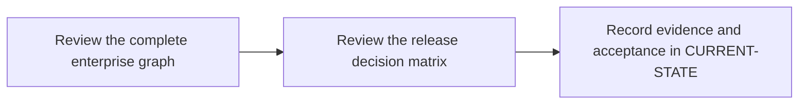

# P11 · End-to-end enterprise pipeline

**Prerequisites** — P4, P5, P6, P8, P9, P10. **Effort** — 6–10 hours. **Access** — Offline documentation and configuration reading.

Combine Cargo checks, tests, reports, quality and security decisions and packaging. Draw the trust boundary around privileged refs and scanner credentials.

## Flow to trace

## Bounded documentation steps

### P11.1 · Review the complete enterprise graph

**Prerequisites** — Read the relevant prerequisite phase notes.

**Scope and deliverable** — Trace explicit dependencies, privileged jobs, reports and the release gate in a complete illustrative configuration. Save annotated examples and a worked answer.

**Verification** — Compare predictions with the official reference and verify that the worked answer follows from the supplied inputs.

### P11.2 · Review the release decision matrix

**Prerequisites** — Complete P11.1.

**Scope and deliverable** — Predict pass, block, scanner outage and fork outcomes and trace artifact provenance. Save a reading exercise, answer key and troubleshooting notes.

**Verification** — Walk through the exercise offline and check the predicted outcome and diagnostic path against the example.

## Acceptance and operational review

Mark this phase DOCUMENTATION COMPLETE when the explanations, annotated examples, troubleshooting guide and knowledge assessment are ready. Evaluate the following outcome by reading the supplied examples. [Future runtime lab](../../FUTURE-LABS.md).

Classify the evidence for each gate and distinguish simulated results from future live sign-off.

Use the phase's official references from [concepts](../concepts/README.md) and log each step separately in [CURRENT-STATE.md](../../CURRENT-STATE.md).

## Knowledge check

Where is the fail-closed policy enforced? Which jobs may read scanner credentials?
