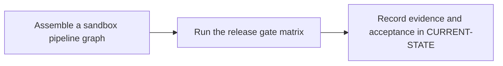

# P11 · End-to-end enterprise pipeline

**Prerequisites** — P4, P5, P6, P8, P9, P10. **Effort** — 6–10 hours. **Access** — GitLab + Windows + licensed Vendor for live validation.

Combine Cargo checks, tests, reports, quality and security decisions and packaging. Draw the trust boundary around privileged refs and scanner credentials.

## Flow to trace

## Bounded implementation steps

### P11.1 · Assemble a sandbox pipeline graph

**Prerequisites** — Roadmap reviewed and phase dependencies met. Confirm access for the specific lab before starting.

**Scope and deliverable** — Perform the first exercise in the phase and save a reproducible lab note under [labs](../labs/README.md), including sanitized inputs and observed output.

**Verification and expected result** — Integrate approved jobs and reports via pinned templates and explicit needs. Lint merged YAML and compare MR versus protected default-branch topology.

### P11.2 · Run the release gate matrix

**Prerequisites** — Complete P11.1 and confirm access for the second exercise.

**Scope and deliverable** — Perform the second exercise in isolation, then save the lab instructions, expected results, and a troubleshooting note for the demonstrated failure.

**Verification and expected result** — Check passing, blocked and unavailable scanner paths, plus fork behavior. Verify packaged artifacts are traceable to the tested commit and blocked when an enforced gate fails.

## Acceptance and operational review

Accept P11.1 when its verification is reproducible from the recorded inputs. Accept P11.2 when its verification is repeatable and the learner can meet this phase outcome.

Record each gate's evidence and live/simulated status. Require live checks for live sign-off.

Use the phase's official references from [concepts](../concepts/README.md) and log each step separately in [CURRENT-STATE.md](../../CURRENT-STATE.md).

## Knowledge check

Where is the fail-closed policy enforced? Which jobs may read scanner credentials?
