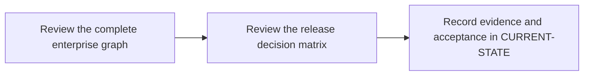

# P11 · End-to-end enterprise pipeline

**Study effort** — 6–10 hours. **Access** — Offline documentation and configuration reading.

## Purpose and enterprise relevance

Combine Cargo checks, tests, reports, quality and security decisions and packaging. Draw the trust boundary around privileged refs and scanner credentials.

**Operational target** — L3. Change an edge or stage policy and predict impact on trust and release outcomes. Locate and explain a blocked release using the decisive job, report and commit evidence.

## Prerequisites

- **Mandatory** — P4, P5, P6, P8, P9, P10. Use P4–P6 for credentials, handoffs and runners, and complete P8.B, P9.B and P10.B for the three gate contracts.
- **Optional** — P7 for migration context; study the three vendor references before designing integration.
- Use the [concept index](../concepts/README.md) for source and version notes. Dependency checks concern the prerequisite knowledge listed here. A learner can use the existing material while earlier expansion work is pending.

## Layer A · Knowledge Base deliverables

**PLANNED chapter** — `docs/concepts/enterprise-pipeline-architecture.md`

**Subject and learning objective** — Enterprise pipeline architecture and controls. Build a mental model that transfers across enterprise configurations and failure paths.

### Planned chapter hierarchy

1. **Concepts and definitions.** Define event class, graph, trust zone, validation producer, report, gate, approval, release and provenance. Then connect build, transfer, scanner and distribution ownership across systems. For each major concept, state why it exists, what problem it solves, what it owns and what it is commonly confused with.
2. **Responsibilities, relationships and usage.** Explain critical path, concurrent checks, isolation of privileged jobs, cache versus provenance and release governance. Compare centralized templates with project-owned policy and consider latency, blast radius and fail-closed tradeoffs.
3. **Architecture and internal execution.** Plan component, sequence and trust-boundary views. Cover MR and fork feedback, protected release, scanner rejection, transport outage, missing evidence, cancellation and approval. Separate orchestration status from external verdicts.
4. **Configuration and enterprise application.** Map GitLab UI policy, YAML graph, runner config, Cargo files and vendor settings. Explain evidence identities, approval and failure defaults before assembling a pipeline. Explain graph selection, credential eligibility, tool inputs, failure modes, gate ownership and release decision for a single commit.
5. **Selected illustrations.** Select one end-to-end baseline and a few decision contrasts to demonstrate the controls, drawing on P4–P10 without copying their explanations. Present these after the relevant explanation and use Layer B for the full reference.
6. **Conclusions and knowledge checks.** Synthesize event, trust, artifact provenance and policy as a release contract. Ask what proof is needed for an approved commit and how missing evidence changes the decision. Direct readers to P12 and P13.

**Dependencies and reuse** — Use the mandatory prerequisite knowledge above. Consult [enterprise scenarios](../enterprise-scenarios/README.md), [artifact handoff](../labs/p5-2-trace-artifacts-and-dependency-edges.md) and [vendor support notes](../concepts/README.md) for existing explanations, diagrams or later assessment alignment. Set chapter coverage from the hierarchy above and verify technical claims against authoritative references.

**Knowledge acceptance** — Explain the purpose, boundaries, interactions and material alternatives across the hierarchy. Diagrams and prose must agree for normal and significant alternate or failure paths. End with a synthesis that resolves the named distinctions and a knowledge check that can be answered from the chapter. Review completeness independently of any existing example or L1–L3 target. Plan roughly 1,000–2,000 words for substantial coverage, with room for diagrams and tables.

## Layer B · Practical Reference deliverables

**PLANNED reference** — `docs/references/enterprise-pipeline-reference.md`.

- **Technologies and selected illustrations** — Complete illustrative pipeline and pinned includes, Windows routing and version-qualified scanner contracts with a release decision matrix.
- **Syntax, alternatives and depth** — Annotate essential YAML and show protected push, MR/fork, gate failure and outage outcomes. Preserve provenance and distinguish simulated vendor evidence. Annotate material lines and explain defaults, tradeoffs, version assumptions and change consequences.
- **Dependencies and reuse** — Complete P11.A before choosing examples. Use existing material where it illustrates the established concepts: [enterprise scenarios](../enterprise-scenarios/README.md), [artifact handoff](../labs/p5-2-trace-artifacts-and-dependency-edges.md) and [vendor support notes](../concepts/README.md).
- **Acceptance** — Supply the configuration or evidence needed to predict the stated outcomes, identify owners and justify a safe alternative. Use complete illustrative files where appropriate, mark them unexecuted and check their structure offline.

## Layer C · Competency Validation deliverables

Apply the [L1–L3 model](../competency-levels/00-COMPETENCY-MODEL.md) and [validation rubric](../competency-levels/04-SUMMARY-VALIDATION.md). Each required level assumes Layers A and B and the knowledge and evidence listed below. Learners work through the required levels in order. The mapping below identifies evidence for selected capabilities already taught. Conceptual coverage may extend beyond the exercises and the initial competency target.

| Level | Expected capability and required knowledge | Exercise | Assessment evidence |
|---|---|---|---|
| L1 · Understand | Read the end-to-end graph and trace reports and release identity. Requires the Layer A definitions and flow. | P11.1 complete graph review. | Annotated explanation citing the relevant configuration or trace and identifying the responsible component. |
| L2 · Modify | Change an edge or stage policy and predict impact on trust and release outcomes. Requires L1 and the Layer B syntax and ownership rules. | P11.1 controlled edge change against the P11.2 matrix. | A bounded change or review decision with predicted outcomes, regression risk and applicable rollback. |
| L3 · Troubleshoot | Locate and explain a blocked release using the decisive job, report and commit evidence Requires L2 and the Layer B failure evidence. | P11.2 release decision matrix. | A ranked hypothesis, decisive evidence, scoped correction and recovery check. |

**Exercise source** — The named P11.1/.2 exercises will be sections of the PLANNED pack `docs/labs/p11-phase-validation.md`. Reuse related material linked below and extend only where phase-specific evidence is needed.

## Educational gaps

- **EXISTING / ADEQUATE** for the stated baseline — The subsystem examples supply reusable fixtures for cache, artifact and credential decisions. Evidence: [enterprise scenarios](../enterprise-scenarios/README.md), [artifact handoff](../labs/p5-2-trace-artifacts-and-dependency-edges.md) and [vendor support notes](../concepts/README.md).
- **EXISTING / NEEDS EXPANSION** for full phase coverage — Review [enterprise scenarios](../enterprise-scenarios/README.md), [artifact handoff](../labs/p5-2-trace-artifacts-and-dependency-edges.md) and [vendor support notes](../concepts/README.md) against Layer A. Dedicated integrated architecture and coherent end-to-end example with compatible assumptions and gates.
- **MISSING / PLANNED** — The dedicated Layer A chapter and Layer B reference above. The phase-specific validation pack and worked answers are planned under the retained steps.

## Implementation steps

### P11.A · Develop the Knowledge Base chapter

**Status** — PLANNED.

**Scope and inputs** — Develop the subject in the order specified by the Layer A hierarchy. Use prerequisite knowledge and technical references to establish scope, then consult existing material for reuse.

**Expected Markdown deliverable** — `docs/concepts/enterprise-pipeline-architecture.md`.

**Dependencies** — Mandatory prerequisite knowledge above.

**Acceptance and documentation validation** — Meet Layer A acceptance. Trace each diagram through the prose, check normal and alternate paths against official references, and review the synthesis and knowledge checks independently of the labs.

### P11.B · Develop the Practical Reference

**Status** — PLANNED.

**Scope and inputs** — Select and annotate Layer B examples that clarify the completed subject model. Explain why each example is useful and what assumptions it makes.

**Expected Markdown deliverable** — `docs/references/enterprise-pipeline-reference.md`.

**Dependencies** — P11.A.

**Acceptance and documentation validation** — Meet Layer B acceptance. Review annotated examples for syntax, compatible assumptions and deterministic expected outcomes; check Markdown links and file relationships.

### P11.1 · Review the complete enterprise graph

**Status** — PLANNED.

**Prerequisites** — Read the relevant prerequisite phase notes.

**Scope and deliverable** — Trace explicit dependencies, privileged jobs, reports and the release gate in a complete illustrative configuration. Save annotated examples and a worked answer.

**Verification** — Compare predictions with the official reference and verify that the worked answer follows from the supplied inputs.

**Educational dependencies** — P11.B must be complete before this step.

**Inputs** — Layer A, Layer B and the referenced existing material.

**Expected Markdown deliverable** — the P11.1 exercise and answer section of the PLANNED validation pack `docs/labs/p11-phase-validation.md`.

**Acceptance and documentation validation** — Check the prompt against the stated evidence and expected answer in the corresponding Layer C capability. Verify references and version assumptions offline.

### P11.2 · Review the release decision matrix

**Status** — PLANNED.

**Prerequisites** — Complete P11.1.

**Scope and deliverable** — Predict pass, block, scanner outage and fork outcomes and trace artifact provenance. Save a reading exercise, answer key and troubleshooting notes.

**Verification** — Walk through the exercise offline and check the predicted outcome and diagnostic path against the example.

**Educational dependencies** — P11.B must be complete before this step, and P11.1 must supply the reading baseline.

**Inputs** — Layer A, Layer B and the referenced existing material.

**Expected Markdown deliverable** — the P11.2 exercise and answer section of the PLANNED validation pack `docs/labs/p11-phase-validation.md`.

**Acceptance and documentation validation** — Check the prompt against the stated evidence and expected answer in the corresponding Layer C capability. Verify references and version assumptions offline.

### P11.C · Verify education coverage

**Status** — PLANNED.

**Scope and inputs** — Compare both layers and the retained P11.1/P11.2 deliverables with the Layer C table.

**Expected Markdown deliverable** — the planned validation pack at `docs/labs/p11-phase-validation.md`, plus its coverage and scoring crosswalk in this phase specification.

**Dependencies** — P11.A, P11.B, P11.1 and P11.2.

**Acceptance and documentation validation** — Walk through required assessments offline, verify each answer uses documented concepts and references, and close or explicitly classify gaps. Check links, fixture consistency and the phase status.

## Phase completion criteria

- **Knowledge complete** — P11.A meets its acceptance criteria, with definitions, component relationships and internal flows supported by diagrams.
- **Reference complete** — P11.B provides the stated enterprise scenario with annotated examples and tradeoffs.
- **Validation ready** — P11.C confirms that all required levels through L3 are assessable, including the existing or planned work in P11.1 and P11.2.
- **Education complete** — All three layers meet their criteria. Verify internal consistency from diagrams to settings, traces and answer keys. Judge conceptual breadth against the subject hierarchy and assess competency alignment separately. Phase-specific exit evidence: Classify the evidence for each gate and distinguish simulated results from future live sign-off.
- **Live validation deferred** — Runtime evidence is tracked separately in [Future labs](../../FUTURE-LABS.md). Historical step progress is in [CURRENT-STATE.md](../../CURRENT-STATE.md).

## Flow to trace

## Knowledge check

Where is the fail-closed policy enforced? Which jobs may read scanner credentials?
