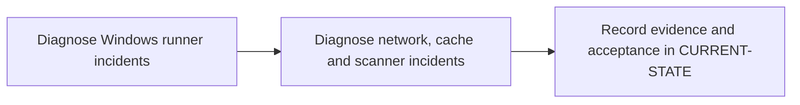

# P12 · Enterprise troubleshooting

**Study effort** — 4–6 hours. **Access** — Offline documentation and configuration reading.

## Purpose and enterprise relevance

Classify incidents by creation, scheduling, host preparation, connectivity, execution, transfer and policy. Compare interactive diagnostics with service-identity evidence.

**Operational target** — L3. Propose a small reversible correction and a recovery check. Rank hypotheses, choose a discriminating check and justify the cause and recovery evidence.

## Prerequisites

- **Mandatory** — P4, P5 and P6 for core incidents. Complete P11 before integrated drills.
- **Optional** — Use P11 for integrated drills; subsystem diagnosis can start with P4–P6.
- Use the [concept index](../concepts/README.md) for source and version notes. Dependency checks concern the prerequisite knowledge listed here. A learner can use the existing material while earlier expansion work is pending.

## Layer A · Knowledge Base deliverables

**PLANNED chapter** — `docs/concepts/incident-diagnosis-model.md`

**Subject and learning objective** — Enterprise incident diagnosis and recovery. Build a mental model that transfers across enterprise configurations and failure paths.

### Planned chapter hierarchy

1. **Concepts and definitions.** Define symptom, evidence, hypothesis, fault boundary, root cause, mitigation, recovery and prevention. Teach evidence quality and safe collection before diagnostic branching. For each major concept, state why it exists, what problem it solves, what it owns and what it is commonly confused with.
2. **Responsibilities, relationships and usage.** Map ownership across GitLab, Runner, Windows, network, Cargo, storage and scanner services. Explain when to escalate, when to contain or roll back, and the tradeoff between quick recovery and preserving evidence.
3. **Architecture and internal execution.** Plan a fault-boundary tree from event to release and a diagnosis lifecycle from triage through verification. Include coincident failures, timeouts, retries, missing evidence, misleading success and access constraints.
4. **Configuration and enterprise application.** Explain configuration surfaces, access needed for logs, safe redaction, trace correlation and reviewable change/rollback procedures. Separate a test of a hypothesis from the proposed repair. Teach how to distinguish a policy block from transport and permission faults, and how to correlate logs without leaking secrets.
5. **Selected illustrations.** Select cases that discriminate ambiguous symptoms across layers. Reuse runner and gate traces where they illustrate different boundaries. Present these after the relevant explanation and use Layer B for the full reference.
6. **Conclusions and knowledge checks.** Synthesize correlation versus causation, containment versus recovery, and success evidence versus absence of errors. Ask which observation would falsify a candidate cause. Direct readers to P13.

**Dependencies and reuse** — Use the mandatory prerequisite knowledge above. Consult [troubleshooting index](../troubleshooting/README.md), [enterprise scenarios](../enterprise-scenarios/README.md), [Windows diagnosis](../labs/p6-2-diagnose-windows-service-context.md) and [L3 incidents](../competency-levels/03-L3-TROUBLESHOOT.md) for existing explanations, diagrams or later assessment alignment. Set chapter coverage from the hierarchy above and verify technical claims against authoritative references.

**Knowledge acceptance** — Explain the purpose, boundaries, interactions and material alternatives across the hierarchy. Diagrams and prose must agree for normal and significant alternate or failure paths. End with a synthesis that resolves the named distinctions and a knowledge check that can be answered from the chapter. Review completeness independently of any existing example or L1–L3 target. Plan roughly 1,000–2,000 words for substantial coverage, with room for diagrams and tables.

## Layer B · Practical Reference deliverables

**PLANNED reference** — `docs/references/pipeline-triage-reference.md`.

- **Technologies and selected illustrations** — Annotated trace bundles, safe PowerShell and GitLab evidence checklist, ownership and escalation guide.
- **Syntax, alternatives and depth** — Include branching outcomes for runner identity, Cargo, cache/artifact, credentials, CA/proxy and scanners. Specify the evidence required before a fix. Annotate material lines and explain defaults, tradeoffs, version assumptions and change consequences.
- **Dependencies and reuse** — Complete P12.A before choosing examples. Use existing material where it illustrates the established concepts: [troubleshooting index](../troubleshooting/README.md), [enterprise scenarios](../enterprise-scenarios/README.md), [Windows diagnosis](../labs/p6-2-diagnose-windows-service-context.md) and [L3 incidents](../competency-levels/03-L3-TROUBLESHOOT.md).
- **Acceptance** — Supply the configuration or evidence needed to predict the stated outcomes, identify owners and justify a safe alternative. Use complete illustrative files where appropriate, mark them unexecuted and check their structure offline.

## Layer C · Competency Validation deliverables

Apply the [L1–L3 model](../competency-levels/00-COMPETENCY-MODEL.md) and [validation rubric](../competency-levels/04-SUMMARY-VALIDATION.md). Each required level assumes Layers A and B and the knowledge and evidence listed below. Learners work through the required levels in order. The mapping below identifies evidence for selected capabilities already taught. Conceptual coverage may extend beyond the exercises and the initial competency target.

| Level | Expected capability and required knowledge | Exercise | Assessment evidence |
|---|---|---|---|
| L1 · Understand | Identify which component emitted the evidence and its last successful boundary. Requires the Layer A definitions and flow. | P12.1 trace and component identification. | Annotated explanation citing the relevant configuration or trace and identifying the responsible component. |
| L2 · Modify | Propose a small reversible correction and a recovery check. Requires L1 and the Layer B syntax and ownership rules. | P12.1/P12.2 scoped repair review. | A bounded change or review decision with predicted outcomes, regression risk and applicable rollback. |
| L3 · Troubleshoot | Rank hypotheses, choose a discriminating check and justify the cause and recovery evidence Requires L2 and the Layer B failure evidence. | P12.1 runner and P12.2 network/cache/scanner cases. | A ranked hypothesis, decisive evidence, scoped correction and recovery check. |

**Exercise source** — The named P12.1/.2 exercises will be sections of the PLANNED pack `docs/labs/p12-phase-validation.md`. Reuse related material linked below and extend only where phase-specific evidence is needed.

## Educational gaps

- **EXISTING / ADEQUATE** for the stated baseline — The Windows diagnosis lab and L3 incidents provide worked examples of evidence-based isolation. Evidence: [troubleshooting index](../troubleshooting/README.md), [enterprise scenarios](../enterprise-scenarios/README.md), [Windows diagnosis](../labs/p6-2-diagnose-windows-service-context.md) and [L3 incidents](../competency-levels/03-L3-TROUBLESHOOT.md).
- **EXISTING / NEEDS EXPANSION** for full phase coverage — Review [troubleshooting index](../troubleshooting/README.md), [enterprise scenarios](../enterprise-scenarios/README.md), [Windows diagnosis](../labs/p6-2-diagnose-windows-service-context.md) and [L3 incidents](../competency-levels/03-L3-TROUBLESHOOT.md) against Layer A. Expand the structured triage method and integrate an evidence pack across failure domains.
- **MISSING / PLANNED** — The dedicated Layer A chapter and Layer B reference above. The phase-specific validation pack and worked answers are planned under the retained steps.

## Implementation steps

### P12.A · Develop the Knowledge Base chapter

**Status** — PLANNED.

**Scope and inputs** — Develop the subject in the order specified by the Layer A hierarchy. Use prerequisite knowledge and technical references to establish scope, then consult existing material for reuse.

**Expected Markdown deliverable** — `docs/concepts/incident-diagnosis-model.md`.

**Dependencies** — Mandatory prerequisite knowledge above.

**Acceptance and documentation validation** — Meet Layer A acceptance. Trace each diagram through the prose, check normal and alternate paths against official references, and review the synthesis and knowledge checks independently of the labs.

### P12.B · Develop the Practical Reference

**Status** — PLANNED.

**Scope and inputs** — Select and annotate Layer B examples that clarify the completed subject model. Explain why each example is useful and what assumptions it makes.

**Expected Markdown deliverable** — `docs/references/pipeline-triage-reference.md`.

**Dependencies** — P12.A.

**Acceptance and documentation validation** — Meet Layer B acceptance. Review annotated examples for syntax, compatible assumptions and deterministic expected outcomes; check Markdown links and file relationships.

### P12.1 · Diagnose Windows runner incidents

**Status** — PLANNED.

**Prerequisites** — Read the relevant prerequisite phase notes.

**Scope and deliverable** — Locate scheduling and service environment faults from sanitized configuration and traces. Save annotated examples and a worked answer.

**Verification** — Compare predictions with the official reference and verify that the worked answer follows from the supplied inputs.

**Educational dependencies** — P12.B must be complete before this step.

**Inputs** — Layer A, Layer B and the referenced existing material.

**Expected Markdown deliverable** — the P12.1 exercise and answer section of the PLANNED validation pack `docs/labs/p12-phase-validation.md`.

**Acceptance and documentation validation** — Check the prompt against the stated evidence and expected answer in the corresponding Layer C capability. Verify references and version assumptions offline.

### P12.2 · Diagnose network, cache and scanner incidents

**Status** — PLANNED.

**Prerequisites** — Complete P12.1.

**Scope and deliverable** — Give the smallest discriminating check, a scoped repair and expected recovery evidence for each case. Save a reading exercise, answer key and troubleshooting notes.

**Verification** — Walk through the exercise offline and check the predicted outcome and diagnostic path against the example.

**Educational dependencies** — P12.B must be complete before this step, and P12.1 must supply the reading baseline.

**Inputs** — Layer A, Layer B and the referenced existing material.

**Expected Markdown deliverable** — the P12.2 exercise and answer section of the PLANNED validation pack `docs/labs/p12-phase-validation.md`.

**Acceptance and documentation validation** — Check the prompt against the stated evidence and expected answer in the corresponding Layer C capability. Verify references and version assumptions offline.

### P12.C · Verify education coverage

**Status** — PLANNED.

**Scope and inputs** — Compare both layers and the retained P12.1/P12.2 deliverables with the Layer C table.

**Expected Markdown deliverable** — the planned validation pack at `docs/labs/p12-phase-validation.md`, plus its coverage and scoring crosswalk in this phase specification.

**Dependencies** — P12.A, P12.B, P12.1 and P12.2.

**Acceptance and documentation validation** — Walk through required assessments offline, verify each answer uses documented concepts and references, and close or explicitly classify gaps. Check links, fixture consistency and the phase status.

## Phase completion criteria

- **Knowledge complete** — P12.A meets its acceptance criteria, with definitions, component relationships and internal flows supported by diagrams.
- **Reference complete** — P12.B provides the stated enterprise scenario with annotated examples and tradeoffs.
- **Validation ready** — P12.C confirms that all required levels through L3 are assessable, including the existing or planned work in P12.1 and P12.2.
- **Education complete** — All three layers meet their criteria. Verify internal consistency from diagrams to settings, traces and answer keys. Judge conceptual breadth against the subject hierarchy and assess competency alignment separately. Phase-specific exit evidence: Supply a hypothesis, discriminating check, remediation and proof of recovery for each drill.
- **Live validation deferred** — Runtime evidence is tracked separately in [Future labs](../../FUTURE-LABS.md). Historical step progress is in [CURRENT-STATE.md](../../CURRENT-STATE.md).

## Flow to trace

## Knowledge check

What does a successful TCP probe establish? What evidence identifies an expired artifact?
