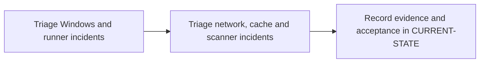

# P12 · Enterprise troubleshooting

**Prerequisites** — P4, P5, P6; P11 for integrated drills. **Effort** — 4–6 hours. **Access** — Local + GitLab + Windows; Vendor optional.

Classify incidents by creation, scheduling, host preparation, connectivity, execution, transfer and policy. Compare interactive diagnostics with service-identity evidence.

## Flow to trace

## Bounded implementation steps

### P12.1 · Triage Windows and runner incidents

**Prerequisites** — Roadmap reviewed and phase dependencies met. Confirm access for the specific lab before starting.

**Scope and deliverable** — Perform the first exercise in the phase and save a reproducible lab note under [labs](../labs/README.md), including sanitized inputs and observed output.

**Verification and expected result** — Reproduce a sandbox tag mismatch and service PATH failure. Compare job status, runner status, Event Viewer and Get-Command before and after a scoped repair.

### P12.2 · Triage network, cache and scanner incidents

**Prerequisites** — Complete P12.1 and confirm access for the second exercise.

**Scope and deliverable** — Perform the second exercise in isolation, then save the lab instructions, expected results, and a troubleshooting note for the demonstrated failure.

**Verification and expected result** — Use sandbox faults or sanitized traces for TLS/proxy, stale cache, expired artifact, authorization and scanner timeout. Probe the failing endpoint under the service identity and document recovery.

## Acceptance and operational review

Accept P12.1 when its verification is reproducible from the recorded inputs. Accept P12.2 when its verification is repeatable and the learner can meet this phase outcome.

Supply a hypothesis, discriminating check, remediation and proof of recovery for each drill.

Use the phase's official references from [concepts](../concepts/README.md) and log each step separately in [CURRENT-STATE.md](../../CURRENT-STATE.md).

## Knowledge check

What does a successful TCP probe establish? What evidence identifies an expired artifact?
